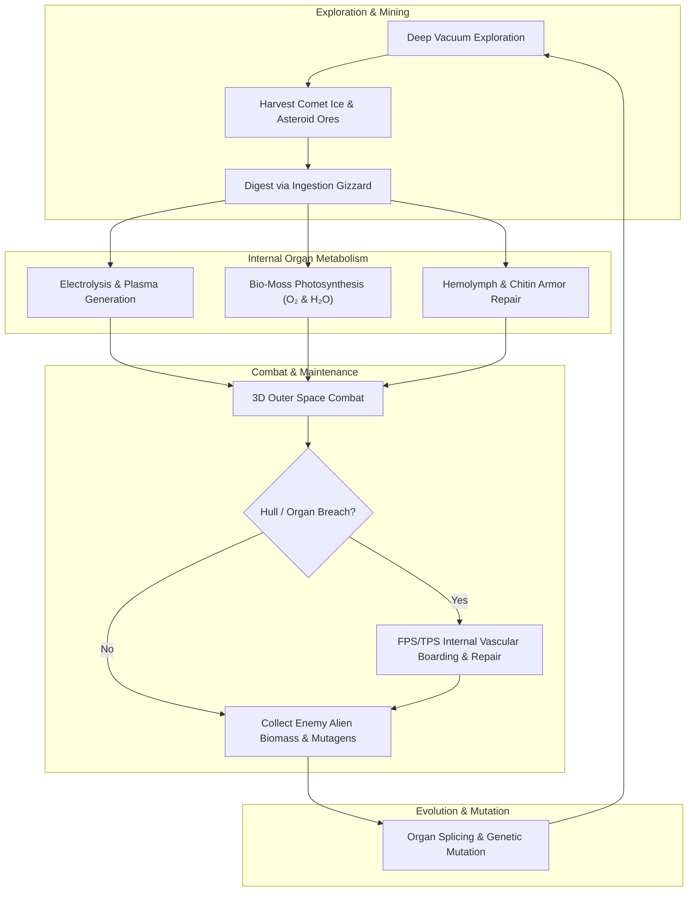
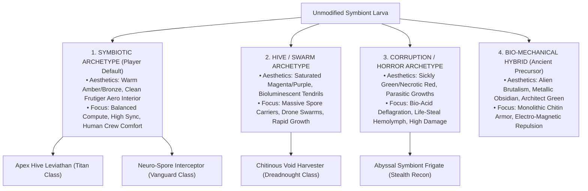

# AAA Gameplay Systems Design Specification — BioGenesis
> **Document Status**: Institutional Standard · Approved Publication Draft  
> **Engine Target**: GENESIS-X Living Ship Engine (Three.js / React 19 / Vite 6)  
> **Classification**: Core Gameplay Mechanics & Systems Architecture  
> **Author**: AAA Gameplay Systems Lead (BioGenesis Systems Division)  
> **Cross-References**: [`LORE.md`](../../LORE.md) · [`ORGAN_SYSTEMS.md`](../../ORGAN_SYSTEMS.md) · [`NEURAL_COMPUTE_ARCHITECTURE.md`](../research/NEURAL_COMPUTE_ARCHITECTURE.md) · [`COMMAND_ROOM_SPEC.md`](../research/COMMAND_ROOM_SPEC.md)

---

## 1. Executive Summary & Core Gameplay Loops

### 1.1 The Trinity Architecture
*BioGenesis* is an AAA biopunk space simulator and survival-action game set within deep interstellar space. The gameplay framework rests on three interdependent Pillars—the **Trinity Architecture**:

```
                       ┌─────────────────────────────────────────┐
                       │           THE TRINITY TRADEOFF          │
                       └────────────────────┬────────────────────┘
                                            │
        ┌───────────────────────────────────┼───────────────────────────────────┐
        ▼                                   ▼                                   ▼
┌───────────────┐                   ┌───────────────┐                   ┌───────────────┐
│     PILLAR I  │                   │    PILLAR II  │                   │   PILLAR III  │
│    SHIP-AS-   │ ◄───────────────► │    BIOMASS    │ ◄───────────────► │  DUAL-LAYER   │
│   CHARACTER   │                   │    ECONOMY    │                   │    COMBAT     │
└───────────────┘                   └───────────────┘                   └───────────────┘
```

1. **Pillar I: Ship-as-Character (Living Symbiont)**:
   The starship is not an inanimate piece of metal; it is a living, sentient Void-Fauna organism governed by real-time biological feedback loops. The ship possesses an **Encephalization Quotient (EQ)**, a **Neuro-Sync Ratio**, metabolic constraints, somatosensory pain responses, and organ health states. Damage inflicts physical trauma and phantom neural pain on the pilot, while proper nourishment fosters organic evolution and emotional coherence.

2. **Pillar II: Biomass Economy & Closed-Loop Organ Pipeline**:
   All ship capabilities (thrust, weapons, shields, life support, sensors) depend on closed-loop metabolic pipelines. Players mine asteroid ores ($\text{Fe/Ni/Si}$), harvest comet ice ($H_2O, CO_2, NH_3$), and collect alien biomass to fuel five closed-loop organ systems. Over-harvesting or metabolic neglect leads to organ ischemia, systemic excitotoxicity, or atmospheric collapse.

3. **Pillar III: Dual-Layer Space & Internal Hull Combat**:
   Combat occurs simultaneously on two seamlessly integrated planes:
   - *Outer 3D Space*: High-G hydro-pulse dogfighting, vector maneuvers, and precision subsystem targeting of enemy anatomical organs.
   - *Inner Hull Chamber*: FPS/TPS internal movement within vascular corridors to repair damaged organ chambers, clear arterial embolisms, extinguish bioluminescent fires, and repel parasite boarding pods.

---

### 1.2 Master Core Gameplay Loop

The continuous gameplay loop seamlessly links exploration, resource processing, organic growth, tactical dogfighting, and internal damage control:



---

### 1.3 Core Systems Interconnection Overview

| System Pipeline | Primary Input Resource | Storage & Transport | Output Effector / Action | Failure State Mode |
| --- | --- | --- | --- | --- |
| **1. Bio-Plasma Propulsion** | Ingested Comet Ice ($H_2O$) | Muscular Bladder ($140\text{ Bar}$) & Plasma Trunk | Siphon Vent Nozzles ($1,700\text{ kN}$) & Bio-Plasma Disruptors ($450\text{ MW}$) | Electrolyte Starvation / Fuel Bladder Deflagration |
| **2. Hemolymph & Thermal** | Oxygenated Copper-Hemocyanin | Central Aorta & Capillary Bed Network | Dorsal Spiracle Gill Vents ($820\text{ W/m}^2$ IR) | Thermal Shock / Systemic Hemolymph Freezing |
| **3. Nervous & Cybernetic** | Metabolic Compute / Neuro-Link | Spinal Axon Cord ($120\text{ m/s}$) & Ganglia | Multispectral Eye Pods & FABRIK IK Tendons | Excitotoxicity / Neuro-Sync Collapse |
| **4. Endosymbiotic Life Support** | Liquid Waste, $CO_2$, Minerals | Photosynthetic Bio-Moss Carpet ($420\text{ L/min}$) | Pressurized Habitat Chambers ($1.0\text{ atm}$) | Hypoxia / Airlock Pressure Breach |
| **5. Exoskeleton & Defense** | $\text{Fe/Ni}$ Ores & Bio-Nanites | Sub-Dermal Bio-Nanite Bed ($1.2\text{ m}^3/\text{s}$) | Repulsion Shield Nodes ($450\text{ MW}$) & Carapace Plates | Structural Collapse / Armor Ablation |

---

## 2. The Neuro-Link & Pilot Coherence System

### 2.1 Brain Scaling: Haller's Rule & Jerison Allometry

The neural intelligence of the Void-Fauna scales strictly according to biological allometry. Body mass is proxied by hull volume ($V_{\text{ship}}$), while brain mass ($E$) follows **Jerison's Allometric Power Law** combined with **Haller's Rule** (smaller organisms possess proportionally larger brains relative to body mass).

```
                      [ BRAIN SCALING & METABOLIC BUDGET ]
   EQ
    7 ───┐ (6m Ship: EQ 7.0, 20% Energy Budget, High Strained Mutualism)
      │   └───┐
    5 ───┤     └───┐ (10m Ship: EQ 5.1, 15% Energy Budget)
      │             └───┐ (14m Ship: EQ 4.1, 12% Energy Budget - Default)
    3 ───┴───────────────┴───────────────► (30m+ Ship: EQ 3.0, 8% Energy Budget - Autonomous)
      0m        10m       20m       30m   Ship Length
```

#### Mathematical Formulas

1. **Ship Hull Volume Calculation**:
   $$V_{\text{ship}} = L_{\text{ship}} \times W_{\text{thorax}}^2 \times \pi \times \phi_{\text{fill}}$$
   *Where $\phi_{\text{fill}} \approx 0.65$ represents the anatomical tapered ellipse fill factor.*

2. **Encephalization Quotient (EQ) (Haller's Rule)**:
   $$\text{EQ} = \text{clamp}\left(7.0 \times \left(\frac{V_{\text{ref}}}{V_{\text{ship}}}\right)^{1/3}, 3.0, 7.0\right)$$
   *Where $V_{\text{ref}} \approx 108.6\text{ m}^3$ corresponds to the baseline $6\text{m}$ interceptor.*

3. **Brain Mass ($E$) (Jerison Allometry)**:
   $$E = 0.12 \times \left(V_{\text{ship}}\right)^{0.67} \times \text{EQ}$$

4. **Raw Compute Generation ($C_{\text{brain}}$)**:
   $$N_{\text{neurons}} = E \times \rho_{\text{neuron}} \quad (\text{where } \rho_{\text{neuron}} = 8.6 \times 10^{10}\text{ neurons/m}^3)$$
   $$C_{\text{brain}} = N_{\text{neurons}} \times 5.0\text{ bits/s/neuron}$$

#### Allometric Scaling Matrix

| Ship Class / Length | Approx Hull Volume ($V_{\text{ship}}$) | Encephalization Quotient ($\text{EQ}$) | Brain % of Energy Budget | Neural Mutualism & Gameplay Character |
| --- | --- | --- | --- | --- |
| **Vanguard Interceptor** ($6\text{m}$) | $\sim 108.6\text{ m}^3$ | **7.0** | **$20\%$** | *Metabolically Strained*: High neural demand. Vital dependency on pilot strategic direction. High agility, deep bond. |
| **Strike Frigate** ($10\text{m}$) | $\sim 302.0\text{ m}^3$ | **5.1** | **$15\%$** | *Balanced Symbiont*: Moderate autonomy. Excellent reflexes with responsive neuro-link input. |
| **Abyssal Cruiser** ($14\text{m}$, Default) | $\sim 586.0\text{ m}^3$ | **4.1** | **$12\%$** | *Tactical Partner*: Capable independent processing. Values human goal-setting and targeted weapon overclocking. |
| **Dreadnought Harvester** ($20\text{m}$) | $\sim 1,200.0\text{ m}^3$ | **3.3** | **$9\%$** | *Semi-Autonomous*: Low energy strain. Manages internal organ systems automatically; human pilot acts as fleet strategist. |
| **Apex Carrier** ($30\text{m}+$) | $\sim 2,700.0\text{ m}^3$ | **3.0** (clamped) | **$8\%$** | *Wise Leviathan*: Highly autonomous. Brain cost is trivial. Human crew required for ethical judgment and complex macro tactics. |

> [!NOTE]
> **Biological Mutualism Rationale**: Small ships (EQ 7.0) dedicate $20\%$ of their total metabolic budget to their brain. They are metabolically strained and *need* the human pilot's cerebrum for high-level tactical choices. Large ships (EQ 3.0) can compute basic functions easily ($8\%$ budget) but lack human creative adaptability, creating a complementary bond regardless of size.

---

### 2.2 Neuro-Sync Ratio & Coherence Mechanics

The **Neuro-Sync Ratio** ($\mathcal{S}$) measures the real-time bandwidth and fidelity of the connection between the human pilot's central nervous system and the ship's Ganglion Brain Core via graphene neural threads.

```
┌─────────────────────────────────────────────────────────────────────────┐
│                      NEURO-SYNC CALCULATOR ENGINE                       │
└─────────────────────────────────────────────────────────────────────────┘
  Base Coherence (99.9%) ──┐
  Neural Supply Ratio  ───┼──► [ 𝒮 = Coherence × η_neural × (1-D_brain) - Stress ]
  Brain Damage (D_brain) ───┤                                   │
  Pilot Stress Penalty ───┘                                   ▼
                                                   Neuro-Sync Ratio (0 - 100%)
                                                                │
                                    ┌───────────────────────────┴───────────────────────────┐
                                    ▼                                                       ▼
                      High Sync (>90%):                                        Low Sync (<40%):
                      • +25% Turn Rate & Handling                              • Visual Tunnel Vision & Noise
                      • Instant Target Acquisition                             • Control Input Latency (+350ms)
                      • Automatic Aim Reticle Correction                       • Involuntary Reflex Spasms
```

#### Mathematical Formulation

$$\mathcal{S} = \text{clamp}\left( \mathcal{C}_{\text{base}} \times \eta_{\text{neural}} \times \left(1.0 - \mathcal{D}_{\text{brain}}\right) - \mathcal{P}_{\text{stress}}, 0.0, 1.0 \right)$$

Where:
- $\mathcal{C}_{\text{base}}$: Base genetic compatibility ($0.95 - 0.999$).
- $\eta_{\text{neural}}$: Neural Compute Efficiency derived from organ supply ($0.0 - 1.20$).
- $\mathcal{D}_{\text{brain}}$: Fractional structural damage to Primary Ganglion Brain Core ($0.0 - 1.0$).
- $\mathcal{P}_{\text{stress}}$: Cumulative pilot stress penalty caused by somatosensory pain and hypoxia.

---

### 2.3 Somatosensory Pain Feedback Loop

Because the pilot's nerve endings are spliced into the Spinal Axon Cord via graphene synapses, hull and organ damage trigger **phantom somatic pain**.

$$\mathcal{P}_{\text{stress}}(t) = \int_{0}^{t} \left( \alpha \cdot \frac{d\mathcal{D}_{\text{carapace}}}{dt} + \beta \cdot \sum \text{Damage}_{\text{organ}} \right) e^{-\gamma (t-\tau)} d\tau$$

#### Gameplay Penalties Across Pain Thresholds

1. **Minor Nociception ($\mathcal{S} = 75\% - 89\%$)**:
   - Subtle screen edge chromatic aberration.
   - Low-frequency bio-auditory heartbeat pulses in HUD audio.

2. **Severe Somatization ($\mathcal{S} = 40\% - 74\%$)**:
   - Visual vignetting (tunnel vision) restricting peripheral awareness.
   - Control input lag ($+150\text{ms} - 350\text{ms}$) simulating neural shock.
   - Reticle jitter during precision weapon aiming.

3. **Neuro-Traumatic Shock ($\mathcal{S} < 40\%$)**:
   - **Involuntary Reflex Spasms**: The ship violently pitches or rolls independent of stick inputs as internal muscles contract involuntarily.
   - Partial blackout/redout visual flashes.
   - Risk of complete Neuro-Sync Disconnection (forcing pilot into manual emergency override).

---

### 2.4 Excitotoxicity & Yerkes-Dodson Overclocking Curves

The allocation of compute from ganglia to organs follows the empirical **Yerkes-Dodson Inverted-U Law** (Yerkes & Dodson 1908; PNAS 2024). Performance increases with supply up to optimal saturation ($100\% - 120\%$), after which overstimulation causes **excitotoxic decline** due to excess neurotransmitter accumulation.

```
  Organ Efficiency (η)
   120% ───────────────────────────┐ (Overclocked Zone: 100% - 120% Supply)
        │                         / \
   100% ─────────────────────────/   └───┐ (Excitotoxic Decline)
        │                       /         \
    50% ───────────────┐       /           └─── Minimum Floor (50%)
        │               \     /
    20% ───────┐         \   /
     0% ───────┴──────────┴──┴─────┴───────┴──────────────► Supply Ratio (r)
               0.0        0.25 0.50 1.00  1.20   2.00
            (Shutdown)   (Heavy Loss)
```

#### Piecewise Efficiency Function $\eta(r)$

$$\eta(r) = \begin{cases} 
0.0 & \text{if } r < 0.25 \quad \text{(Systemic Shutdown)} \\
0.20 + 0.60 \times \left(\frac{r - 0.25}{0.25}\right) & \text{if } 0.25 \le r < 0.50 \quad \text{(Heavy Loss: 20% to 50%)} \\
0.50 + 0.50 \times \left(\frac{r - 0.50}{0.50}\right) & \text{if } 0.50 \le r < 1.00 \quad \text{(Linear Ramp: 50% to 100%)} \\
1.00 + 1.00 \times \left(\frac{r - 1.00}{0.20}\right) & \text{if } 1.00 \le r \le 1.20 \quad \text{(Overclocked Boost: 100% to 120%)} \\
\max\left(0.50, 1.20 - 0.70 \times \left(\frac{r - 1.20}{0.80}\right)\right) & \text{if } r > 1.20 \quad \text{(Excitotoxic Overstimulation)}
\end{cases}$$

#### Overclocking Rules

- **Default State**: Ganglia supply exactly $r = 1.00$ ($100\%$ demand). Excess compute capacity is stored in the local **Neural Reserve Tank**.
- **Captain's Overclock Command**: The player manually diverts Neural Reserve to specific organs (e.g., boosting Bio-Plasma Disruptors or Siphon Vent Nozzles to $120\%$).
- **Excitotoxicity Toxicity Risk**: Maintaining $r > 1.20$ via continuous item injection causes cellular damage to organ tissues at a rate of $2.5\text{ HP/sec}$, eventually burning out the organ.

---

## 3. The 5 Closed-Loop Organ Systems Gameplay Mechanics

### 3.1 System 1: Bio-Plasma Power & Propulsion System

```
  [ Comet Ice Ore ] ──► (Ingestion Gizzard) ──► (Electrolysis Gland) ──► [ Bio-Plasma Feed Duct (r=0.45m) ]
                                                                                   │
                                                                                   ▼
  [ Siphon Nozzles (1,700 kN) ] ◄── [ Caudal Manifold ] ◄── [ Plasma Trunk (r=0.85m) ] ◄── [ Muscular Bladder (140 Bar) ]
               │                                                    │
               ▼                                                    ▼
    (Hydro-Pulse Thrust)                                  [ Bio-Plasma Disruptors (450 MW) ]
```

#### 1. System Components & Node Matrix

- **Comet Ingestion Gizzard** (`GENERATION`): Mechanical crushing sphincter at the mouth cavity. Converts raw comet ice into liquid $H_2O$ and mineral slurries.
- **Bio-Plasma Electrolysis Gland** (`GENERATION`): High-voltage organ that electrolyzes $H_2O$ into volatile $H_2$ and $O_2$ plasma gas at $850\text{ kW}$.
- **Muscular Plasma Bladder** (`STORAGE`): Thick-walled bio-reservoir maintaining pressurized fuel at $140\text{ Bar}$.
- **Primary Plasma Trunk Highway** (`DISTRIBUTION`): Reinforced ventral bio-conduit ($r = 0.85\text{m}$) capable of routing $2,400\text{ L/min}$ of plasma fuel.
- **Bio-Plasma Siphon Vent Nozzles** (`EFFECTOR`): Posterior muscular sphincters that ignite exothermal gas expansion, delivering $1,700\text{ kN}$ hydro-pulse thrust.
- **Bio-Plasma Disruptor Glands** (`EFFECTOR`): Dorsal forward-facing glands firing $450\text{ MW}$ focused thermal bio-plasma bolts.

#### 2. Mathematical Contracts & Equations

- **Fuel Electrolysis Conversion Rate**:
  $$\frac{dV_{\text{plasma}}}{dt} = \kappa_{\text{gland}} \cdot P_{\text{electro}} \cdot \eta_{\text{gland}}(r)$$
  *Where $\kappa_{\text{gland}} = 0.045\text{ L/(kW}\cdot\text{s)}$ and $P_{\text{electro}} = 850\text{ kW}$.*

- **Exothermal Hydro-Pulse Thrust Output**:
  $$F_{\text{thrust}} = \dot{m}_{\text{plasma}} \cdot v_{\text{exhaust}} + (P_{\text{nozzle}} - P_{\text{vacuum}}) A_{\text{nozzle}}$$
  *Peak output reaches $1,700\text{ kN}$ at $140\text{ Bar}$ internal bladder pressure.*

#### 3. Gameplay Mechanics & Failure States

- **Boost Over-Pressurization Risk**: Exceeding $160\text{ Bar}$ by continuous boosting without firing weapons risks rupturing the Muscular Plasma Bladder. A ruptured bladder triggers **Bio-Plasma Deflagration**, causing massive internal fire damage ($450\text{ HP}$) and catastrophic hull acceleration.
- **Electrolyte Starvation (Flameout)**: Depleting comet ice reserves starves the electrolysis gland, dropping propulsion thrust to zero and leaving the ship drifting on inertia.
- **Player Controls**:
  - `[Hold Space / Shift]`: Engage Hydro-Pulse Siphons (consumes $45\text{ Bar/sec}$).
  - `[LMB]`: Fire Bio-Plasma Disruptors (consumes $20\text{ Bar/shot}$).
  - `[R]`: Flush Bladder Vent (emergency pressure release).

---

### 3.2 System 2: Hemolymph & Thermal Management System

```
  (Aorta Peristaltic Heart) ──► [ Systolic Ejection Duct ] ──► [ Hemolymph Atrium (18.5 Bar) ]
              ▲                                                               │
              │                                                               ▼
  (Venous Return Network) ◄── [ Dorsal Spiracles (820 W/m²) ] ◄── [ Central Aorta Highway (r=0.60m) ]
                                                                              │
                                                                              ▼
                                                                  [ Organ Capillary Beds ]
```

#### 1. System Components & Node Matrix

- **Aorta Peristaltic Heart Core** (`GENERATION`): Twin-chambered muscle pumping copper-hemocyanin fluid at $68\text{ BPM}$.
- **Hemolymph Atrium Reservoir** (`STORAGE`): High-pressure hydraulic buffer maintaining an antifreeze pressure of $18.5\text{ Bar}$.
- **Central Aorta Highway** (`DISTRIBUTION`): Full-length dorsal spinal highway ($r = 0.60\text{m}$) branching via Murray's Law.
- **Luminescent Flank Arteries** (`DISTRIBUTION`): Lateral vascular vessels feeding organ capillary beds.
- **Dorsal Spiracle Gill Vents** (`EFFECTOR`): Overlapping dorsal armor vents radiating waste heat at $820\text{ W/m}^2$ in the IR spectrum.

#### 2. Mathematical Contracts & Equations

- **Murray's Law Hydrodynamics**:
  $$r_{\text{parent}}^3 = r_{\text{child},1}^3 + r_{\text{child},2}^3 + \dots + r_{\text{child},n}^3$$
  *Ensures zero turbulence and minimal metabolic pumping work across arterial junctions.*

- **Stefan-Boltzmann Radiative Cooling**:
  $$Q_{\text{radiated}} = \epsilon \cdot \sigma \cdot A_{\text{spiracles}} \cdot \left( T_{\text{hemolymph}}^4 - T_{\text{space}}^4 \right) \cdot \eta_{\text{spiracle}}$$
  *Where $\epsilon = 0.94$ (bio-organic emissivity), $\sigma = 5.67 \times 10^{-8}\text{ W/(m}^2\text{K}^4)$, and $T_{\text{space}} = 3\text{ K}$.*

#### 3. Gameplay Mechanics & Failure States

- **Thermal Radiation vs. Kinetic Vulnerability**: Opening Dorsal Spiracle Gill Vents increases heat dissipation by $+400\%$, cooling the ship during heavy plasma fire. However, open spiracles expose soft sub-dermal capillary tissue, granting enemy attacks $+250\%$ critical damage.
- **Hemolymph Freezing / Thermal Shock**: If ship heat drops below $265\text{ K}$ (spiracles left open in deep shadow), hemolymph viscosity spikes, causing heart cardiac arrest. Conversely, if heat exceeds $380\text{ K}$, hemolymph boils, causing systemic vascular rupture.
- **Player Controls**:
  - `[G]`: Toggle Dorsal Spiracles (Open/Closed).
  - `[V]`: Inject Cryo-Hemocyanin Coolant Surge.

---

### 3.3 System 3: Nervous & Cyber-Synaptic System

```
  (Primary Ganglion Brain Core) ──► [ Graphene Neuro-Link ] ──► [ Spinal Axon Cord (120 m/s) ]
                                                                            │
                                                                            ├─► [ Multispectral Eye Pods ]
                                                                            └─► [ FABRIK IK Muscle Tendons ]
```

#### 1. System Components & Node Matrix

- **Primary Ganglion Brain Core** (`GENERATION`): Central bio-cognitive intelligence located in the anterior thorax head.
- **Human Neuro-Link Interface** (`INTERFACE`): Sub-cranial cockpit plug linking human spinal nerves directly to graphene fibers.
- **Spinal Axon Cord Highway** (`DISTRIBUTION`): Myelinated nerve trunk ($r = 0.18\text{m}$) conducting impulses at $120\text{ m/s}$.
- **Multispectral Ocular Eye Pods** (`EFFECTOR`): Cephalic compound optics detecting IR, UV, electromagnetic, and starlight spectra.
- **Biomechanical Muscle Tendons** (`EFFECTOR`): High-tensile chitinous tendons providing structural actuation via FABRIK Inverse Kinematics.

#### 2. Mathematical Contracts & Equations

- **Shannon Channel Capacity (Nerve Bandwidth)**:
  $$\mathcal{B}_{\text{nerve}} = \pi \cdot r_{\text{nerve}}^2 \cdot \rho_{\text{axon}} \cdot \mu_{\text{bitrate}}$$
  *Where $\rho_{\text{axon}} = 10^6\text{ axons/mm}^2$ and $\mu_{\text{bitrate}} = 5.0\text{ bits/s/axon}$.*

- **Chklovskii Wiring Cost Model**:
  $$\mathcal{W}_{\text{wire}} = \sum_{\text{nerves}} L_i^2 \cdot d_i^2$$
  *Calculates metabolic upkeep cost based on nerve length ($L$) and diameter ($d$).*

- **Conduction Latency**:
  $$\tau_{\text{delay}} = \frac{L_{\text{nerve}}}{v_{\text{conduction}}} \quad (v_{\text{conduction}} = 120\text{ m/s})$$

#### 3. Gameplay Mechanics & Failure States

- **Neural Compute Re-Allocation**: Players use a dynamic GUI radial wheel to shift compute bandwidth between Sensory (Targeting/HUD), Motor (Handling/Speed), and Defense (Shield response/Repair).
- **Conduction Lag / Paralysis**: Damage to the Spinal Axon Cord severs signal flow to posterior thrusters and tail tendons, causing partial body paralysis and unresponsive flight controls.
- **Player Controls**:
  - `[Middle Mouse / Tab]`: Open Neural Compute Allocation Wheel.
  - `[T]`: Trigger Multispectral Vision Overlay (EM/IR Spectrum).

---

### 3.4 System 4: Endosymbiotic Life Support & Command Room

```
  [ Comet Ice Ore ] ──► (Comet Ice Gizzard) ──► [ Bio-Moss Bed (420 L/min O₂) ] ──► [ Pressurized Habitat (1.0 atm) ]
                                                                                            │
                                                                                            ▼
                                                                               [ Cyber-Airlock Stomata ]
```

#### 1. System Components & Node Matrix

- **Comet Ice Ingestion Gizzard** (`GENERATION`): Melts harvested ice to supply pure $H_2O$ and trace nitrates to internal flora.
- **Photosynthetic Bio-Moss Carpet** (`STORAGE`): Kleptoplastic vascular mats producing $420\text{ L/min}$ $O_2$ while scrubbing human $CO_2$.
- **Human Habitat Chambers** (`SOCIETAL`): Pressurized $1.0\text{ atm}$ interior quarters housing $1 - 5$ human crew members.
- **Cyber-Airlock Stomata Valves** (`EFFECTOR`): Sphincter airlocks using nanite-stabilized lipid layers to preserve internal pressure against outer vacuum.

#### 2. Command Room Architectural & Geometric Specifications

```
                       ┌──────────────────────────────────────────┐
                       │     COMMAND ROOM GEOMETRY & CUT PLANE     │
                       └────────────────────┬─────────────────────┘
                                            │
   Max Window Angle Plane ───►  ┌───────────┴───────────┐  ◄── Top Exterior Edge (y_top)
                                │  Cyan Viewport Glass │
   Min Window Angle Plane ───►  └───────────┬───────────┘  ◄── Bottom Exterior Edge (y_bottom)
                                            │
                                ┌───────────┴───────────┐
                                │ 5 Crew Workstations   │
                                │ (Negative-G Ground)   │
                                └───────────────────────┘
```

- **Location**: Cranial Hull Section ($u \approx 0.05 - 0.12$).
- **Crew Capacity Scaling**:
  $$N_{\text{crew}}(L_{\text{ship}}) = \begin{cases} 1 & \text{if } L \le 7\text{m} \quad \text{(Commander Only)} \\ 2 & \text{if } 7 < L \le 12\text{m} \quad \text{(+ Helm)} \\ 3 & \text{if } 12 < L \le 17\text{m} \quad \text{(+ Bio-Systems Officer)} \\ 4 & \text{if } 17 < L \le 25\text{m} \quad \text{(+ Tactical Officer)} \\ 5 & \text{if } L > 25\text{m} \quad \text{(+ Science/Sensor Officer)} \end{cases}$$

- **Workstation & Room Dimensions**:
  $$\text{Volume}_{\text{room}} = N_{\text{crew}} \times (2.0\text{m} \times 2.0\text{m} \times 2.5\text{m}) + 15.0\text{ m}^3 \quad (\text{Fixed Overhead})$$
  *A standard 3-crew room yields a total volume of $45\text{ m}^3$ with a square footprint of $3.87\text{m} \times 3.87\text{m}$.*

- **Window Cut Geometry Constraints**:
  - *Skin Depth*: Floor sits $5\text{ cm}$ below exterior hull skin ($y_{\text{bottom}} = y_{\text{hull}} - 0.05\text{m}$).
  - *Max Window Angle*: Plane extending from top exterior edge ($y_{\text{top}} = y_{\text{bottom}} + h_{\text{room}}$) extruding outward through the hull.
  - *Min Window Angle*: Angle plane from interior ceiling edge to bottom exterior sill, defining sightlines.
  - *Frutiger Aero Viewport Glass*: High-clarity cyan-tinted glass panel with glossy reflections ($15\%$ roughness, $95\%$ transmission).
- **Negative-Gravity Grounding**: Sub-dermal grav-plate organ embedded in floor generates a localized $-1.0\text{ G}$ vector, allowing crew to walk upright without floating during micro-G maneuvers.

#### 3. Gameplay Mechanics & Failure States

- **Hypoxia & Bio-Moss Desiccation**: Weapon impacts puncturing the Bio-Moss carpet reduce $O_2$ output. If $O_2$ drops below $150\text{ L/min}$, crew members suffer hypoxia, causing pilot blackouts and losing access to station bonuses.
- **Explosive Decompression**: Hull breaches near stomata valves vent room pressure ($1.0\text{ atm} \to 0.0\text{ atm}$ in $3\text{ sec}$), triggering emergency bio-curtains to isolate the chamber.
- **Player Controls**:
  - `[Press E inside Room]`: Manning specific Crew Workstations.
  - `[C]`: Toggle Command Room Interior Camera / Overview.

---

### 3.5 System 5: Exoskeleton & Nanite Defense System

```
  (Chitinous Bone Vertebrae) ──► [ Overlapping Carapace Plates ] ──► [ Sub-Dermal Nanite Bed (1.2 m³/s) ]
                                                                                    │
                                                                                    ▼
                                                                     [ Repulsion Emitters (450 MW) ]
```

#### 1. System Components & Node Matrix

- **Chitinous Bone Vertebrae Column** (`STRUCTURAL`): Primary load-bearing C3 NURBS vertebral spine.
- **Overlapping Carapace Plates** (`DEFENSE`): Ablative mineralized nacre plates absorbing $85\text{ Gy/hr}$ cosmic radiation.
- **Sub-Dermal Bio-Nanite Bed** (`REPAIR`): Vascular layer carrying microscopic nanites for $1.2\text{ m}^3/\text{s}$ breach clotting.
- **Repulsion Shield Deflector Nodes** (`EFFECTOR`): Perimeter organ emitters generating a $450\text{ MW}$ electromagnetic forcefield screen.

#### 2. Mathematical Contracts & Equations

- **Ablative Armor Mitigation**:
  $$\text{Damage}_{\text{net}} = \text{Damage}_{\text{raw}} \cdot e^{-\lambda \cdot t_{\text{carapace}}} \cdot \left(1.0 - \text{Hardness}_{\text{nacre}}\right)$$
  *Where $t_{\text{carapace}}$ is local plate thickness ($0.15\text{m} - 0.45\text{m}$).*

- **Bio-Nanite Coagulation Velocity**:
  $$\frac{d\text{HP}_{\text{hull}}}{dt} = \psi_{\text{nanite}} \cdot [\text{Fe/Ni Stock}] \cdot \eta_{\text{repair}}(r)$$
  *Consumes raw $\text{Fe/Ni}$ mineral reserves to seal hull punctures.*

#### 3. Gameplay Mechanics & Failure States

- **Nanite Mineral Exhaustion**: If $\text{Fe/Ni}$ mineral reserves drop to zero, bio-nanites cannot synthesize replacement nacre, causing armor breaches to remain permanently unsealed.
- **Shield Frequency Overload**: Repulsion shields require frequency tuning against incoming kinetic, bio-acid, or plasma weapons. Matching frequency reduces damage by $90\%$; mis-matching triggers shield collapse and back-feeds $450\text{ MW}$ into the spinal cord.
- **Player Controls**:
  - `[F]`: Activate Repulsion Shield Deflector.
  - `[X]`: Direct Bio-Nanite Swarm to priority organ repair.

---

## 4. Dual-Layer Space & Internal Hull Combat

### 4.1 Outer 3D Space Combat Mechanics

Outer space combat is a high-velocity, 6-DOF Newtonian biopunk dogfight powered by exothermal hydro-pulse thrust.

```
                               ┌─────────────────────────────────────────┐
                               │       TARGETED ORGAN DESTRUCTION        │
                               └────────────────────┬────────────────────┘
                                                    │
        ┌───────────────────────┬───────────────────┴───────────────────┬───────────────────────┐
        ▼                       ▼                                       ▼                       ▼
┌───────────────┐       ┌───────────────┐                       ┌───────────────┐       ┌───────────────┐
│ TARGET EYES   │       │ TARGET BLADDER│                       │ TARGET CORDS  │       │TARGET SPIRACLE│
│ Blind Target, │       │ Explosive Bio-│                       │ Paralyze Tail │       │ Thermal Freeze│
│ Force Lock-Off│       │ Deflagration  │                       │  & Thrust IK  │       │ & Cardiac Fail│
└───────────────┘       └───────────────┘                       └───────────────┘       └───────────────┘
```

#### Flight Physics & Control Actuation
- **Propulsion**: Vectoring hydro-pulse gas expansion through Siphon Vent Nozzles.
- **Pitch/Yaw/Roll**: Executed via differential contraction of Biomechanical Muscle Tendons pulling against the Chitinous Bone Vertebrae.
- **Inertial Drift vs. Muscular Braking**: Players can uncouple flight heading from orientation (de-couple mode) by contracting lateral ribs to drift while aiming off-vector.

#### Subsystem Targeted Organ Destruction
Players can select specific anatomical nodes on enemy Void-Fauna:
1. **Ocular Eye Pod Puncture**: Blinds enemy optics, forcing weapon lock-off and HUD targeting failure.
2. **Muscular Plasma Bladder Rupture**: Triggers internal chain-reaction deflagration, instantly destroying $50\%$ of enemy fuel and dealing severe kinetic shock.
3. **Spinal Axon Cord Severance**: Instantly disables enemy muscle tendon actuation, causing the target to spin helplessly on its last momentum vector.
4. **Spiracle Vent Destruction**: Prevents enemy heat radiation, forcing target organs to overheat and shut down within seconds.

---

### 4.2 Internal Hull Boarding & FPS/TPS Vascular Repair

When the ship's carapace is breached, combat seamlessly shifts to an internal FPS/TPS perspective inside the living vascular corridors.

```
┌─────────────────────────────────────────────────────────────────────────┐
│               FPS/TPS INTERNAL VASCULAR COMBAT & REPAIR                 │
└─────────────────────────────────────────────────────────────────────────┘
  • Environment: Wet, organic corridors lined with bio-moss & pulsating vascular trunks.
  • Threat 1: Enemy Spore Boarding Pods breaching stomata valves.
  • Threat 2: Necrotic Viral Parasites attacking organ tissues.
  • Player Tool 1: Bio-Nanite Injector Gun (Seals leaks, heals tissue).
  • Player Tool 2: Plasma Cauterizer (Burns off parasites, welds chitin plates).
  • Player Tool 3: Arterial Clamp (Stops hemolymph hemorrhaging).
```

#### Internal Environment Characteristics
- Corridors are organic blood vessels ($2.5\text{m} - 4.0\text{m}$ diameter) lined with pulsating muscle tissue, glowing bio-moss, and clear hemolymph pools.
- Micro-gravity / Negative-G environment: Players navigate using magnetic bio-boots or zero-G thruster suits.

#### Real-Time Internal Repair Actions (During Flight/Combat)
1. **Vascular Hemorrhage Clamping**: Manually applying arterial clamps to severed Luminescent Flank Arteries to stop hemolymph pressure drop ($18.5\text{ Bar} \to 0\text{ Bar}$).
2. **Organ Cauterization**: Using a hand-held Plasma Cauterizer to burn away invasive necro-spores growing on the Primary Ganglion Brain Core.
3. **Stomata Seal Replacement**: Inserting fresh chitin membranes into blown cyber-airlocks before crew quarters lose all atmosphere.

---

### 4.3 Dual-Layer Interconnection & Real-Time Stress

Actions taken in space combat directly alter the internal FPS environment in real time, and vice versa:

| Outer Space Event | Immediate Internal Hull Consequence | Required Internal FPS Repair Action |
| --- | --- | --- |
| **Laser Hit on Dorsal Armor** | Carapace puncture; internal hemolymph flooding in Section 3 corridor. | Equip Bio-Nanite Injector to coagulate breach; clear flooded vessel. |
| **Over-Pressurized Boost** | Muscular Plasma Bladder rupture; internal bio-plasma fire outbreak. | Deploy chemical foam extinguishers to prevent fire reaching Brain Core. |
| **Invasive Boarding Missile** | Penetrates Stomata Valve; deploys 4 Parasitic Broodlings. | Engage in FPS gunfight to protect crew inside Command Room. |
| **Internal Arterial Repair Complete** | Hemolymph pressure restored to $18.5\text{ Bar}$. | Outer space weapons cool-down rate restored to $100\%$. |

---

## 5. Biomass Economy, Organ Splicing, and Evolution Trees

### 5.1 Raw Material Taxonomy & Resource Extraction

To maintain life support and evolve new organs, players harvest four fundamental resource classes across planetary rings, nebulae, and ship graveyards.

```
                       ┌──────────────────────────────────────────┐
                       │          RAW MATERIAL TAXONOMY           │
                       └────────────────────┬─────────────────────┘
                                            │
        ┌───────────────────────┬───────────┴───────────┬───────────────────────┐
        ▼                       ▼                       ▼                       ▼
┌───────────────┐       ┌───────────────┐       ┌───────────────┐       ┌───────────────┐
│ INORGANIC ORES│       │  COMET ICE    │       │ ALIEN BIOMASS │       │MUTAGEN RNA    │
│  (Fe / Ni / Si) │       │(H₂O, CO₂, NH₃)│       │(Lipids/Proteins│      │ (Epigenetic)  │
└───────┬───────┘       └───────┬───────┘       └───────┬───────┘       └───────┬───────┘
        │                       │                       │                       │
        ▼                       ▼                       ▼                       ▼
  Bone Vertebrae,         Plasma Fuel,           Organ Tissue,            Unlocks New
  Chitin Armor &          Breathable O₂          Bio-Moss Bed &          Organ Evolution
  Bio-Nanites             & Coolant              Health Regeneration     Tree Nodes
```

#### Resource Matrix

| Resource Category | Chemical / Biological Composition | Primary Extraction Method | Primary Metabolic Use |
| --- | --- | --- | --- |
| **Inorganic Ores** | Metallic Iron ($\text{Fe}$), Nickel ($\text{Ni}$), Silicates ($\text{Si}$) | Crushing Asteroids via Ingestion Gizzard | Mineralizing Chitin Armor, Bone Vertebrae, and Bio-Nanite Synthesis. |
| **Comet Ice** | Water Ice ($H_2O$), Carbon Dioxide ($CO_2$), Ammonia ($NH_3$) | Mining Comet Tails via Collector Mouth | Electrolyzed for Bio-Plasma Fuel ($H_2/O_2$), Bio-Moss $O_2$, and Cooling. |
| **Alien Biomass** | Complex Lipids, Raw Proteins, Kleptoplastic Chloroplasts | Scavenging Slain Void-Fauna Carcasses | Growing candidate organ meshes, repairing damaged muscle, feeding crew. |
| **Genetic Mutagens** | Catalyst Epigenetic RNA, Abyssal Spore Enzymes | Harvesting Deep Space Anomaly Pods | Unlocking higher-tier organ evolution nodes in the Genetics Laboratory. |

---

### 5.2 Organ Splicing & Grafting Mechanics

Players alter their ship's anatomy by grafting candidate organ meshes onto structural spinal nodes using the **Genetics Drawer Interface**.

```
┌─────────────────────────────────────────────────────────────────────────┐
│                 ORGAN SPLICING & TISSUE COMPATIBILITY                   │
└─────────────────────────────────────────────────────────────────────────┘
  Candidate Organ Selected (e.g., Heavy Plasma Disruptor)
    │
    ├─► Step 1: Anatomical Node Slot Verification (Thoracic Node U=0.42)
    ├─► Step 2: Tissue Compatibility Check (Hadamard Bio-Match Index)
    │     ├── Match > 80%: Instant Graft, 0% Rejection Risk
    │     └── Match < 50%: Graft-Versus-Host Reaction (Requires Immuno-Suppressant Biomass)
    └─► Step 3: SDF Smooth-Min Blending Fillet (smin_blend = 0.35m)
          └── Seamlessly merges candidate organ mesh into Carapace / Hull SDF field
```

#### 1. Tissue Compatibility & Rejection Mechanics
Every organ possesses a **Genetic Signature Matrix**. Splicing an incompatible organ (compatibility $< 50\%$) triggers a **Graft-Versus-Host Bio-Reaction**:
$$\text{Rejection}_{\text{risk}} = 1.0 - \frac{\mathbf{v}_{\text{ship}} \cdot \mathbf{v}_{\text{organ}}}{\|\mathbf{v}_{\text{ship}}\| \|\mathbf{v}_{\text{organ}}\|}$$
*High rejection risk causes internal inflammation, draining $1.5\text{ HP/sec}$ from the central heart until Immuno-Suppressant Lipids are administered.*

#### 2. SDF Smooth-Min Mesh Blending Integration
When a candidate organ is grafted, the engine evaluates a smooth Signed Distance Field (SDF) union using polynomial smooth-minimum ($s_{\text{min}}$):

$$s_{\text{min}}(d_1, d_2, k) = -\ln\left( e^{-k \cdot d_1} + e^{-k \cdot d_2} \right) / k$$

This creates an anatomical biological fillet at the connection junction, visually blending skin textures and blood vessels seamlessly between the hull carapace and the new organ.

---

### 5.3 Evolution Trees & Faction Archetype Trees

Ship evolution splits across four distinct **Taxonomic Faction Archetypes**, each altering visual aesthetics, color palettes, and organ traits.



#### Detailed Archetype Specification Matrix

| Evolution Archetype | Primary Visual Language | Primary Color Palette | Signature Organ Node Unlocks | Unique Gameplay Mechanic |
| --- | --- | --- | --- | --- |
| **1. Symbiotic** *(Player Standard)* | Smooth organic curves, glossy white interface panels, clean Frutiger Aero cockpit. | Warm Amber (`#FFB347`), Cyan (`#00CED1`), Bronze | Graphene Neuro-Plug, Photosynthetic Bio-Moss Bed, Dual Atrium Heart. | **Neuro-Coherence Boost**: $+25\%$ sync ratio bonus; eliminates control input latency. |
| **2. Hive / Swarm** | Multitudinous sensory tendrils, segmented shell plating, pulsating bio-sacs. | Saturated Magenta (`#E0115F`), Deep Purple, Bioluminescent Green | Spore Launcher Sacs, Brood-Mother Drone Vent, Hyper-Vascular Aorta. | **Bio-Drone Deployment**: Spawns autonomous micro-symbionts to attack enemies or repair hull. |
| **3. Corruption / Horror** | Necrotic bio-mass, exposed skeletal ribs, jagged tendrils, weeping acid pores. | Sickly Acid Green (`#39FF14`), Blood Red (`#8B0000`), Charcoal | Bio-Acid Ejector Gland, Necrotic Parasite Incubator, Deflagration Bladder. | **Vascular Life-Steal**: Syphons hemolymph from targeted enemy ships to repair own organs. |
| **4. Bio-Mechanical Hybrid** | Monolithic geometric carapace plates, Mayan revival bio-carvings, crystalline nodes. | Metallic Obsidian (`#1B1B1B`), Architect Green (`#00FF7F`), Gold | Repulsion Deflector Array, Crystalline Disruptor Core, Cyber-Vertebrae. | **Kinetic Shield Deflection**: Converts incoming enemy kinetic rounds into internal capacitor energy. |

---

## 6. Summary Matrix of TypeScript Contracts

To ensure total programmatic alignment with the engine codebase (`src/types.ts`, `src/utils/pipelineGraph.ts`, `src/utils/neuralCompute.ts`), all mathematical and organ contracts map directly to TypeScript interfaces:

```typescript
// Core Organ System Pipeline Types
export type OrganPipelineType =
  | 'BIO_PLASMA'
  | 'HEMOLYMPH'
  | 'NERVOUS'
  | 'LIFE_SUPPORT'
  | 'ARMOR_DEFENSE';

export interface OrganGameplayTelemetry {
  operatingPressureBar: number;   // e.g., 140.0 Bar for Plasma Bladder
  flowRateLitersPerMin: number;   // e.g., 2400 L/min for Central Aorta
  temperatureKelvin: number;      // e.g., 310 K normal operating range
  computeSupplyRatio: number;     // r = totalSupply / demand (Yerkes-Dodson)
  organEfficiency: number;        // η(r) derived from piecewise curve
  isExcitotoxic: boolean;         // true if r > 1.20
  structuralHP: number;           // 0.0 to 100.0 HP
}

export interface PilotNeuroSyncState {
  syncRatio: number;              // 0.0 to 1.0 (0% to 100%)
  coherenceBase: number;          // 0.95 to 0.999
  somaticPainStress: number;      // Stress penalty accumulated from damage
  controlInputLatencyMs: number;  // Latency penalty applied to flight controls
  isSpasming: boolean;            // True if sync < 40% (involuntary spasms)
}

export interface CommandRoomSpec {
  crewCount: number;              // 1 to 5 crew members
  roomVolumeM3: number;           // Volume in cubic meters based on crew
  windowMaxAngleRad: number;      // Cut plane angle at top exterior sill
  windowMinAngleRad: number;      // Sightline angle at bottom interior sill
  negativeGravityG: number;       // Fixed at -1.0 G
}
```

---

*This document constitutes the institutional AAA gameplay systems specification for BioGenesis (GENESIS-X Engine). All implemented game code, Three.js shaders, and procedural graph algorithms must strictly comply with the mathematical constants, design aesthetics, and architectural contracts defined herein.*
