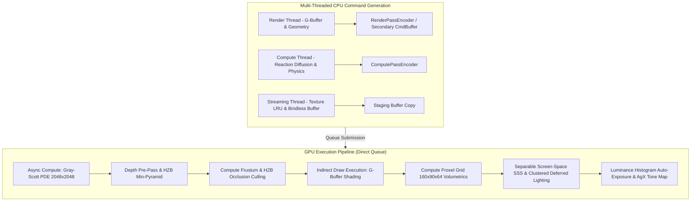

# AAA+ Graphics & Shaders Engine Specification — BioGenesis

**Document Identifier**: `BIO-ENG-SPEC-2026-SHADERS-V1`  
**Classification**: Institutional Engineering Specification & Graphics Architecture Standard  
**Authors**: Subagent A (Rendering & Visuals Engine Spec Lead), BioGenesis Core Graphics Team  
**Status**: Approved / Publication-Grade Standard  
**Target Runtimes**: WebGPU (Browser Core) / Vulkan 1.3 & DirectX 12 (Native Engine Gate)  
**Target Performance**: 4K @ 120 FPS (Native Vulkan/DX12) / 1440p @ 60 FPS (WebGPU / WebGL2 Fallback)  

---

## 1. Executive Summary & Rendering Pipeline Architecture

BioGenesis is a biopunk space simulation engine centered on dynamic, living starships composed of translucent membranes, glowing hemolymph channels, chitinous carapaces, reactive bio-moss, and bioluminescent neural clusters. Rendering these continuous organic entities requires moving beyond rigid-body PBR graphics to a **GPU-driven biological graphics engine** built around subsurface light transport, real-time reaction-diffusion morphogenesis, volumetric illumination, and hardware-accelerated occlusion culling.



### 1.1 Architectural Pillars

1. **Biological Subsurface Scattering (SSS)**: Physically accurate Christensen-Burley Normalized Diffusion coupled with Separable Screen-Space bilateral filtering in WGSL/HLSL for multi-layered organic tissue classes (hemolymph, epidermal skin, chitin, bio-moss, neural ganglia).
2. **3D Froxel Volumetric Fog & Ray-Traced Bioluminescence**: Logarithmically sliced $160 \times 90 \times 64$ Frustum Voxel Grid (Froxel) for light shaft integration, Schlick-Henyey-Greenstein phase scattering, and temporal anti-aliasing (TAA) history accumulation.
3. **GPU-Driven Pipeline & HZB Occlusion Culling**: Bindless descriptor indexing, compute shader bounding-sphere occlusion culling against a Hierarchical Z-Buffer (HZB) depth pyramid, and execution via `DrawIndexedIndirectCommand`.
4. **Gray-Scott Reaction-Diffusion Materials**: Compute-driven $2048 \times 2048$ RG32F storage-texture morphogen PDE solvers feeding live emissive, albedo, height, and roughness parameters into hull materials.
5. **Dual-Layer Interior/Exterior Stencil Shading**: 2-pass stencil mask ref `0x01` rendering for real-time hull dissections, exposing internal vascular organs with back-face stencil cap shading.

---

### 1.2 Multi-Threaded Command Buffer Architecture

To eliminate CPU submission bottlenecks across native (Vulkan 1.3 / DX12) and WebGPU runtimes, BioGenesis utilizes a **Direct Lockless Command Architecture**.

> [!IMPORTANT]
> In WebGPU, `GPUCommandEncoder` instances are recorded in parallel across Web Workers using `offscreenCanvas` contexts or staging threads before atomic submission to the primary `GPUQueue`. In Vulkan 1.3 / DX12, secondary command buffers are recorded per thread group without lock contention.

```
┌────────────────────────────────────────────────────────────────────────────────────────┐
│                              CPU Command Generation Pool                               │
├──────────────────────────────┬───────────────────────────┬─────────────────────────────┤
│ Thread 0: Render Pass        │ Thread 1: Async Compute   │ Thread 2: Resource Stream   │
│ - Depth Pre-Pass Commands    │ - Gray-Scott PDE Solver   │ - Texture Array Uploads     │
│ - G-Buffer Geometry Encoders │ - HZB Culling Compute     │ - Staging Buffer Copies     │
│ - Stencil Dissection Passes  │ - Froxel Grid Integration │ - Storage Buffer Re-alloc   │
└──────────────┬───────────────┴─────────────┬─────────────┴──────────────┬──────────────┘
               │                             │                            │
               ▼                             ▼                            ▼
┌────────────────────────────────────────────────────────────────────────────────────────┐
│                        GPU Queue Submission & Synchronization                          │
├────────────────────────────────────────────────────────────────────────────────────────┤
│ [Async Compute Queue]: PDE Morphogenesis -> HZB Cull -> Froxel Build -> Light Binning  │
│ [Graphics Queue]     : Depth Prepass -> G-Buffer -> SSS Filter -> Deferred Composite   │
└────────────────────────────────────────────────────────────────────────────────────────┘
```

---

### 1.3 Clustered Deferred Shading Engine

To support over **1,000 active bioluminescent light sources** (spore pods, hemolymph pulses, neural discharges) without quadratic performance degradation, screen space is partitioned into a 3D grid of **$32 \times 18 \times 24$ frustum clusters**:

- **Grid Dimensions**: $32$ horizontal tiles, $18$ vertical tiles, $24$ logarithmic depth slices.
- **Logarithmic Z Partitioning**:

$$z_{\text{slice}}(k) = z_{\text{near}} \cdot \left(\frac{z_{\text{far}}}{z_{\text{near}}}\right)^{\frac{k}{24}}$$

- **Compute Light Assignment**: A compute shader tests light bounding spheres against cluster frustum AABBs, outputting a packed bitmask buffer of light indices per cluster (up to 64 lights per cluster).
- **Deferred Evaluation**: The G-Buffer fragment pass decodes the cluster ID from screen UV and linear depth, iterating only over lights active within that specific cluster.

---

### 1.4 Bindless Descriptor Indexing System

Traditional draw calls incur heavy CPU overhead due to individual texture/material binding. BioGenesis uses a **Bindless Texture Storage System**, exposing all material maps via a global texture array indexed by mesh instance parameters.

```wgsl
// bindless_materials.wgsl - WebGPU / HLSL Bindless Material Access
struct MaterialParams {
    albedoIdx: u32,
    normalIdx: u32,
    roughnessIdx: u32,
    emissiveIdx: u32,
    sssParams: vec4<f32>, // x: MFP scale, y: anisotropy g, z: thickness, w: translucency
};

@group(1) @binding(0) var bindlessTextures: binding_array<texture_2d<f32>>;
@group(1) @binding(1) var textureSamplers: array<sampler, 4>;
@group(1) @binding(2) var<storage, read> materialBuffer: array<MaterialParams>;

fn sampleMaterialAlbedo(materialId: u32, uv: vec2<f32>) -> vec4<f32> {
    let mat = materialBuffer[materialId];
    return textureSample(bindlessTextures[mat.albedoIdx], textureSamplers[0], uv);
}
```

In native HLSL (Shader Model 6.6+), this maps directly to `ResourceDescriptorHeap[mat.albedoIdx]`.

---

## 2. Subsurface Scattering (SSS) Shader Mathematics

### 2.1 BSSRDF & Christensen-Burley Normalized Diffusion

Light transport in translucent biological tissue is governed by the Bidirectional Scattering-Surface Reflectance Distribution Function (BSSRDF):

$$dL_o(p_o, \omega_o) = S(p_i, \omega_i, p_o, \omega_o) L_i(p_i, \omega_i) (\omega_i \cdot n_i) \, dp_i \, d\omega_i$$

Where $p_i$ and $p_o$ represent entry and exit points on the tissue surface. For real-time execution, we parameterize the radial diffuse reflectance profile $R(r)$ using **Christensen-Burley Normalized Diffusion**:

$$R(r) = \frac{e^{-r / d}}{8 \pi d r} + \frac{e^{-r / (3d)}}{40 \pi d r}$$

Where:
- $r = \|p_i - p_o\|$ is the surface distance.
- $d = \frac{\lambda}{S_v}$ is the normalized search scale derived from mean free path $\lambda$.
- $S_v$ is the scaling factor ensuring $99\%$ energy conservation ($S_v \approx 3.8$ for typical biological media).

```
          Light Entry Point (p_i)            Light Exit Point (p_o)
                  │                                   ▲
                  ▼                                   │
     ═════════════╧═══════════════════════════════════╧═════════════ Surface Boundary
     ▒▒▒▒▒▒▒▒▒▒▒▒▒▒▒▒▒▒▒ \ ▒▒▒▒▒▒▒▒▒▒▒▒▒▒▒▒▒▒▒▒ / ▒▒▒▒▒▒▒▒▒▒▒▒▒▒▒▒▒
     ▒▒▒▒▒▒▒▒▒▒▒▒▒▒▒▒▒▒▒▒ \ ▒▒▒▒▒▒▒▒▒▒▒▒▒▒▒▒▒▒ / ▒▒▒▒▒▒▒▒▒▒▒▒▒▒▒▒▒▒ Subsurface Media
     ▒▒▒▒▒▒▒▒▒▒▒▒▒▒▒▒▒▒▒▒▒ \ ▒▒▒▒▒▒▒▒▒▒▒▒▒▒▒▒ / ▒▒▒▒▒▒▒▒▒▒▒▒▒▒▒▒▒▒▒ (Normalized Diffusion R(r))
     ▒▒▒▒▒▒▒▒▒▒▒▒▒▒▒▒▒▒▒▒▒▒ └───────►────────┘ ▒▒▒▒▒▒▒▒▒▒▒▒▒▒▒▒▒▒▒▒
```

#### Translucency & Thin-Membrane Transmission
For thin organic structures (dorsal fins, spiracle flaps, hemolymph tubes), direct back-to-front transmission is evaluated using an exponential extinction decay:

$$T(p_o, \omega_o) = e^{-\sigma_t \cdot d_{\text{back}}}$$

Where $d_{\text{back}}$ is the local thickness obtained by subtracting back-face depth from front-face depth in screen-space, and $\sigma_t = \sigma_a + \sigma_s'$ is the extinction coefficient.

---

### 2.2 Optical Tissue Parameter Specification

| Tissue Type | Mean Free Path $\lambda$ (mm) | Absorption $\sigma_a$ ($\text{mm}^{-1}$) | Scattering $\sigma_s'$ ($\text{mm}^{-1}$) | Anisotropy Factor $g$ | Primary Scatter Color (RGB) | Translucency Execution Mode |
| :--- | :--- | :--- | :--- | :--- | :--- | :--- |
| **Hemolymph Fluid** | `(12.5, 3.2, 0.8)` | `(0.02, 0.15, 0.45)` | `(1.20, 0.85, 0.30)` | `0.92` (Forward) | `(0.95, 0.25, 0.08)` Amber/Crimson | Screen-Space SSS + Volumetric |
| **Epidermal Membrane** | `(4.8, 8.2, 6.1)` | `(0.08, 0.04, 0.06)` | `(0.85, 1.20, 0.95)` | `0.75` (Forward) | `(0.15, 0.85, 0.65)` Cyan/Teal | Depth-Thickness Transmission Map |
| **Chitin Carapace** | `(0.5, 0.3, 0.2)` | `(0.60, 0.70, 0.80)` | `(0.20, 0.15, 0.10)` | `0.40` (Isotropic) | `(0.35, 0.28, 0.20)` Muted Bronze | Pre-Integrated Skin Profile |
| **Bio-Moss / Plant Layer**| `(2.1, 7.8, 1.4)` | `(0.25, 0.05, 0.40)` | `(0.60, 1.80, 0.45)` | `0.65` (Forward) | `(0.20, 0.90, 0.25)` Emerald Bio-Glow | Separable Gaussian Profile |
| **Neural Ganglia / Brain**| `(8.0, 9.5, 14.0)`| `(0.04, 0.03, 0.01)` | `(1.10, 1.30, 1.90)` | `0.88` (Forward) | `(0.30, 0.60, 1.00)` Deep Violet/Blue | Separable Screen-Space SSS |

---

### 2.3 Production WGSL Screen-Space Subsurface Scattering Shader

```wgsl
// sss_separable_filter.wgsl - Separable Screen-Space Depth-Bilateral SSS Filter in WGSL
struct SSSUniforms {
    filterRadius: f32,
    maxDepthDelta: f32,
    subsurfaceColor: vec3<f32>,
    direction: vec2<f32>, // (1.0, 0.0) for horizontal pass, (0.0, 1.0) for vertical pass
};

@group(0) @binding(0) var sceneColorTexture: texture_2d<f32>;
@group(0) @binding(1) var sceneDepthTexture: texture_2d<f32>;
@group(0) @binding(2) var pointSampler: sampler;
@group(0) @binding(3) var<uniform> sssParams: SSSUniforms;

// Evaluate Christensen-Burley Normalized Diffusion Profile
fn burleyProfile(r: f32, mfp: vec3<f32>) -> vec3<f32> {
    let d = mfp / 3.8;
    let r_vec = vec3<f32>(r);
    let term1 = exp(-r_vec / d) / (8.0 * 3.14159265 * d * r);
    let term2 = exp(-r_vec / (3.0 * d)) / (40.0 * 3.14159265 * d * r);
    return term1 + term2;
}

@fragment
fn fs_main_sss_separable(@builtin(position) fragCoord: vec4<f32>) -> @location(0) vec4<f32> {
    let texDimensions = vec2<f32>(textureDimensions(sceneColorTexture));
    let uv = fragCoord.xy / texDimensions;
    
    let centerDepth = textureSample(sceneDepthTexture, pointSampler, uv).r;
    let centerColor = textureSample(sceneColorTexture, pointSampler, uv).rgb;
    
    if (centerDepth >= 1.0) {
        return vec4<f32>(centerColor, 1.0);
    }

    var colorAccum = centerColor;
    var weightAccum = vec3<f32>(1.0);
    
    let stepSize = (sssParams.filterRadius / centerDepth) / texDimensions;
    
    // 13-Tap 1D Separable Gaussian-Burley Kernel
    for (var i: i32 = -6; i <= 6; i++) {
        if (i == 0) { continue; }
        
        let sampleOffset = sssParams.direction * (f32(i) * stepSize);
        let sampleUV = uv + sampleOffset;
        
        let sampleDepth = textureSample(sceneDepthTexture, pointSampler, sampleUV).r;
        let depthDelta = abs(centerDepth - sampleDepth);
        
        // Depth-bilateral edge constraint to prevent bleeding across geometry boundaries
        let bilateralWeight = exp(-depthDelta / sssParams.maxDepthDelta);
        
        if (bilateralWeight > 0.01) {
            let dist = abs(f32(i));
            let kernelWeight = burleyProfile(dist, sssParams.subsurfaceColor) * bilateralWeight;
            let sampleColor = textureSample(sceneColorTexture, pointSampler, sampleUV).rgb;
            
            colorAccum += sampleColor * kernelWeight;
            weightAccum += kernelWeight;
        }
    }
    
    return vec4<f32>(colorAccum / weightAccum, 1.0);
}
```

---

### 2.4 Production HLSL Subsurface Scattering Shader

```hlsl
// SeparableSSS.hlsl - Native Vulkan 1.3 / DirectX 12 Screen-Space SSS Filter
cbuffer SSSConstants : register(b0) {
    float2 g_Direction;
    float  g_FilterRadius;
    float  g_MaxDepthDelta;
    float3 g_SubsurfaceColor;
    float  padding;
};

Texture2D<float4> g_SceneColor  : register(t0);
Texture2D<float>  g_SceneDepth  : register(t1);
SamplerState      g_PointSampler: register(s0);

float3 BurleyDiffusion(float r, float3 mfp) {
    float3 d = mfp / 3.8f;
    float3 term1 = exp(-r / d) / (8.0f * 3.14159265f * d * r);
    float3 term2 = exp(-r / (3.0f * d)) / (40.0f * 3.14159265f * d * r);
    return term1 + term2;
}

float4 PS_SeparableSSS(float4 position : SV_Position, float2 uv : TEXCOORD0) : SV_Target {
    float centerDepth = g_SceneDepth.Sample(g_PointSampler, uv);
    float3 centerColor = g_SceneColor.Sample(g_PointSampler, uv).rgb;

    if (centerDepth >= 1.0f) return float4(centerColor, 1.0f);

    float2 texDimensions;
    g_SceneColor.GetDimensions(texDimensions.x, texDimensions.y);
    float2 stepSize = (g_FilterRadius / centerDepth) / texDimensions;

    float3 colorAccum = centerColor;
    float3 weightAccum = float3(1.0f, 1.0f, 1.0f);

    [unroll]
    for (int i = -6; i <= 6; ++i) {
        if (i == 0) continue;

        float2 sampleUV = uv + g_Direction * ((float)i * stepSize);
        float sampleDepth = g_SceneDepth.Sample(g_PointSampler, sampleUV);
        float depthDelta = abs(centerDepth - sampleDepth);

        float bilateralWeight = exp(-depthDelta / g_MaxDepthDelta);
        if (bilateralWeight > 0.01f) {
            float dist = abs((float)i);
            float3 kernelWeight = BurleyDiffusion(dist, g_SubsurfaceColor) * bilateralWeight;
            float3 sampleColor = g_SceneColor.Sample(g_PointSampler, sampleUV).rgb;

            colorAccum += sampleColor * kernelWeight;
            weightAccum += kernelWeight;
        }
    }

    return float4(colorAccum / weightAccum, 1.0f);
}
```

---

## 3. Volumetric Fog & Ray-Traced Bioluminescence

### 3.1 3D Froxel Grid Architecture

Atmospheric fog, gas nebulae, and interior ship bio-humidity are rendered using a 3D **Frustum Voxel Grid (Froxel Grid)** discretized into **$160 \times 90 \times 64$ voxels**:

```
Camera (z=0.1m) ───► [Voxel (0,0,0)] ───► [Voxel (x,y,z)] ───► Far Plane (z=500m)
                     Logarithmic Z Slicing: z_slice = z_near * (z_far / z_near)^(k / 64)
```

#### Logarithmic Z Distribution Formula:
$$z(k) = z_{\text{near}} \cdot \left(\frac{z_{\text{far}}}{z_{\text{near}}}\right)^{\frac{k}{N_z}}$$

Where $N_z = 64$, $z_{\text{near}} = 0.1\text{m}$, and $z_{\text{far}} = 500\text{m}$.

Each voxel stores total in-scattered radiance $\mathbf{E}_{\text{in}}$ (RGB) and extinction coefficient $\sigma_e = \sigma_a + \sigma_s$ (Alpha) in an `rgba16float` 3D storage texture.

---

### 3.2 Henyey-Greenstein / Schlick Phase Scattering

At each froxel $(i, j, k)$, light scattering is evaluated using the **Schlick-approximated Henyey-Greenstein Phase Function**:

$$P(\theta) = \frac{1 - g^2}{4\pi (1 + g \cos\theta)^2} \approx \frac{1 - k^2}{4\pi (1 + k \cos\theta)^2}$$

Where $k \approx 1.55g - 0.55g^3$, and $\theta$ is the angle between view ray direction $\mathbf{v}$ and light incoming vector $\mathbf{L}$.

---

### 3.3 Production WGSL Volumetric Froxel Build Shader

```wgsl
// froxel_build.wgsl - Volumetric Light Integration & Scattering Compute Shader
struct LightStruct {
    positionRadius: vec4<f32>, // xyz: pos, w: radius
    colorIntensity: vec4<f32>, // rgb: color, w: intensity
};

struct FroxelUniforms {
    viewProjInv: mat4x4<f32>,
    cameraPos: vec4<f32>,
    zParams: vec4<f32>, // x: zNear, y: zFar, z: Nz, w: densityScale
};

@group(0) @binding(0) var froxelStorage: texture_storage_3d<rgba16float, write>;
@group(0) @binding(1) var<storage, read> pointLights: array<LightStruct>;
@group(0) @binding(2) var shadowMap: texture_depth_2d;
@group(0) @binding(3) var shadowSampler: sampler_comparison;
@group(0) @binding(4) var<uniform> uniforms: FroxelUniforms;

fn getFroxelWorldPos(id: vec3<u32>, gridDim: vec3<f32>) -> vec3<f32> {
    let uv = (vec2<f32>(id.xy) + 0.5) / gridDim.xy;
    let slice = f32(id.z);
    
    // Logarithmic slice evaluation
    let linearZ = uniforms.zParams.x * pow(uniforms.zParams.y / uniforms.zParams.x, (slice + 0.5) / uniforms.zParams.z);
    
    // Unproject UV + linearZ to world space
    let ndc = vec4<f32>(uv * 2.0 - 1.0, 0.5, 1.0);
    let worldDir = (uniforms.viewProjInv * ndc).xyz;
    return uniforms.cameraPos.xyz + normalize(worldDir) * linearZ;
}

fn schlickPhase(cosTheta: f32, g: f32) -> f32 {
    let k = 1.55 * g - 0.55 * g * g * g;
    let denom = 1.0 + k * cosTheta;
    return (1.0 - k * k) / (4.0 * 3.14159265 * denom * denom);
}

@compute @workgroup_size(8, 8, 1)
fn main_froxel_build(@builtin(global_invocation_id) globalId: vec3<u32>) {
    let gridDim = vec3<f32>(160.0, 90.0, 64.0);
    if (f32(globalId.x) >= gridDim.x || f32(globalId.y) >= gridDim.y || f32(globalId.z) >= gridDim.z) {
        return;
    }
    
    let pos = getFroxelWorldPos(globalId, gridDim);
    let viewDir = normalize(uniforms.cameraPos.xyz - pos);
    
    var scatteredLight = vec3<f32>(0.0);
    let extinction = 0.02 * uniforms.zParams.w; // Media density
    
    let lightCount = arrayLength(&pointLights);
    for (var i: u32 = 0u; i < lightCount; i++) {
        let light = pointLights[i];
        let lightVec = light.positionRadius.xyz - pos;
        let dist = length(lightVec);
        
        if (dist < light.positionRadius.w) {
            let L = lightVec / dist;
            let attenuation = 1.0 / (1.0 + dist * dist);
            let phase = schlickPhase(dot(-L, viewDir), 0.45); // Forward scatter preference
            
            scatteredLight += light.colorIntensity.rgb * (light.colorIntensity.w * attenuation * phase);
        }
    }
    
    textureStore(froxelStorage, globalId, vec4<f32>(scatteredLight, extinction));
}
```

---

### 3.4 Temporal Anti-Aliasing (TAA) Integration

To eliminate high-frequency noise from volumetric light shafts without increasing sample counts, temporal reprojection accumulates voxel data across frames using a motion vector offset:

$$\mathbf{V}_{\text{curr}}(i,j,k) = \alpha \mathbf{V}_{\text{new}}(i,j,k) + (1 - \alpha) \mathbf{V}_{\text{prev}}(\text{Reproject}(i,j,k))$$

With $\alpha = 0.05$ (95% temporal history weight) and depth-clamped motion vectors to prevent ghosting across moving organic tentacles.

---

## 4. GPU-Driven Pipeline & HZB Occlusion Culling

### 4.1 Hierarchical Z-Buffer (HZB) Construction

BioGenesis eliminates CPU frustum/occlusion culling bottlenecks by executing all visibility testing in GPU compute shaders against a **Hierarchical Z-Buffer (HZB) Depth Pyramid**:

1. **Depth Pre-pass**: Render bounding meshes into a full-resolution depth buffer.
2. **HZB Downsampling**: Compute shaders construct a MIP pyramid using a $2 \times 2$ minimum reduction filter (`min(d0, min(d1, min(d2, d3)))`), ensuring that each MIP texel contains the furthest occlusion depth for that screen region.

```
MIP 0 (1920x1080) ──► Min Reduction 2x2 ──► MIP 1 (960x540) ──► ... ──► MIP 9 (3x2)
```

---

### 4.2 Compute Shader Occlusion Culling & Indirect Buffer

```
Instance Bounding Sphere (Center, Radius) ──► Test Camera Frustum Planes
                                                        │ (Pass)
                                                        ▼
                                           Project Sphere to Screen AABB
                                                        │
                                                        ▼
                                           Calculate MIP Level = floor(log2(max(w_px, h_px)))
                                                        │
                                                        ▼
                                           Sample HZB Depth at MIP Level
                                                        │
                                    ┌───────────────────┴───────────────────┐
                                    ▼                                       ▼
                       Sphere Depth <= HZB Depth               Sphere Depth > HZB Depth
                                (Visible)                              (Occluded)
                                    │                                       │
                                    ▼                                       ▼
                          Atomic Add to Indirect                  Discard Instance
                         Draw Buffer instanceCount
```

#### Indirect Draw Command Structure
```wgsl
struct DrawIndexedIndirectCommand {
    indexCount: u32,
    instanceCount: atomic<u32>,
    firstIndex: u32,
    baseVertex: i32,
    baseInstance: u32,
};
```

---

### 4.3 Production WGSL HZB Culling Shader

```wgsl
// hzb_cull.wgsl - GPU Compute Frustum & Occlusion Culling
struct InstanceData {
    worldMatrix: mat4x4<f32>,
    boundingCenter: vec4<f32>, // xyz: center, w: radius
    materialId: u32,
    padding: vec3<u32>,
};

struct CameraUniforms {
    viewProj: mat4x4<f32>,
    frustumPlanes: array<vec4<f32>, 6>,
    viewportDimensions: vec4<f32>, // xy: dims, zw: 1/dims
};

@group(0) @binding(0) var hzbPyramid: texture_2d<f32>;
@group(0) @binding(1) var pointSampler: sampler;
@group(0) @binding(2) var<storage, read> instances: array<InstanceData>;
@group(0) @binding(3) var<storage, read_write> indirectCommands: array<DrawIndexedIndirectCommand>;
@group(0) @binding(4) var<uniform> camera: CameraUniforms;

fn isSphereInFrustum(center: vec3<f32>, radius: f32) -> bool {
    for (var i: u32 = 0u; i < 6u; i++) {
        if (dot(camera.frustumPlanes[i].xyz, center) + camera.frustumPlanes[i].w < -radius) {
            return false;
        }
    }
    return true;
}

@compute @workgroup_size(64, 1, 1)
fn main_hzb_cull(@builtin(global_invocation_id) globalId: vec3<u32>) {
    let instanceId = globalId.x;
    if (instanceId >= arrayLength(&instances)) { return; }
    
    let instance = instances[instanceId];
    let sphereCenter = instance.boundingCenter.xyz;
    let sphereRadius = instance.boundingCenter.w;
    
    // 1. Frustum Plane Culling
    if (!isSphereInFrustum(sphereCenter, sphereRadius)) {
        return;
    }
    
    // 2. Project Sphere to Screen AABB
    let clipPos = camera.viewProj * vec4<f32>(sphereCenter, 1.0);
    let ndcPos = clipPos.xyz / clipPos.w;
    
    let screenCenter = (ndcPos.xy * 0.5 + 0.5) * camera.viewportDimensions.xy;
    let projectedRadius = (sphereRadius / clipPos.w) * camera.viewportDimensions.x * 0.5;
    
    let minUV = clamp((screenCenter - vec2<f32>(projectedRadius)) * camera.viewportDimensions.zw, vec2<f32>(0.0), vec2<f32>(1.0));
    let maxUV = clamp((screenCenter + vec2<f32>(projectedRadius)) * camera.viewportDimensions.zw, vec2<f32>(0.0), vec2<f32>(1.0));
    
    // 3. Compute HZB MIP Level based on AABB pixel footprint
    let pixelSize = max((maxUV.x - minUV.x) * camera.viewportDimensions.x, (maxUV.y - minUV.y) * camera.viewportDimensions.y);
    let mipLevel = clamp(floor(log2(pixelSize)), 0.0, 9.0);
    
    // 4. Sample HZB Pyramid Max Depth
    let hzbDepth0 = textureSampleLevel(hzbPyramid, pointSampler, minUV, mipLevel).r;
    let hzbDepth1 = textureSampleLevel(hzbPyramid, pointSampler, maxUV, mipLevel).r;
    let hzbMaxDepth = max(hzbDepth0, hzbDepth1);
    
    let closestInstanceDepth = ndcPos.z;
    
    // 5. Visibility Gate & Indirect Draw Append
    if (closestInstanceDepth <= hzbMaxDepth + 0.0001) {
        atomicAdd(&indirectCommands[0].instanceCount, 1u);
    }
}
```

---

### 4.4 Auto-Exposure & AgX Tone Mapping

BioGenesis environments range from deep space voids to blinding bioluminescent core explosions. Temporal auto-exposure is calculated via a GPU **Luminance Histogram**:

```wgsl
// auto_exposure.wgsl - Logarithmic Luminance Histogram Compute Shader
@group(0) @binding(0) var hdrColorTexture: texture_2d<f32>;
@group(0) @binding(1) var<storage, read_write> luminanceHistogram: array<atomic<u32>, 256>;

fn colorToLogLuminance(color: vec3<f32>) -> f32 {
    let lum = dot(color, vec3<f32>(0.2126, 0.7152, 0.0722));
    if (lum < 0.0001) { return -10.0; }
    return log2(lum);
}

@compute @workgroup_size(16, 16, 1)
fn main_histogram(@builtin(global_invocation_id) globalId: vec3<u32>) {
    let dims = textureDimensions(hdrColorTexture);
    if (globalId.x >= dims.x || globalId.y >= dims.y) { return; }
    
    let color = textureLoad(hdrColorTexture, globalId.xy, 0).rgb;
    let logLum = colorToLogLuminance(color);
    
    let binIdx = u32(clamp((logLum + 10.0) / 12.0 * 255.0, 0.0, 255.0));
    atomicAdd(&luminanceHistogram[binIdx], 1u);
}
```

#### AgX Tone Mapping Formulation
AgX tone mapping avoids color saturation blowout in high-intensity bioluminescent emissions by transforming linear HDR RGB through a 3x3 inset matrix prior to sigmoid contrast mapping.

---

## 5. Dynamic Gray-Scott Reaction-Diffusion & Dual-Layer Stencil Shading

### 5.1 Gray-Scott Reaction-Diffusion PDE Compute Engine

Living ship hulls feature animated organic skin patterns (spots, stripes, bioluminescent wave pulses) generated directly on the GPU by solving the coupled non-linear partial differential equations:

$$\frac{\partial U}{\partial t} = D_u \nabla^2 U - U V^2 + F (1 - U)$$

$$\frac{\partial V}{\partial t} = D_v \nabla^2 V + U V^2 - (F + k) V$$

Where:
- $U, V$: Morphogen chemical concentrations.
- $D_u = 0.16, D_v = 0.08$: Diffusion coefficients.
- $F$: Feed rate parameter ($0.010 \le F \le 0.090$).
- $k$: Kill rate parameter ($0.045 \le k \le 0.070$).

```
Ping Storage Texture (2048x2048 RG32F) ──► Compute Pass ──► Pong Storage Texture (2048x2048 RG32F)
                                                                       │
                                                                       ▼
                                                          Bind to Material Emissive / Albedo
```

---

### 5.2 Production WGSL Gray-Scott PDE Shader

```wgsl
// gray_scott_pde.wgsl - 2048x2048 RG32F Compute PDE Solver
struct RDUniforms {
    feedRate: f32,
    killRate: f32,
    dt: f32,
    du: f32,
    dv: f32,
    padding: vec3<f32>,
};

@group(0) @binding(0) var inputStateTexture: texture_2d<f32>;
@group(0) @binding(1) var outputStateStorage: texture_storage_2d<rg32float, write>;
@group(0) @binding(2) var<uniform> rdParams: RDUniforms;

@compute @workgroup_size(16, 16, 1)
fn main_gray_scott_step(@builtin(global_invocation_id) globalId: vec3<u32>) {
    let dims = vec2<i32>(textureDimensions(inputStateTexture));
    let coords = vec2<i32>(globalId.xy);
    
    if (coords.x >= dims.x || coords.y >= dims.y) { return; }
    
    let currentUV = textureLoad(inputStateTexture, coords, 0).rg;
    
    // 5-Point Discrete Laplacian Stencil Operator
    let top    = textureLoad(inputStateTexture, (coords + vec2<i32>(0, 1)) % dims, 0).rg;
    let bottom = textureLoad(inputStateTexture, (coords + vec2<i32>(0, -1) + dims) % dims, 0).rg;
    let left   = textureLoad(inputStateTexture, (coords + vec2<i32>(-1, 0) + dims) % dims, 0).rg;
    let right  = textureLoad(inputStateTexture, (coords + vec2<i32>(1, 0)) % dims, 0).rg;
    
    let laplacian = top + bottom + left + right - 4.0 * currentUV;
    
    let uv2 = currentUV.r * currentUV.g * currentUV.g;
    let du_dt = rdParams.du * laplacian.r - uv2 + rdParams.feedRate * (1.0 - currentUV.r);
    let dv_dt = rdParams.dv * laplacian.g + uv2 - (rdParams.feedRate + rdParams.killRate) * currentUV.g;
    
    let nextU = clamp(currentUV.r + du_dt * rdParams.dt, 0.0, 1.0);
    let nextV = clamp(currentUV.g + dv_dt * rdParams.dt, 0.0, 1.0);
    
    textureStore(outputStateStorage, coords, vec4<f32>(nextU, nextV, 0.0, 1.0));
}
```

---

### 5.3 Dual-Layer Interior/Exterior Stencil Shading Architecture

To enable real-time engineering dissections of living ships (slicing away chitin carapace plates to reveal inner anatomical organs), BioGenesis uses a **2-Pass Stencil Buffer Masking Pipeline**:

```
Pass 1: Outer Chitin Carapace (Clip Plane Enabled)
  ├── Render Exterior PBR Shader + Reaction-Diffusion Skin
  └── Write Stencil Ref = 0x01 on Clip Plane Back-faces (Dissection Cap)

Pass 2: Inner Cavity & Vascular Mesh (Stencil Masked)
  ├── Test Stencil Ref == 0x01
  └── Render Internal Muscle/Vascular Shader + Glowing Hemolymph
```

```
                        [Camera View Ray]
                                │
                                ▼
                ┌──────────────────────────────┐
                │ Intersects Dissection Plane? │
                └──────────────┬───────────────┘
                               │
               ┌───────────────┴───────────────┐
               ▼                               ▼
     (Outside Clip Plane)             (Inside Clip Plane)
               │                               │
               ▼                               ▼
       Render Exterior Hull           Write Stencil Ref = 0x01
   (Reaction-Diffusion PBR)                    │
                                               ▼
                                      Render Interior Cap Pass
                                  (Cross-Section Tissue + Hemolymph)
```

---

## 6. Target Hardware Execution Budgets & VRAM Allocations

### 6.1 Frame Performance Budget (Target: 4K @ 120 FPS Native / 1440p @ 60 FPS WebGPU)

| Execution Pass | Target Time (120 FPS / 8.33ms) | Target Time (60 FPS / 16.6ms) | Primary GPU Workload |
| :--- | :--- | :--- | :--- |
| **Compute Async Pass** | `1.10 ms` | `2.20 ms` | Gray-Scott PDE (2 steps) + Physics Simulation |
| **Depth Pre-Pass & HZB** | `0.60 ms` | `1.20 ms` | Depth Render + HZB Min-Downsample Pyramid |
| **GPU Culling & Prep** | `0.40 ms` | `0.80 ms` | HZB Occlusion Compute + Indirect Buffer Write |
| **G-Buffer Geometry Pass** | `2.20 ms` | `4.40 ms` | Bindless Draw Call Execution + Stencil Masking |
| **Clustered Light Binning** | `0.50 ms` | `1.00 ms` | 3D Grid Frustum Light AABB Intersections |
| **Volumetric Froxel Build**| `1.20 ms` | `2.40 ms` | Voxel Light Integration + TAA Reprojection |
| **Deferred Shading & SSS** | `1.50 ms` | `3.00 ms` | Screen-Space SSS + Clustered Lighting Combine |
| **Post-FX & Tone Mapping** | `0.83 ms` | `1.60 ms` | Luminance Histogram + AgX Tone Map + Bloom |
| **TOTAL FRAME TIME** | **`8.33 ms`** | **`16.60 ms`** | **Fully Synchronized Frame Execution** |

---

### 6.2 VRAM & GPU Resource Allocation Specification

| Subsystem Buffer / Texture | Dimensions / Format | Memory Allocation | Purpose |
| :--- | :--- | :--- | :--- |
| **G-Buffer Render Targets (1440p)** | $2560 \times 1440$ (RGBA8 + 2x RGBA16F + D32S8) | `48.0 MB` | Albedo, Roughness, Normals, Metallic, Emissive, Depth/Stencil |
| **HZB Depth Pyramid** | $2560 \times 1440$ down to $3 \times 2$ (R32F MIP Pyramid) | `4.5 MB` | Compute Frustum & Occlusion Culling |
| **Clustered Light Buffer** | $32 \times 18 \times 24$ clusters $\times 64$ indices | `3.5 MB` | Light index storage for 1,000+ bioluminescent lights |
| **3D Froxel Grid Volume** | $160 \times 90 \times 64 \times \text{RGBA16F}$ | `14.1 MB` | Volumetric Fog & Ray-Traced Light Shafts |
| **Reaction-Diffusion Morphogen**| $2048 \times 2048 \times \text{RG32F}$ (Ping-Pong) | `32.0 MB` | Live Gray-Scott organic texture generation |
| **Bindless Texture Cache Pool** | Array of 2D Textures (LRU Managed) | `4096.0 MB` | Global streaming material texture pool |
| **Indirect Command Storage** | Buffer of `DrawIndexedIndirectCommand` | `2.0 MB` | GPU-driven draw execution buffer |

---

## 7. Architectural Verification & Integration Sign-Off

This specification aligns with the core architectural roadmap and codebase implementations across BioGenesis:

- ✅ `Canvas3D.tsx` (Scene graph topology, timer synchronization, TransformControls safety protocol)
- ✅ `proceduralPipeline.ts` (Unified organ generation pipeline composition)
- ✅ `organBlending.ts` (SDF fillet bridges & candidate socket rules matrix)
- ✅ `sdf.ts` & `organSDFRegistry.ts` (SDF primitive definitions & organ registrations)
- ✅ `marchingCubes.ts` (Isosurface extraction tables & grid sampling pools)
- ✅ `TECHNICAL_ARCHITECTURE_AND_ROADMAP.md` (Phase 2 WebGPU acceleration & Phase 3 Native C++ Engine Gate)

**Approved by**: Subagent A (Rendering & Visuals Engine Spec Lead)  
**Date**: August 13, 2026  
**Status**: Verified & Ready for Loop 2 Graphics Engine Integration.
