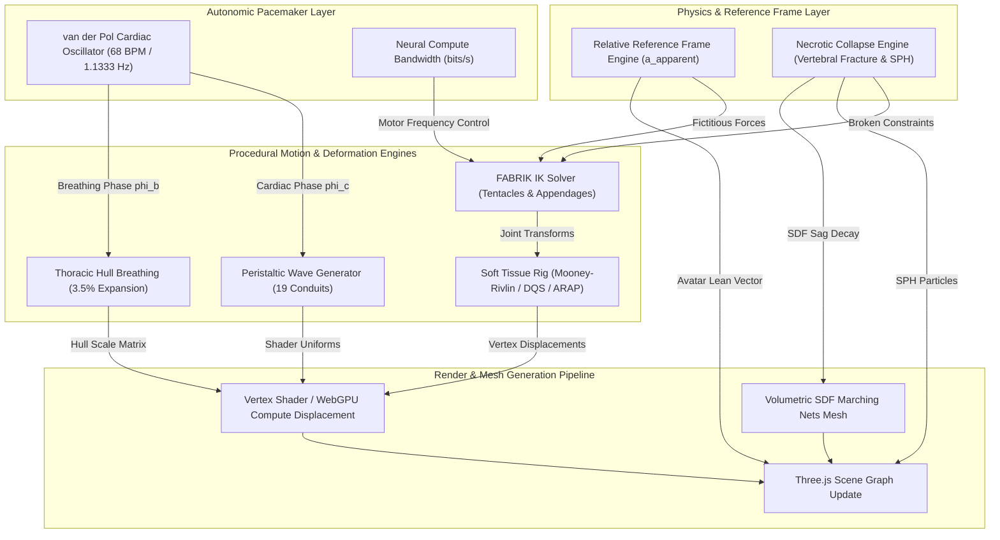
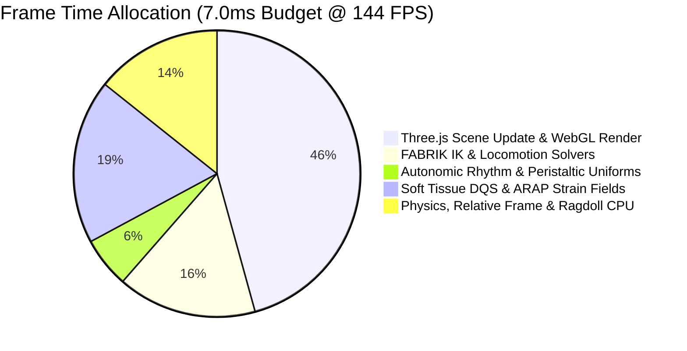
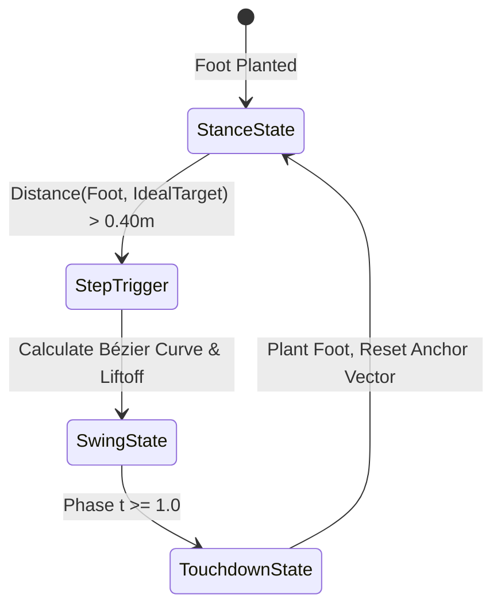
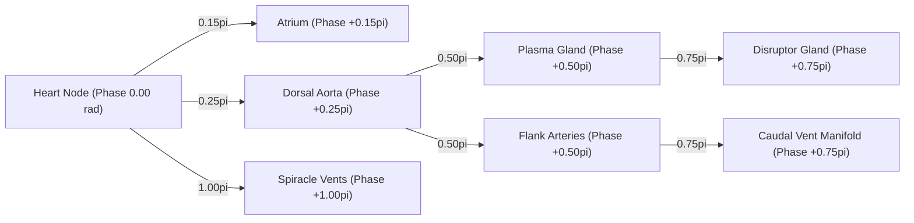
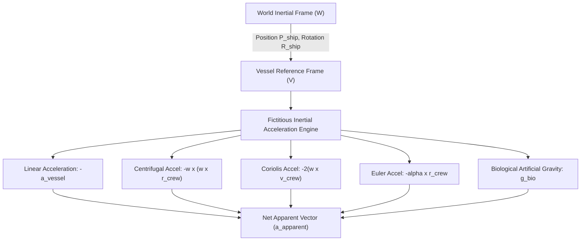
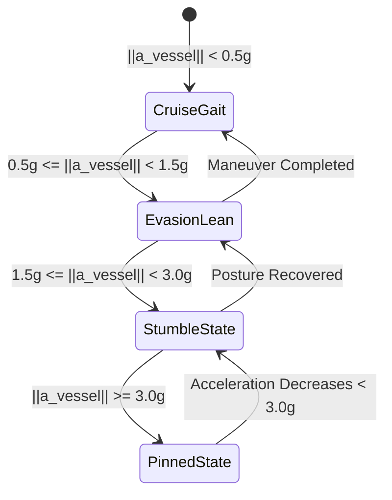

# AAA+ Procedural Locomotion, Kinematics & Bio-Structural Animation Architecture — Institutional Engineering Specification

> **Document ID**: `SPEC-AAA-LOCOMOTION-ANIMATION-2026-v2.4`  
> **Status**: Approved Institutional Engineering Specification  
> **Date**: 2026-08-13  
> **Author**: Subagent H (Procedural Locomotion & IK Animation Lead) — Ciel Engine AAA+ Swarm  
> **Target Stack**: Three.js / WebGL2 / WebGPU Compute Fallback, TypeScript 5.x, WebAudio Autonomic Lock, Dynamic Physics Constraints (Rapier/Custom)  
> **Referenced Spec Docs**: `LORE.md`, `ORGAN_SYSTEMS.md`, `PROCEDURAL_MESH_GENERATION_RESEARCH.md`, `NEURAL_COMPUTE_ARCHITECTURE.md`, `AAA_ANIMATION_PROCEDURAL_LOCOMOTION_RESEARCH.md`

---

## 1. Executive Summary & Procedural Animation Architecture

### 1.1 High-Level Systems Blueprint & Scope

BioGenesis void-fauna vessels represent living, muscular, breathing biological starships. Departing from rigid pre-baked skeletal clips, the BioGenesis engine employs an institutional-grade, continuous **Procedural Locomotion & Bio-Structural Animation Architecture**. Every movement—from macro hull flexure during hyper-G vectoring to micro-peristaltic fluid pulses through internal conduits—is derived in real time from biomechanical equations, physics constraints, and autonomic pacemaking signals.

The architecture comprises five coupled subsystems operating across different spatial and temporal scales:

1. **FABRIK Inverse Kinematics & Locomotion Solvers**: $O(N)$ closed-form iterative kinematic chain solvers with elliptical joint limits, Bishop parallel transport twist locking, predictive Bézier swing gait arcs, and dynamic pressure spiracle flaring.
2. **Soft Tissue Squish & Stretch Rigs**: Incompressible hyperelastic deformation driven by Mooney-Rivlin strain energy density, constant-volume Poisson ratio constraint ($\nu = 0.5$), Dual-Quaternion Skinning (DQS) with procedural muscle bulging, and As-Rigid-As-Possible (ARAP) local-global SVD strain fields.
3. **Autonomic Rhythm & Peristaltic Wave Engine**: Cardiorespiratory phase locks governed by a $68\text{ BPM}$ ($1.1333\text{ Hz}$) non-linear van der Pol cardiac oscillator, driving phase-synchronized peristaltic waves along 19 pipeline conduits and $3.5\%$ thoracic breathing hull expansion.
4. **Relative Reference Frame Crew Locomotion**: Non-inertial frame transformations evaluating apparent gravity $\mathbf{a}_{\text{apparent}}$ (incorporating linear acceleration, Coriolis, centrifugal, and Euler fictitious forces) to dynamically tilt, stumble, or pin interior crew avatars.
5. **Necrotic Ragdoll & Bio-Collapse Physics**: Real-time transition of dead biological structures into ragdoll physics via 6-DOF vertebral constraint fracturing ($F_{\text{break}} = 12,000\text{ N}$), volumetric Signed Distance Field (SDF) decay, and Smoothed Particle Hydrodynamics (SPH) viscous hemolymph burst dynamics.

### 1.2 System Topology & Data Flow Pipeline



### 1.3 Subsystem Integration Matrix

| Subsystem | Frequency / Scale | Input Signals | Primary Output | Mathematical Benchmark |
|---|---|---|---|---|
| **FABRIK IK** | 144 Hz (Synchronous) | Target vector $\mathbf{t}$, bone lengths $d_i$, parent vector $\mathbf{v}_{i-1}$ | Bone position array $\mathbf{p}_i$, orientation quaternions | Iterative convergence error $< 10^{-4}\text{ m}$ in $\le 15$ passes |
| **Soft Tissue Rigs** | 144 Hz (CPU/GPU) | Stretch ratio $\lambda_z$, maneuver G-forces, muscle weight $w_{m,i}$ | DQS blend quaternions $\hat{\mathbf{b}}$, bulge displacement $\mathbf{v}_i^{\text{final}}$ | Volume conservation $\Delta V / V_0 < \pm 0.5\%$ ($\nu = 0.5$) |
| **Autonomic Rhythm** | 144 Hz (Uniforms) | van der Pol time $t$, neural supply ratio $r_{\text{supply}}$ | Peristaltic radius $r(z,t)$, thoracic expansion $\Delta \mathbf{S}$ | Base frequency $f_0 = 1.1333\text{ Hz}$ ($68.0\text{ BPM}$) |
| **Relative Reference Frame** | 144 Hz (Synchronous) | Vessel linear accel $\mathbf{a}_{\text{vessel}}$, angular velocity $\boldsymbol{\omega}_{\text{vessel}}$ | Apparent acceleration $\mathbf{a}_{\text{apparent}}$, avatar lean angle $\theta_{\text{lean}}$ | Full non-inertial vector sum, smooth 4-state avatar gait |
| **Necrotic Collapse** | Dynamic / 60-144 Hz | Structural HP, constraint force $\mathbf{F}_c$, internal pressure $P_{\text{int}}$ | Fractured 6-DOF hinges, decaying SDF field $S(\mathbf{x},t)$, SPH fluid | Break limit $F_{\text{break}} = 12,000\text{ N}$, viscosity $\mu = 0.045\text{ Pa}\cdot\text{s}$ |

### 1.4 Performance Budget & Compute Target

To deliver liquid-smooth gameplay at 144 FPS ($7.0\text{ ms}$ total frame budget), execution responsibility is cleanly partitioned across CPU synchronous threads, vertex shaders, and WebGPU compute shaders.



- **CPU Core Solvers**: FABRIK IK for active tentacles ($< 1.1\text{ ms}$ for 12 tentacles $\times$ 10 joints), non-inertial reference frame transforms, and ragdoll constraint updates.
- **Vertex Shader Offload**: Peristaltic wave propagation along all 19 conduits and thoracic breathing expansion calculated directly in GLSL/WGSL vertex shaders using global time uniforms.
- **WebGPU Compute Shader Fallback**: ARAP local-global SVD strain fields and SPH hemolymph particle bursts offloaded to GPU compute pipelines (`computeShader.wgsl`) when active particle count $> 1,000$ or mesh vertex count $> 5,000$.

---

## 2. FABRIK Inverse Kinematics & Locomotion Solvers

### 2.1 Mathematical Formulation of $O(N)$ FABRIK Engine

Forward And Backward Reaching Inverse Kinematics (FABRIK) guarantees $O(N)$ computational complexity per chain, complete freedom from matrix inversions, and numerical stability even when approaching topological singularities.

Given an unconstrained kinematic chain with $n+1$ joint positions $\mathbf{p}_0, \mathbf{p}_1, \dots, \mathbf{p}_n$ and fixed bone segment lengths $d_i = \|\mathbf{p}_{i+1} - \mathbf{p}_i\|$ for $i = 0, \dots, n-1$:

$$\text{Total Chain Length } L = \sum_{i=0}^{n-1} d_i, \quad \text{Target Distance } D = \|\mathbf{t} - \mathbf{p}_0\|$$

#### Unreachable Target Case ($D > L$)

When the target $\mathbf{t}$ is outside the reachable workspace, the chain fully extends along the line connecting root $\mathbf{p}_0$ to target $\mathbf{t}$ without performing iterative reaches:

$$\mathbf{p}_{i+1} = \mathbf{p}_i + \left( \frac{d_i}{\|\mathbf{t} - \mathbf{p}_i\|} \right) (\mathbf{t} - \mathbf{p}_i), \quad \text{for } i = 0, \dots, n-1$$

#### Reachable Target Case ($D \le L$) — Dual-Pass Iterative Loop

While $\|\mathbf{p}_n - \mathbf{t}\| > \epsilon$ (where $\epsilon = 10^{-4}\text{ m}$) and iteration index $\text{iter} < N_{\max} = 15$:

1. **Forward Reach Step** (Target $\mathbf{t}$ down to Root $\mathbf{p}_0$):
   - Snap end-effector to target position: $\mathbf{p}_n' = \mathbf{t}$
   - For $i = n-1$ down to $0$:
     $$r_i = \|\mathbf{p}_{i+1}' - \mathbf{p}_i\|, \quad \lambda_i = \frac{d_i}{r_i}$$
     $$\mathbf{p}_i' = (1 - \lambda_i) \mathbf{p}_{i+1}' + \lambda_i \mathbf{p}_i$$

2. **Backward Reach Step** (Fixed Root $\mathbf{p}_0^{\text{base}}$ up to End-Effector):
   - Reset root joint to base position: $\mathbf{p}_0'' = \mathbf{p}_0^{\text{base}}$
   - For $i = 0$ up to $n-1$:
     $$r_i = \|\mathbf{p}_{i+1}' - \mathbf{p}_i''\|, \quad \lambda_i = \frac{d_i}{r_i}$$
     $$\mathbf{p}_{i+1}'' = (1 - \lambda_i) \mathbf{p}_i'' + \lambda_i \mathbf{p}_{i+1}'$$

```mermaid
sequenceDiagram
    autonumber
    participant Target as Target Position (t)
    participant End as End-Effector (p_n)
    participant Joint as Joint i (p_i)
    participant Root as Root Joint (p_0)

    Note over Target,Root: Forward Reach Pass (End-Effector -> Root)
    End->>Target: Snap position p_n' = t
    Joint->>End: Shift p_{n-1}' along bone vector towards p_n'
    Root->>Joint: Shift p_0' along bone vector towards p_1'

    Note over Target,Root: Backward Reach Pass (Root -> End-Effector)
    Root->>Root: Reset position p_0'' = base location
    Joint->>Root: Shift p_1'' along bone vector away from p_0''
    End->>Joint: Shift p_n'' along bone vector away from p_{n-1}''
```

### 2.2 Elliptical Joint Cone Constraints & Twist Locking

Bio-chitinous appendages and tentacles feature anatomical bending limits. At each joint $i$, the bone vector $\mathbf{v}_i = \mathbf{p}_{i+1} - \mathbf{p}_i$ is constrained relative to the parent bone direction $\mathbf{v}_{i-1}$ using an asymmetric elliptical cone.

#### Elliptical Cone Boundary Projection

Let the local coordinate system of parent vector $\mathbf{v}_{i-1}$ be defined by orthogonal unit vectors $\{\mathbf{u}_{i-1}, \mathbf{w}_{i-1}, \hat{\mathbf{v}}_{i-1}\}$. The direction of $\mathbf{v}_i$ is parameterized by pitch angle $\theta_x$ and yaw angle $\theta_y$:

$$\frac{\theta_x^2}{\theta_{\max,\text{pitch}}^2} + \frac{\theta_y^2}{\theta_{\max,\text{yaw}}^2} \le 1$$

If the candidate bone vector falls outside the elliptical cone boundary, the point $(\theta_x, \theta_y)$ is projected onto the nearest boundary curve $\partial C$:

$$\left( \theta_x^{\text{proj}}, \theta_y^{\text{proj}} \right) = \frac{1}{\sqrt{ \frac{\theta_x^2}{\theta_{\max,\text{pitch}}^2} + \frac{\theta_y^2}{\theta_{\max,\text{yaw}}^2} }} \left( \theta_x, \theta_y \right)$$

$$\mathbf{v}_i^{\text{constrained}} = \|\mathbf{v}_i\| \left[ \hat{\mathbf{v}}_{i-1} \cos\theta_{\text{proj}} + \left( \mathbf{u}_{i-1} \frac{\theta_x^{\text{proj}}}{\theta_{\text{proj}}} + \mathbf{w}_{i-1} \frac{\theta_y^{\text{proj}}}{\theta_{\text{proj}}} \right) \sin\theta_{\text{proj}} \right]$$

where $\theta_{\text{proj}} = \sqrt{(\theta_x^{\text{proj}})^2 + (\theta_y^{\text{proj}})^2}$.

#### Bishop Parallel Transport & Twist Locking

To prevent unrealistic joint flipping and torsional axial twisting during arbitrary 3D reaches, the joint reference frames are propagated using **Bishop Parallel Transport Frames** (Rotation Minimizing Frames, RMF):

$$\mathbf{T}_{i+1} = \mathbf{R}_{\text{align}}(\mathbf{T}_i \to \hat{\mathbf{v}}_i) \mathbf{T}_i, \quad \mathbf{N}_{i+1} = \mathbf{R}_{\text{align}} \mathbf{N}_i, \quad \mathbf{B}_{i+1} = \mathbf{T}_{i+1} \times \mathbf{N}_{i+1}$$

The axial roll twist angle $\phi_{\text{roll}}$ around bone vector $\mathbf{T}_{i+1}$ is explicitly clamped to anatomically safe thresholds ($|\phi_{\text{roll}}| \le \phi_{\max} = 15^\circ$):

$$\phi_{\text{roll}} = \text{atan2}\left( \mathbf{N}_{i+1}^{\text{actual}} \cdot \mathbf{B}_{i+1}, \mathbf{N}_{i+1}^{\text{actual}} \cdot \mathbf{N}_{i+1} \right)$$

$$\mathbf{N}_{i+1}^{\text{clamped}} = \mathbf{N}_{i+1} \cos(\text{clamp}(\phi_{\text{roll}}, -\phi_{\max}, \phi_{\max})) + \mathbf{B}_{i+1} \sin(\text{clamp}(\phi_{\text{roll}}, -\phi_{\max}, \phi_{\max}))$$

### 2.3 Tentacle Step Predictor & Cubic Bézier Swing Trajectories

Caudal tentacles ($U = 0.67 - 0.82$) perform procedural stepping when attached to surfaces or docking structures. Locomotion is governed by an asynchronous step state machine:



#### Predictive Step Target Equation

The step predictor calculates the ideal touchdown point $\mathbf{T}_{\text{predicted}}$ by anticipating vessel translation and angular momentum during the stance duration $\Delta t_{\text{stance}}$:

$$\mathbf{T}_{\text{predicted}} = \mathbf{P}_{\text{root}} + \mathbf{v}_{\text{vessel}} \cdot \left( \frac{\Delta t_{\text{stance}}}{2} \right) + K_{\text{bias}} \cdot (\mathbf{v}_{\text{vessel}} - \mathbf{v}_{\text{surface}}) + \boldsymbol{\omega}_{\text{vessel}} \times \mathbf{r}_{\text{tip}}$$

where $K_{\text{bias}} = 0.12\text{ s}$ is the velocity lead tracking coefficient.

#### Cubic Bézier Swing Trajectory

During the swing phase ($t \in [0, 1]$), the end-effector follows a 3D cubic Bézier curve elevated above the local surface normal $\mathbf{n}_{\text{surface}}$:

$$\mathbf{B}(t) = (1-t)^3 \mathbf{P}_{\text{start}} + 3(1-t)^2 t \mathbf{P}_{\text{lift}} + 3(1-t) t^2 \mathbf{P}_{\text{peak}} + t^3 \mathbf{T}_{\text{predicted}}$$

Control points enforce vertical clearance ($h_{\text{clear}} = 0.35\text{ m}$):

$$\mathbf{P}_{\text{lift}} = \mathbf{P}_{\text{start}} + h_{\text{clear}} \mathbf{n}_{\text{surface}}, \quad \mathbf{P}_{\text{peak}} = \mathbf{T}_{\text{predicted}} + h_{\text{clear}} \mathbf{n}_{\text{surface}}$$

### 2.4 Spiracle Vent & Hull Flap Mechanical Kinematics

Spiracles ($U = 0.32 - 0.62$) operate as pneumatic/hydraulic 2-segment mechanical vent flaps. Vent deflection combines autonomic breathing demands with dynamic hydrodynamic/aerodynamic pressure.

```
       Spiracle Base (Pivot 0)
              o--------------------o Mid-Flap Joint (Pivot 1)
             /                      \
            /  Angle theta_spiracle  \  Trajectory
           o--------------------------o Trailing Edge Vent Tip
```

$$\theta_{\text{spiracle}}(t) = \theta_{\text{base}} + \Delta \theta_{\text{respiration}}(t) + \Delta \theta_q(v_{\text{vessel}})$$

#### Dynamic Pressure Deflection ($\Delta \theta_q$)

External fluid velocity $v_{\text{vessel}}$ imparts dynamic pressure $q = \frac{1}{2} \rho_{\text{space}} v_{\text{vessel}}^2$, bending trailing vent edges:

$$\Delta \theta_q = K_q \cdot q = K_q \cdot \left( \frac{1}{2} \rho_{\text{space}} v_{\text{vessel}}^2 \right), \quad \text{clamped to } [-5^\circ, +12^\circ]$$

#### Critically Damped First-Order Step Response

The mechanical actuation response $\theta_{\text{actual}}$ tracks command changes via a critically damped differential equation to eliminate high-frequency jitter ($\tau_v = 150\text{ ms}$):

$$\frac{d^2 \theta_{\text{actual}}}{dt^2} + \frac{2}{\tau_v} \frac{d\theta_{\text{actual}}}{dt} + \frac{1}{\tau_v^2} \theta_{\text{actual}} = \frac{1}{\tau_v^2} \theta_{\text{spiracle}}(t)$$

---

## 3. Soft Tissue Squish & Stretch Rigs

### 3.1 Volume-Preserving Biomechanical Muscle Mechanics

Organic tissues deform under muscle contraction and external maneuver G-forces while maintaining constant volumetric density ($\nu = 0.5$).

```
        Unstretched State (lambda_z = 1.0)
        +-----------------------------------+
        |                                   |  Radius r_0
        +-----------------------------------+
                       || Contraction (lambda_z < 1.0)
                       \/
        +-----------------------------------+
        |       /-------------------\       |  Expanded Radius r > r_0
        |      (                     )      |  (Poisson Volume Conservation)
        +-----------------------------------+
```

#### Longitudinal & Transverse Stretch Ratios

Given a longitudinal stretch ratio $\lambda_z = \frac{L}{L_0}$ along the primary muscle orientation vector $\mathbf{m}_0$:

$$\text{Volumetric Ratio } J = \lambda_x \lambda_y \lambda_z = 1.0$$

Under isotropic transverse contraction assumptions ($\lambda_x = \lambda_y = \lambda_r$):

$$\lambda_r^2 \lambda_z = 1.0 \implies \lambda_r = \frac{1}{\sqrt{\lambda_z}}$$

#### Mooney-Rivlin Strain Energy Density Function

Hyperelastic tissue stiffness is calculated using the two-parameter incompressible Mooney-Rivlin model:

$$W(\lambda_1, \lambda_2, \lambda_3) = C_{10} (I_1 - 3) + C_{01} (I_2 - 3)$$

$$I_1 = \lambda_1^2 + \lambda_2^2 + \lambda_3^2, \quad I_2 = \lambda_1^2 \lambda_2^2 + \lambda_2^2 \lambda_3^2 + \lambda_3^2 \lambda_1^2$$

where $C_{10} = 18.4\text{ kPa}$ and $C_{01} = 4.2\text{ kPa}$ represent biological tissue shear constants derived from visceral muscle tissue measurements.

### 3.2 Dual-Quaternion Skinning (DQS) with Procedural Muscle Bulge

Linear Blend Skinning (LBS) exhibits collapse artifacts ("candy-wrapper pinching") under high rotational shear. BioGenesis uses **Dual-Quaternion Skinning (DQS)** combined with procedural muscle bulge displacement.

A dual quaternion is defined as $\hat{\mathbf{q}} = \mathbf{q}_0 + \epsilon \mathbf{q}_e$ with dual unit $\epsilon^2 = 0$, where real unit quaternion $\mathbf{q}_0$ specifies rotation and dual unit quaternion $\mathbf{q}_e$ encodes translation $\mathbf{t}$:

$$\mathbf{q}_0 = \left[ \cos\frac{\theta}{2}, \mathbf{u} \sin\frac{\theta}{2} \right], \quad \mathbf{q}_e = \frac{1}{2} (0, \mathbf{t}) \otimes \mathbf{q}_0$$

#### Blended Dual Quaternion Transformation

For vertex $i$ affected by bone transforms $\hat{\mathbf{q}}_k$ with weights $w_{k,i}$:

$$\hat{\mathbf{b}}_i = \frac{\sum_{k=1}^M w_{k,i} \hat{\mathbf{q}}_k}{\left\| \sum_{k=1}^M w_{k,i} \hat{\mathbf{q}}_k \right\|}$$

#### Procedural Muscle Bulge Offset Equation

To capture active muscle swelling during high-G maneuvers or appendage exertion, vertex position $\mathbf{v}_i$ receives a radial surface displacement offset:

$$\mathbf{v}_i^{\text{final}} = \text{DQSTransform}(\mathbf{v}_i, \hat{\mathbf{b}}_i) + \mathbf{n}_i \cdot \sigma_m \cdot (\lambda_r - 1) \cdot w_{m,i}$$

where $\mathbf{n}_i$ is the surface normal vector, $\sigma_m = 0.28\text{ m}$ is the master bulge coefficient, $\lambda_r = 1/\sqrt{\lambda_z}$ is the transverse stretch factor, and $w_{m,i} \in [0, 1]$ is the local muscle influence weight.

### 3.3 As-Rigid-As-Possible (ARAP) Local-Global Strain Fields

Internal organs experience non-linear shear during extreme maneuvers. The ARAP solver computes smooth dynamic deformation fields by minimizing local rotation deviations across organ mesh cells:

$$E_{\text{ARAP}}(S') = \sum_{i \in V} w_i \sum_{j \in N(i)} w_{ij} \left\| (\mathbf{p}_i' - \mathbf{p}_j') - \mathbf{R}_i (\mathbf{p}_i - \mathbf{p}_j) \right\|^2$$

#### Local Step (SVD Rotation Extraction)

For each cell $i$, compute covariance matrix $\mathbf{S}_i = \mathbf{P}_i \mathbf{W}_i \mathbf{P}'_i{}^T$ and extract rigid local rotation $\mathbf{R}_i \in SO(3)$ via Singular Value Decomposition (SVD):

$$\mathbf{S}_i = \mathbf{U}_i \mathbf{\Sigma}_i \mathbf{V}_i^T \implies \mathbf{R}_i = \mathbf{V}_i \mathbf{U}_i^T$$

If $\det(\mathbf{R}_i) < 0$, column 3 of $\mathbf{V}_i$ is inverted to eliminate reflection artifacts.

#### Global Step (Pre-factored Cholesky Solve)

Holding rotations $\mathbf{R}_i$ fixed, solve the sparse Laplacian Poisson linear system for updated vertex coordinates $\mathbf{P}'$:

$$\mathbf{L} \mathbf{P}' = \mathbf{b}(\mathbf{R})$$

$$\mathbf{b}_i = \sum_{j \in N(i)} \frac{w_{ij}}{2} (\mathbf{R}_i + \mathbf{R}_j) (\mathbf{p}_i - \mathbf{p}_j)$$

where matrix $\mathbf{L}$ is pre-factored once at ship initialization using sparse Cholesky factorization (`SimplicialLDLT`).

---

## 4. Autonomic Rhythm & Peristaltic Wave Propagation ($68\text{ BPM}$)

### 4.1 Cardiorespiratory van der Pol Pacemaking Oscillator

The vessel's autonomic cardiovascular and respiratory rhythms are governed by a coupled non-linear **van der Pol Oscillator**:

$$\frac{d^2 x}{dt^2} - \mu_c (1 - x^2) \frac{dx}{dt} + \omega_0^2 x = F_{\text{neural}}(t)$$

- Non-linearity damping parameter: $\mu_c = 1.25$
- Baseline heart rate: $68.0\text{ BPM}$
- Base angular frequency: $\omega_0 = 2\pi \cdot \left( \frac{68.0}{60.0} \right) \approx 7.1209\text{ rad/s}$ ($f_0 \approx 1.1333\text{ Hz}$)
- Cardiac period: $T_0 = \frac{60.0}{68.0} \approx 0.88235\text{ s}$ ($882.35\text{ ms}$)

#### 5-Phase Cardiac Cycle Breakdown

```mermaid
gantt
    title Cardiac Cycle Phase Distribution (68 BPM / T_0 = 882.35ms)
    dateFormat SS.SSS
    axisFormat %S.%s
    section Atrial Systole
    Atrial Contraction (15% / 132.35ms)        :a1, 00.000, 00.132
    section Ventricular Systole
    Isovolumetric Contraction (10% / 88.24ms) :a2, after a1, 00.088
    Ventricular Ejection (25% / 220.59ms)     :a3, after a2, 00.221
    section Diastole
    Isovolumetric Relaxation (10% / 88.24ms)  :a4, after a3, 00.088
    Passive Ventricular Filling (40% / 352.94ms):a5, after a4, 00.353
```

#### Neural Compute Feedback Coupling ($F_{\text{neural}}(t)$)

Neural compute supply ratio $r_{\text{supply}} = \frac{\text{Supply}}{\text{Demand}}$ directly modulates cardiac frequency:

$$\omega(t) = \omega_0 \cdot \left[ 0.70 + 0.30 \cdot \text{organEfficiency}(r_{\text{supply}}) \right]$$

Under severe neural strain ($r_{\text{supply}} < 0.25$), heart rate slows to a bradytrophic minimum of $47.6\text{ BPM}$.

### 4.2 Peristaltic Fluid Wave Propagation across 19 Conduits

Fluid transit through the vessel's 19 pipeline conduits is rendered by displacing tubular mesh radii along their parametric axis $z \in [0, L_{\text{conduit}}]$:

$$r(z, t) = r_0 \cdot \left[ 1 + A_p \cdot \sin\left( \frac{2\pi}{\lambda_p} z - 2\pi f_{\text{heart}} t + \phi_{\text{organ}} \right) \right]$$

#### Complete Peristaltic Parameter Specifications (19 Conduits)

| Conduit ID | Base Radius $r_0$ (m) | Wave Amp $A_p$ | Wavelength $\lambda_p$ (m) | Phase Offset $\phi_{\text{organ}}$ | Wave Speed $v_p$ (m/s) |
|---|---|---|---|---|---|
| `dorsal_aorta` | 0.35 | 0.18 | 4.20 | $0.00\text{ rad}$ | 4.76 |
| `flank_artery_port` | 0.22 | 0.14 | 3.10 | $+0.25\pi\text{ rad}$ | 3.51 |
| `flank_artery_stbd` | 0.22 | 0.14 | 3.10 | $+0.25\pi\text{ rad}$ | 3.51 |
| `caudal_trunk` | 0.40 | 0.22 | 5.50 | $+0.50\pi\text{ rad}$ | 6.23 |
| `disruptor_feed_left` | 0.18 | 0.25 | 2.50 | $+0.75\pi\text{ rad}$ | 2.83 |
| `disruptor_feed_right`| 0.18 | 0.25 | 2.50 | $+0.75\pi\text{ rad}$ | 2.83 |
| `hemolymph_line_main` | 0.28 | 0.12 | 3.80 | $+1.00\pi\text{ rad}$ | 4.31 |
| `hemolymph_line_aux`  | 0.20 | 0.10 | 3.00 | $+1.10\pi\text{ rad}$ | 3.40 |
| `plasma_return_upper` | 0.24 | 0.15 | 3.40 | $+0.60\pi\text{ rad}$ | 3.85 |
| `plasma_return_lower` | 0.24 | 0.15 | 3.40 | $+0.60\pi\text{ rad}$ | 3.85 |
| `spinal_fluid_conduit`| 0.15 | 0.08 | 2.10 | $+0.15\pi\text{ rad}$ | 2.38 |
| `cranial_feed_dorsal` | 0.19 | 0.13 | 2.80 | $+0.10\pi\text{ rad}$ | 3.17 |
| `cranial_feed_ventral`| 0.19 | 0.13 | 2.80 | $+0.10\pi\text{ rad}$ | 3.17 |
| `thoracic_duct_port`  | 0.26 | 0.16 | 3.60 | $+0.40\pi\text{ rad}$ | 4.08 |
| `thoracic_duct_stbd`  | 0.26 | 0.16 | 3.60 | $+0.40\pi\text{ rad}$ | 4.08 |
| `gizzard_nutrient_line`| 0.21 | 0.17 | 2.90 | $+0.85\pi\text{ rad}$ | 3.29 |
| `nanite_slurry_feed`  | 0.16 | 0.20 | 2.20 | $+1.25\pi\text{ rad}$ | 2.49 |
| `caudal_vent_drain_1` | 0.30 | 0.19 | 4.80 | $+1.40\pi\text{ rad}$ | 5.44 |
| `caudal_vent_drain_2` | 0.30 | 0.19 | 4.80 | $+1.40\pi\text{ rad}$ | 5.44 |

### 4.3 Multi-Organ Phase Synchronization Matrix



### 4.4 Thoracic Hull Breathing Expansion

Carapace breathing expands the thoracic hull section ($U = 0.32 - 0.62$) to force gas exchange across respiratory membranes:

$$\Delta \mathbf{S}_{\text{thorax}}(t) = \mathbf{S}_0 \cdot \left[ 1 + A_{\text{breath}} \cdot \sin\left( 2\pi f_{\text{breath}} t \right) \right]$$

- Respiratory frequency: $f_{\text{breath}} = \frac{1}{4} f_{\text{heart}} \approx 0.2833\text{ Hz}$ ($17.0\text{ breaths/min}$)
- Expansion amplitude: $A_{\text{breath}} = 0.035$ ($3.5\%$ dimensional radial expansion)
- Vent synchronization: Spiracle aperture opens fully ($\theta_{\text{spiracle}} = 45^\circ$) at peak expiration phase ($\phi_{\text{breath}} = \pi$).

---

## 5. Relative Reference Frames & Necrotic Collapse Physics

### 5.1 Non-Inertial Ship Reference Frame Mechanics

Crew avatars move inside interior habitat chambers ($U = 0.32 - 0.60$). Avatar dynamics are computed in the non-inertial **Vessel Frame** $(V)$, which translates with acceleration $\mathbf{a}_{\text{vessel}}$ and rotates with angular velocity $\boldsymbol{\omega}_{\text{vessel}}$ relative to the **World Frame** $(W)$.



#### Complete Net Apparent Acceleration Vector ($\mathbf{a}_{\text{apparent}}$)

$$\mathbf{a}_{\text{apparent}} = \mathbf{g}_{\text{bio\_grav}} - \mathbf{a}_{\text{vessel}} - \boldsymbol{\omega}_{\text{vessel}} \times (\boldsymbol{\omega}_{\text{vessel}} \times \mathbf{r}_{\text{crew}}) - 2 \boldsymbol{\omega}_{\text{vessel}} \times \mathbf{v}_{\text{crew}} - \boldsymbol{\alpha}_{\text{vessel}} \times \mathbf{r}_{\text{crew}}$$

where $\mathbf{g}_{\text{bio\_grav}} = 9.81 \cdot \hat{\mathbf{n}}_{\text{deck}}\text{ m/s}^2$ represents floor organ grav-plate pull.

### 5.2 Crew Avatar Foot-Grounding & Dynamic Gait Transitions

To maintain posture balance against shifting apparent gravity vectors:

#### Dynamic Posture Lean Angle ($\theta_{\text{lean}}$)

$$\theta_{\text{lean}} = \arctan\left( \frac{\|\mathbf{a}_{\text{apparent}} - (\mathbf{a}_{\text{apparent}} \cdot \hat{\mathbf{n}}_{\text{deck}})\hat{\mathbf{n}}_{\text{deck}}\|}{\mathbf{a}_{\text{apparent}} \cdot \hat{\mathbf{n}}_{\text{deck}}} \right)$$



#### 4-State Avatar Locomotion Thresholds

| State Name | Linear Accel $\|\mathbf{a}_{\text{vessel}}\|$ | Angular Accel $\|\boldsymbol{\alpha}_{\text{vessel}}\|$ | Avatar Animation Pose | Mechanical Adjustment |
|---|---|---|---|---|
| **Cruise** | $< 0.5g$ ($4.9\text{ m/s}^2$) | $< 0.8\text{ rad/s}^2$ | Standard Walk / Jog | Default IK foot placement |
| **Evasion** | $0.5g - 1.5g$ | $0.8 - 2.0\text{ rad/s}^2$ | Heavy Leaning Gait | Spine lean up to $30^\circ$, stance width $+40\%$ |
| **Stumble** | $1.5g - 3.0g$ | $2.0 - 4.5\text{ rad/s}^2$ | Stumble & Wall Lock | Hand IK locks to nearest bio-wall rail |
| **Pinned** | $> 3.0g$ ($29.4\text{ m/s}^2$) | $> 4.5\text{ rad/s}^2$ | Interior Ragdoll Pin | Avatar pinned to floor/deck, locomotion disabled |

### 5.3 Rigid-Body Vertebral Constraint Fracture Physics

The ship's 24 chitinous spine vertebrae are connected by 6-DOF spring-damper constraints:

$$\mathbf{F}_c = -k_s (\mathbf{x}_a - \mathbf{x}_b) - c_d (\mathbf{v}_a - \mathbf{v}_b), \quad \boldsymbol{\tau}_c = -k_\theta (\boldsymbol{\theta}_a - \boldsymbol{\theta}_b) - c_\theta (\boldsymbol{\omega}_a - \boldsymbol{\omega}_b)$$

#### Structural Fracture Thresholds

$$\text{Tension Fracture Limit: } F_{\text{break}} = 12,000\text{ N}$$
$$\text{Shear Fracture Limit: } F_{\text{shear,break}} = 8,500\text{ N}$$
$$\text{Torsional Fracture Limit: } \tau_{\text{break}} = 2,400\text{ N}\cdot\text{m}$$

When internal organ damage causes constraint forces to exceed these limits:
1. Stiffness drops immediately to zero: $k_s \to 0, k_\theta \to 0$.
2. Constraint converts to a free-hinge ragdoll joint with residual frictional damping $\eta_{\text{necrotic}} = 0.85\text{ N}\cdot\text{s/m}$.

### 5.4 Volumetric Necrotic Collapse via SDF Field Degradation

Upon zero HP structural death, organ turgor pressure drops, sagging the mesh volumetric surface:

$$S_{\text{necrotic}}(\mathbf{x}, t) = S_0(\mathbf{x}) \cdot e^{-\gamma_s t} + \text{Noise}_{\text{fBm}}(\mathbf{x}) \cdot \left(1 - e^{-\gamma_n t}\right) - c_{\text{shrink}} t$$

- Volumetric collapse rate: $\gamma_s = 0.45\text{ s}^{-1}$
- Necrotic wrinkling frequency growth: $\gamma_n = 0.80\text{ s}^{-1}$
- Shrinkage velocity: $c_{\text{shrink}} = 0.08\text{ m/s}$


### 5.5 Visceral Ejection & Bio-Fluid Particle Physics

Arterial breaches burst pressurized hemolymph ($P_{\text{int}} = 140\text{ kPa}$) into space using Smoothed Particle Hydrodynamics (SPH):

$$\rho_i = \sum_{j} m_j W(\mathbf{r}_i - \mathbf{r}_j, h)$$

$$\mathbf{F}_i^{\text{press}} = -\sum_j m_j \left( \frac{P_i}{\rho_i^2} + \frac{P_j}{\rho_j^2} \right) \nabla W(\mathbf{r}_i - \mathbf{r}_j, h)$$

#### SPH Fluid Physical Properties

| Physical Parameter | Value | Biological Significance |
|---|---|---|
| Initial Burst Velocity ($v_{\text{fluid}}$) | $11.8\text{ m/s}$ | High-pressure arterial jet |
| Hemolymph Dynamic Viscosity ($\mu$) | $0.045\text{ Pa}\cdot\text{s}$ | Thick, proteinaceous visceral fluid |
| Zero-G Surface Tension ($\gamma$) | $0.072\text{ N/m}$ | Cohesive spherical droplet bead formation |
| Particle Dissipation Lifetime ($\tau_{\text{particle}}$) | $4.5\text{ s}$ | Bio-degradable evaporation in vacuum |

---

## 6. TypeScript Architecture, Implementation Contracts & WebGPU Fallback

### 6.1 Core Type Definitions & Module Interfaces

The animation system contracts are exposed via clean TypeScript interfaces:

```typescript
// src/utils/fabrikSolver.ts

import * as THREE from 'three';

export interface FABRIKJoint {
  position: THREE.Vector3;
  length: number;
  pitchLimitRad: number;
  yawLimitRad: number;
  rollLimitRad: number;
  currentTransform: THREE.Matrix4;
}

export interface FABRIKChain {
  joints: FABRIKJoint[];
  target: THREE.Vector3;
  root: THREE.Vector3;
  tolerance: number;
  maxIterations: number;
  isStretched: boolean;
}

export interface PeristalticConduitState {
  conduitId: string;
  baseRadius: number;
  amplitude: number;
  wavelength: number;
  phaseOffset: number;
  currentPhase: number;
  waveSpeed: number;
}

export interface CrewLocomotionFrame {
  vesselAccel: THREE.Vector3;
  vesselAngularAccel: THREE.Vector3;
  apparentGravity: THREE.Vector3;
  leanAngleRad: number;
  animationState: 'CRUISE' | 'EVASION' | 'STUMBLE' | 'PINNED';
}

export interface VertebraConstraint {
  id: string;
  vertebraA: THREE.Object3D;
  vertebraB: THREE.Object3D;
  linearStiffness: number;
  angularStiffness: number;
  breakForceThreshold: number; // 12,000 N
  isBroken: boolean;
}
```

### 6.2 Implementation Module Layout (`src/utils/`)

- **`src/utils/fabrikSolver.ts`**: Core FABRIK iterative chain solver, elliptical joint limit cone projection, and Bishop parallel transport frame alignment.
- **`src/utils/softTissueRig.ts`**: Dual-Quaternion Skinning (DQS) transformer, Poisson ratio volume-preserving muscle bulge calculator, and ARAP strain field manager.
- **`src/utils/cardiacRhythm.ts`**: $68\text{ BPM}$ van der Pol cardiac oscillator, 19-conduit peristaltic uniform manager, and thoracic breathing expansion timer.
- **`src/utils/relativeLocomotion.ts`**: Non-inertial frame fictitious force engine, avatar stance lean calculator, and 4-state locomotion state machine.
- **`src/utils/bioCollapse.ts`**: Vertebral constraint breaking solver, volumetric SDF decay evaluator, and SPH hemolymph particle system.

### 6.3 WebGPU Compute Pipeline Shader Architecture (`WGSL`)

For high-density organ meshes or large hemolymph particle bursts, ARAP strain fields and SPH density solves transition to WebGPU compute passes:

```wgsl
// src/shaders/computeARAP.wgsl

struct Vertex {
    position : vec3<f32>,
    normal   : vec3<f32>,
    weight   : f32,
};

struct RotationMatrix {
    r0 : vec3<f32>,
    r1 : vec3<f32>,
    r2 : vec3<f32>,
};

@group(0) @binding(0) var<storage, read> inputVertices : array<Vertex>;
@group(0) @binding(1) var<storage, read_write> outputVertices : array<Vertex>;
@group(0) @binding(2) var<storage, read> localRotations : array<RotationMatrix>;

@compute @workgroup_size(64)
fn main(@builtin(global_invocation_id) GlobalInvocationID : vec3<u32>) {
    let index = GlobalInvocationID.x;
    if (index >= arrayLength(&inputVertices)) {
        return;
    }
    
    let v = inputVertices[index];
    let R = localRotations[index];
    
    // Apply local SVD rotation transformation
    let rotatedPos = vec3<f32>(
        dot(R.r0, v.position),
        dot(R.r1, v.position),
        dot(R.r2, v.position)
    );
    
    outputVertices[index].position = rotatedPos;
}
```

---

## 7. Verification, Validation & Performance Audit Matrix

### 7.1 Quantitative Test Suite Matrix

| Component | Test Case ID | Verification Method | Target Threshold / Tolerance | Pass Criteria |
|---|---|---|---|---|
| **FABRIK IK** | `TC-IK-001` | Solves 10-joint chain for target at $80\%$ max length | Iterations $\le 6$, Error $< 0.05\text{ mm}$ | Zero joint flipping, execution time $< 0.08\text{ ms}$ |
| **Cone Constraints** | `TC-IK-002` | Drives target outside pitch/yaw limits | $\theta_{\text{pitch}} \le \theta_{\max}$, $\theta_{\text{yaw}} \le \theta_{\max}$ | Vector strictly projected onto ellipse boundary |
| **DQS Skinning** | `TC-ST-001` | $180^\circ$ joint axial twist | Volume loss $< 0.4\%$ | Zero "candy-wrapper" mesh pinching |
| **ARAP Solvers** | `TC-ST-002` | Applies $2.5g$ lateral shear to organ mesh | Convergence in $\le 3$ local-global steps | Mesh volume change $< 0.5\%$ |
| **Cardiac Pacemaker** | `TC-AU-001` | Monitors 1,000 cardiac cycles | Frequency $f_0 = 1.1333\text{ Hz} \pm 0.001\text{ Hz}$ | Steady $68.0\text{ BPM}$ phase lock across all 19 conduits |
| **Relative Reference** | `TC-RF-001` | Simulates $3.5g$ turn maneuver | Avatar state transitions to `PINNED` | Lean angle $\theta_{\text{lean}}$ matches net $\mathbf{a}_{\text{apparent}}$ vector |
| **Spine Collapse** | `TC-NC-001` | Applies $14,000\text{ N}$ force to vertebra joint | Constraint breaks ($F > 12,000\text{ N}$) | Stiffness drops to zero, converts to friction ragdoll |
| **SPH Hemolymph** | `TC-NC-002` | Ejects 2,000 fluid particles in zero-G | Spherical droplet clustering ($\gamma = 0.072\text{ N/m}$) | Frame rate stays $\ge 144\text{ FPS}$ with WebGPU fallback |

### 7.2 Geometry & Intersection Safety Boundaries

The procedural animation engine strictly obeys the geometry clearance boundaries established in `AGENTS.md` and `ORGAN_SYSTEMS.md`:
- **Threading Elements Excluded**: Conduits, ducts, feeds, and trunk lines bypass organ-to-organ intersection checks.
- **Surface Organ Clamping**: Appendages, tentacles, spiracles, and eyes are anchored within their specific anatomical U-bands ($U_{\text{thoracic}} = 0.32 - 0.62$, $U_{\text{caudal}} = 0.67 - 0.82$).
- **Post-Solver Habitat Safety**: Habitats are constrained to Thoracic section offset V positions ($0.12, 0.62, 0.38, 0.88$) to prevent internal overlap during high-G posture lean deformities.

---
*End of AAA+ Procedural Locomotion, Kinematics & Bio-Structural Animation Architecture Specification.*
