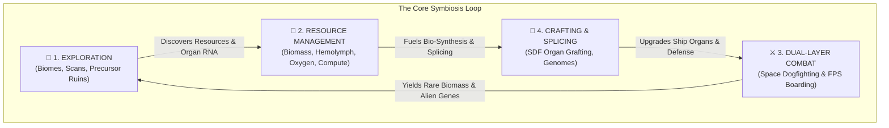

# FOUR_PILLARS_GAMEPLAY_SPEC — The 4 Core Gameplay Pillars

> **Document Identifier**: `BIO-PILLARS-SPEC-2026-V1`  
> **Status**: Institutional Engineering Specification  
> **Authority**: Ciel Council Ratified Specification  
> **Date**: August 2026  
> **Target Scope**: BioGenesis 4-Pillar Core Gameplay Loop (Exploration, Resource Management, Combat, Crafting)

---

## 1. Executive Summary & Master Gameplay Loop

**BioGenesis: Void Symbiosis** is structured around four interconnected gameplay pillars designed specifically for a living, biological starship ecosystem:



---

## 2. Pillar I: 🌌 Exploration (Deep Space Ocean & Biomes)

### 2.1 6-DOF Void Navigation & Sensor Arrays
* **Sensory Eye Pods**: Players navigate deep cosmic vacuum using compound multispectral ocular pods capable of sensing infrared heat trails, gravimetric flux, polarized starlight, and biomorphic electromagnetic signatures.
* **Neuro-Sync Scanning**: Scan resolution scales directly with the pilot's **Neuro-Sync Ratio** ($\mathcal{S} \in [0\%, 100\%]$). At $\mathcal{S} \ge 90\%$, sensor range doubles and hidden gravimetric rift corridors become visible.

### 2.2 Biome Exploration Matrix
1. **Solar Nursery Reefs**: Sunlit asteroid clusters rich in photosynthetic algae and juvenile Void-Fauna. Safe trading, pilot training, and organ grafting.
2. **Hydro-Thermal Nebulae**: Glowing gas clouds with superheated buoyant plumes ($T \ge 1,200\text{ K}$) and thermophilic Leviathans. Requires active spiracle heat venting.
3. **The Neural Graveyard**: Floating skeletal remains of ancient Leviathans ($300\text{m}+$ long). High concentrations of bio-nanites, rare genetic sequences, and parasitic threats.
4. **Precursor Abyssal Vaults**: Monolithic stone-and-tissue bio-brutalist ruins floating in deep void. Unlocks ancient bio-mechanic schematics and primordial organ genes.

---

## 3. Pillar II: 🧪 Resource Gathering & Management (Biomass Economy)

### 3.1 Raw Material Taxonomy
| Resource Class | Examples | Source | Primary Metabolic Usage |
| :--- | :--- | :--- | :--- |
| **Inorganic Ores** | Iron ($\text{Fe}$), Nickel ($\text{Ni}$), Silicon ($\text{Si}$) | Asteroid belts, planetary crusts | Mineralized chitin carapace plates & skeletal vertebrae |
| **Comet Ice** | Water ($H_2O$), Ammonia ($NH_3$), $CO_2$ | Comets, icy rings | Bio-plasma $H_2$ electrolysis, oxygenation, hemolymph volume |
| **Organic Biomass** | Lipids, Proteins, Complex Bio-Polymers | Void-Fauna, space algae | Organ growth, tissue repair, bio-nanite reproduction |
| **Genetic Mutagens** | Epigenetic RNA, Precursor Plasmid Seeds | Apex Leviathans, Vaults | Genome editing, organ splicing, evolution unlocks |

### 3.2 Closed-Loop Metabolic Management
Players balance 5 continuous internal organ pipelines:
1. **Bio-Plasma Power ($H_2O \to H_2$)**: Ingested comet ice is electrolyzed in the *Electrolysis Gland* and stored in the *Muscular Plasma Bladder* ($140\text{ Bar}$) to fuel siphon bio-jets and plasma disruptors.
2. **Hemolymph & Heat ($3\text{ K} \to 310\text{ K}$)**: High-pressure copper-hemocyanin circulation absorbs internal heat and dissipates excess thermal energy through dorsal *Spiracle Gill Vents* ($820\text{ W/m}^2$).
3. **Neural Compute Allocation**: Encephalization Quotient ($\text{EQ}$) generates total compute (bits/s), distributed across sensory pods, weapon glands, and propulsion nozzles via ganglia.
4. **Endosymbiotic Life Support**: Photosynthetic *Bio-Moss Habitats* consume human $CO_2$ and waste, generating $420\text{ L/min}$ breathable $O_2$ and clean water vapor for the crew.
5. **Sub-Dermal Bio-Nanites**: Microscopic nanobots consume raw $\text{Fe/Ni}$ to coagulate hull punctures within seconds ($1.2\text{ m}^3/\text{s}$).

---

## 4. Pillar III: ⚔️ Dual-Layer Combat

### 4.1 Layer 1: Space Combat & Targeted Subsystem Destruction
* **6-DOF Hydro-Pulse Dogfighting**: Siphon bio-jets eject high-impulse expanded gas ($1,700\text{ kN}$), allowing rapid vectoring and high-G maneuvers.
* **Targeted Organ Combat**: Players don't target arbitrary shield points—they target specific enemy organs:
  * Destroying **Eye Pods** blinds enemy sensors.
  * Rupturing **Plasma Bladders** causes catastrophic internal deflagration.
  * Severing **Axon Cords** paralyzes posterior thruster vents.

### 4.2 Layer 2: Internal FPS/TPS Hull & Away-Team Defense
* **Seamless Boarding Actions**: When breached by parasites or boarding Covenant strike-teams, players seamlessly transition to an FPS/TPS internal corridor shooter.
* **Vascular Corridor Combat**: Fight through $2.5\text{m}-4.0\text{m}$ organic tunnels, utilizing soft bio-cover (mucus walls, pulsing muscle tissue) while performing manual emergency organ repairs (clamping arterial leaks, cauterizing necro-spores).

---

## 5. Pillar IV: 🧬 Crafting & Organ Splicing (Bio-Synthesis)

### 5.1 Real-Time SDF Organ Splicing
* **No Static Modules**: Players do not attach rigid steel guns. Instead, using signed distance field smooth-min blending (`organBlending.ts`), players **splice new living organs** directly into their ship's vascular topology:
  * Grafting an additional *Disruptor Gland* onto the cranial section increases plasma firepower but demands higher hemolymph cooling.
  * Growing extra *Bio-Moss Mats* expands life support capacity for larger human away-teams.

```
        Existing Hull SDF ──┐
                            ├──► Polynomial Smooth-Min (smin) ──► Seamless Fillet Mesh
        New Organ SDF  ─────┘
```

### 5.2 Genome Editing & Mutagenic Evolution
* **Chromosome Parameter Vector ($\mathbf{g} \in [0, 1]^N$)**: Using harvested Epigenetic RNA, players mutate their ship's genome loci:
  * Modifying $g[0]$ increases overall ship length ($6\text{m} \to 30\text{m}$).
  * Modifying $g[1]$ thickens chitin carapace armor plates.
  * Modifying $g[4]$ expands the master SDF organ blending radius $k$.
* **Evolutionary Unlocks**: Splicing alien plasmids unlocks specialized organ phenotypes (e.g. *Thermal Refractory Carapace*, *Bio-Kinetic Spore Launchers*, *Bioluminescent Camouflage*).

---

## 6. Integration Matrix Across Systems

| Gameplay Pillar | Core Technical Engine Module | Primary Specification File |
| :--- | :--- | :--- |
| **1. Exploration** | Procedural World Engine & Keplar Solver | [`AAA_PROCEDURAL_WORLD_AND_BIOMES_SPEC.md`](file:///Users/mey/BioGenesis/docs/institutional/AAA_PROCEDURAL_WORLD_AND_BIOMES_SPEC.md) |
| **2. Resource Management** | Closed-Loop Pipeline Engine & Neural Compute | [`AAA_GAMEPLAY_SYSTEMS_DESIGN.md`](file:///Users/mey/BioGenesis/docs/institutional/AAA_GAMEPLAY_SYSTEMS_DESIGN.md) |
| **3. Dual-Layer Combat** | Soft-Body Physics (XPBD) & Rollback Netcode | [`AAA_PHYSICS_AND_TISSUE_DEFORMATION_SPEC.md`](file:///Users/mey/BioGenesis/docs/institutional/AAA_PHYSICS_AND_TISSUE_DEFORMATION_SPEC.md) |
| **4. Crafting & Splicing** | SDF Blending & Chromosome Mutation Pipeline | [`PROCEDURAL_ORGAN_GENETICS_AND_SDF_SPEC.md`](file:///Users/mey/BioGenesis/docs/institutional/PROCEDURAL_ORGAN_GENETICS_AND_SDF_SPEC.md) |

---
*Ratified by Ciel Council of Five — BioGenesis Institutional Specification Suite 2026.*
