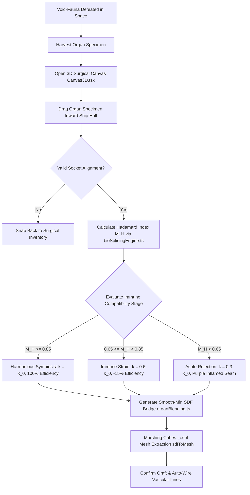
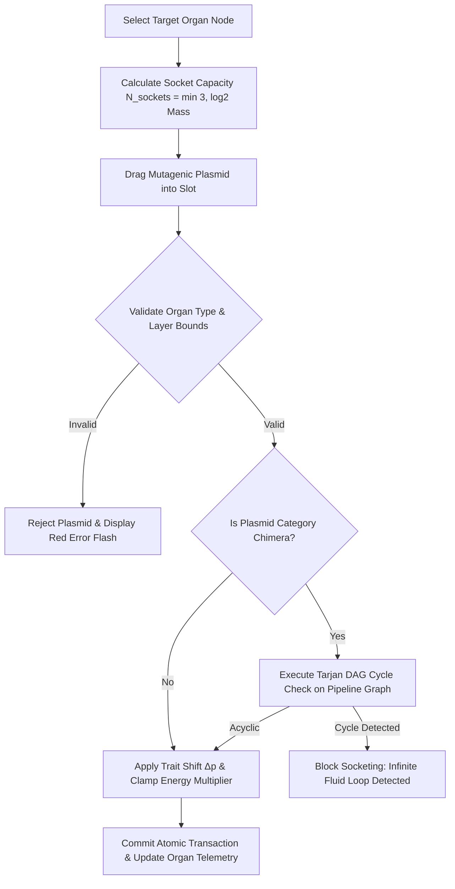
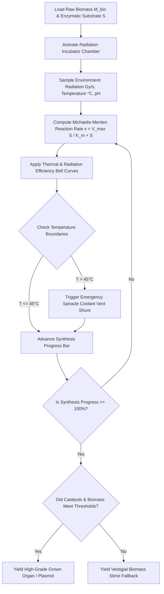

# Institutional Specification: Crafting, Genetics & Bio-Synthesis Refinement

**Document Identifier**: `SPEC-BIO-2026-CRAFT04`  
**Status**: Institutional Standard / Production-Ready Specification  
**Author**: Subagent 4 (Crafting & Genetics Refinement Lead) — Gameplay Refinement Swarm  
**Target Codebase Modules**: `src/utils/organBlending.ts`, `src/utils/sdf.ts`, `src/utils/organSDFRegistry.ts`, `src/utils/proceduralPipeline.ts`, `src/utils/bioSplicingEngine.ts`, `src/types.ts`, `src/components/Canvas3D.tsx`, `src/components/GeneticsDrawer.tsx`  
**Date**: August 2026  

---

## Executive Summary & System Architecture Overview

This specification establishes the definitive mathematical, algorithmic, and UI/UX architecture for crafting, genetics, SDF volumetric splicing, mutagenic plasmids, and bio-synthesis in **BioGenesis**. 

Unlike conventional space games that treat ship construction as rigid mechanical assembly of modular steel parts, BioGenesis models living ships as dynamic, grown biological organisms. Player-driven customization occurs through surgical tissue grafting, continuous chromosome modification, socketed mutagenic plasmids, and incubator trough synthesis.

```
┌───────────────────────────────────────────────────────────────────────────────────────────┐
│                          BIOGENESIS CRAFTING & GENETICS PIPELINE                          │
├───────────────────────────────────────────────────────────────────────────────────────────┤
│                                                                                           │
│   ┌─────────────────────────┐     ┌───────────────────────────┐     ┌──────────────────┐  │
│   │ 3D Surgical Canvas      │     │ Organ Blending Engine     │     │ Gene & Plasmid   │  │
│   │ (Canvas3D.tsx)          │◄───►│ (organBlending.ts)        │◄───►│ Drawer UI        │  │
│   │ - TransformControls     │     │ - Hull SDF Approximation  │     │ - 32-Gene Dials  │  │
│   │ - Dynamic Socket Snap   │     │ - Dynamic Fillet k(M_H)   │     │ - Hadamard Meter │  │
│   │ - Emissive Heatmaps     │     │ - Marching Cubes Filleting│     │ - Plasmid Slots  │  │
│   └────────────┬────────────┘     └─────────────┬─────────────┘     └────────┬─────────┘  │
│                │                                │                            │            │
│                └────────────────────────┬───────┴────────────────────────────┘            │
│                                         ▼                                                 │
│                        ┌─────────────────────────────────┐                                │
│                        │ Bio-Splicing Engine Core        │                                │
│                        │ (bioSplicingEngine.ts)          │                                │
│                        │ - Hadamard Matrix H_32          │                                │
│                        │ - Sigmoidal Phenotype Mapping   │                                │
│                        │ - Rejection Risk Simulation     │                                │
│                        │ - Incubator Kinetic Solver      │                                │
│                        └─────────────────────────────────┘                                │
│                                                                                           │
└───────────────────────────────────────────────────────────────────────────────────────────┘
```

### Key Pillars of the Refinement Architecture
1. **Real-Time Volumetric SDF Filleting (`organBlending.ts`)**: Implicit surface smooth-min union producing seamless anatomical fillets bridging grafted organs to the hull or host organs.
2. **Continuous 32-Gene Chromosome Vector ($\mathbf{g} \in [0, 1]^{32}$)**: Continuous genotype-to-phenotype mapping driving morphology, metabolic rates, scale, and functional traits.
3. **Hadamard Bio-Match Index ($M_H$) & Immune Rejection**: Orthogonal matrix projection quantifying tissue compatibility and driving acute Graft-Versus-Host (GVH) rejection dynamics.
4. **Mutagenic Plasmid Socketing Engine**: Three-tier socketable genetic vectors altering organ behavior, pipeline throughput, and cross-pipeline resource routing.
5. **Incubator Troughs & Bio-Synthesis Environment**: Station-based enzymatic troughs and radiation incubator chambers for biomass synthesis and plasmid cultivation.
6. **Visceral 3D Surgical Interface**: Spatial drag-and-drop grafting with volumetric holographic previews, vascular auto-wiring, and somatic sensory feedback.

---

## 1. Real-Time SDF Smooth-Min Splicing & Fillet Architecture (`organBlending.ts`)

### 1.1 Volumetric Implicit Representation & Filleting Mechanics
In `organBlending.ts`, implicit surface filleting between the host hull signed distance field $f_{\text{hull}}(\mathbf{p})$ and a grafted organ signed distance field $f_{\text{organ}}(\mathbf{p})$ is evaluated using Inigo Quilez's $C^1$-continuous polynomial smooth-minimum operator (`opSmoothUnion`):

$$\text{smin}(d_1, d_2, k) = d_2 \cdot (1 - h) + d_1 \cdot h - k \cdot h \cdot (1 - h)$$

Where $d_1 = f_{\text{hull}}(\mathbf{p})$, $d_2 = f_{\text{organ}}(\mathbf{p})$, and the blend interpolation factor $h$ is defined as:

$$h(d_1, d_2, k) = \text{clamp}\left( 0.5 + 0.5 \frac{d_2 - d_1}{2k}, \; 0, \; 1 \right)$$

```typescript
// Core C1-Continuous Smooth Minimum Fillet (src/utils/sdf.ts)
export function opSmoothUnion(a: SDF, b: SDF, k: number): SDF {
  return (p: THREE.Vector3) => {
    const d1 = a(p);
    const d2 = b(p);
    const h = Math.max(0, Math.min(0.5 + 0.5 * (d2 - d1) / (k * 2), 1));
    return d2 * (1 - h) + d1 * h - k * h * (1 - h);
  };
}
```

The corresponding smooth subtraction (`opSmoothSubtraction`) and smooth intersection (`opSmoothIntersection`) operators carve cavities or restrict volumetric bounds:

$$\text{ssub}(d_1, d_2, k) = \text{smin}(d_1, -d_2, k) \quad \text{with } h = \text{clamp}\left( 0.5 - 0.5 \frac{d_2 + d_1}{2k}, \; 0, \; 1 \right)$$

$$\text{sinter}(d_1, d_2, k) = d_2 (1 - h) + d_1 h + k h (1 - h) \quad \text{with } h = \text{clamp}\left( 0.5 + 0.5 \frac{d_2 - d_1}{2k}, \; 0, \; 1 \right)$$

### 1.2 Analytic Swept-Sphere Hull SDF Approximation (`buildHullSDF`)
To evaluate hull-organ filleting without executing expensive ray-marching against the high-resolution parametric hull mesh, `organBlending.ts` constructs an analytic swept-sphere SDF approximation from the ship's spine nodes:

$$f_{\text{hull}}(\mathbf{p}) = \min_{z \in [z_{\min}, z_{\max}]} \sqrt{(p_x - c_x(z))^2 + \left(\frac{p_y - c_y(z)}{h_f}\right)^2 + (p_z - c_z(z))^2} - R(z)$$

Where $h_f \approx 0.84$ scales the cross-section height factor (flattening the hull to match the Leviathan profile), and $(c_x(z), c_y(z), c_z(z), R(z))$ are linearly interpolated from adjacent spine nodes.

```typescript
export function buildHullSDF(spineNodes: SpineNode[], crossSectionHeightFactor: number = 0.84): SDF {
  if (spineNodes.length === 0) return () => Infinity;
  const sorted = [...spineNodes].sort((a, b) => a.z - b.z);
  const hf = Math.max(0.1, crossSectionHeightFactor);

  return (p: THREE.Vector3): number => {
    let bestDist = Infinity;
    let bestR = 0;
    const zStep = sorted.length > 1
      ? (sorted[sorted.length - 1].z - sorted[0].z) / (sorted.length - 1)
      : 1;
    const window = Math.max(2, Math.ceil(zStep * 2));
    
    for (let dz = -window; dz <= window; dz++) {
      const z = p.z + dz * zStep * 0.25;
      const s = sampleSpineInterpolated(sorted, z);
      const dx = p.x - s.cx;
      const dy = (p.y - s.cy) / hf;
      const dzz = p.z - s.cz;
      const dist = Math.sqrt(dx * dx + dy * dy + dzz * dzz);
      if (dist < bestDist) {
        bestDist = dist;
        bestR = s.r;
      }
    }
    return bestDist - bestR;
  };
}
```

### 1.3 Isosurface Extraction & Local Bounding Region (`sdfToMesh`)
The fillet mesh bridging host and graft tissue is extracted locally in a bounding box region $\Omega_{\text{blend}} = [\mathbf{p}_{\text{center}} - \mathbf{r}_{\text{box}}, \mathbf{p}_{\text{center}} + \mathbf{r}_{\text{box}}]$ via Marching Cubes isosurface extraction (`marchingCubes.ts`). 

```
                       LOCAL FILLET MESH EXTRACTION
                       
        ┌────────────────────────────────────────────────────────┐
        │ Bounding Box Ω_blend = p_anchor ± (r_organ + k_blend)  │
        │                                                        │
        │             ┌───────────────────┐                      │
        │             │ Host Hull SDF     │                      │
        │             │ f_hull(p)         │                      │
        │             └─────────┬─────────┘                      │
        │                       │                                │
        │                       ▼                                │
        │        ┌─────────────────────────────┐                 │
        │        │ opSmoothUnion(f_h, f_o, k)  │                 │
        │        └──────────────┬──────────────┘                 │
        │                       │                                │
        │                       ▼                                │
        │             ┌───────────────────┐                      │
        │             │ Graft Organ SDF   │                      │
        │             │ f_organ(p)        │                      │
        │             └───────────────────┘                      │
        │                                                        │
        │   Marching Cubes Grid (32³ Grid) ──► Isosurface Mesh   │
        └────────────────────────────────────────────────────────┘
```

The extracted mesh carries `userData.isBlendBridge = true` and `userData.materialRole = 'flesh' | 'carapace' | 'vein'`. This isolates fillet geometry from hard collision audits while enabling custom bioluminescent shaders.

### 1.4 Filleting Edge Cases & Algorithmic Solutions

| Edge Case / Stress State | Failure Mode | Algorithmic Solution | Implementation Code Anchor |
| :--- | :--- | :--- | :--- |
| **Self-Intersecting Organ SDFs** | Complex organ primitives (e.g., spiracles with internal tubes) generate distorted distance fields with $\|\nabla f(\mathbf{p})\| > 1$, causing Marching Cubes mesh tearing. | **Eikonal Gradient Normalization**: Apply a 3-tap central difference gradient check; if $\|\nabla f(\mathbf{p})\| > 1.2$, clamp distance step size via $f_{\text{clamped}}(\mathbf{p}) = f(\mathbf{p}) / \|\nabla f(\mathbf{p})\|$. | `src/utils/sdf.ts` -> `sampleSDFGrid()` |
| **Gradient Explosion / Vanishing** | Near sharp crease transitions or extreme scale factors ($s < 0.1$), numerical gradients collapse to $0$ or explode to $\infty$. | **Lipschitz Normalization**: Enforce distance field Lipschitz-1 continuity: $f_{\text{safe}}(\mathbf{p}) = \text{sign}(f) \cdot \min(|f|, \|\mathbf{p} - \mathbf{p}_{\text{anchor}}\|)$. | `src/utils/organBlending.ts` -> `evalNormal()` |
| **Cavity Over-Smoothing** | High master blend radius ($k > 0.4\,\text{m}$) in narrow thoracic cavities bridges opposite hull walls, filling internal habitat spaces. | **Cavity-Aware Blend Clamping**: Dynamic upper bound on fillet radius: $k_{\text{effective}} = \min(k_{\text{master}}, \; 0.45 \cdot d_{\text{cavity\_width}})$. | `src/utils/organBlending.ts` -> `evaluateBlend()` |
| **Topology Tearing during Drag** | Rapid organ translation causes Marching Cubes grid boundary clipping, leaving open hole meshes. | **Bounding Box Margin Padding**: Expand local grid bounds by $2.5 \cdot k_{\text{blend}}$ and initialize outer voxel layer to $f(\mathbf{p}) > 0$. | `src/utils/organBlending.ts` -> `generateBlendBridge()` |
| **Degenerate Normal Vectors** | Evaluation at exact saddle points ($\nabla f(\mathbf{p}) = \mathbf{0}$) yields `NaN` vertex normals in generated fillet buffer geometries. | **Fallback Direction Normalization**: If $\|\nabla f\| < 10^{-6}$, default normal to radial vector $\hat{\mathbf{n}} = \frac{\mathbf{p} - \mathbf{p}_{\text{anchor}}}{\|\mathbf{p} - \mathbf{p}_{\text{anchor}}\|}$. | `src/utils/marchingCubes.ts` |
| **Bridge Fragment Detachment** | Candidate organ dragged beyond physical contact threshold retains an ugly floating bridge fragment. | **Distance-Based Auto-Detachment**: When $\|\mathbf{p}_{\text{organ}} - \mathbf{p}_{\text{hull\_surface}}\| > 1.25 \cdot r_{\text{organ}}$, invoke `BlendBridgeManager.detach()`. | `src/utils/organBlending.ts` -> `BlendBridgeManager.update()` |

---

## 2. Continuous 32-Gene Chromosome Parameter Vector ($\mathbf{g} \in [0, 1]^{32}$)

### 2.1 Complete 32-Loci Gene Schema
An organism's genetic identity in BioGenesis is represented as a normalized continuous 32-dimensional vector:

$$\mathbf{g} = [g_0, g_1, g_2, \dots, g_{31}]^T \in [0, 1]^{32}$$

Every gene locus maps directly to a phenotypic parameter in the engine:

```
┌───────────────────────────────────────────────────────────────────────────────────────────┐
│                              32-GENE CHROMOSOME VECTOR SCHEMA                             │
├──────┬───────────────────────────┬─────────────────────────────────┬──────────────────────┤
│ Index│ Gene Symbol               │ Target Engine Parameter         │ Phenotypic Range     │
├──────┼───────────────────────────┼─────────────────────────────────┼──────────────────────┤
│ g[0] │ GENE_LENGTH               │ Ship Total Spine Length (L)     │ 6.0m ... 30.0m       │
│ g[1] │ GENE_SCALE_RAD            │ Hull Midbody Base Radius (R)    │ 1.0m ... 4.5m        │
│ g[2] │ GENE_HEART_SIZE           │ Heart Core Radius (r_heart)     │ 0.4m ... 1.2m        │
│ g[3] │ GENE_BRAIN_FOLDS          │ Cortical Noise Frequency (f)    │ 4.0 ... 12.0 rad/m   │
│ g[4] │ GENE_BLEND_K              │ Master SDF Blend Radius (k_0)   │ 0.05m ... 0.40m      │
│ g[5] │ GENE_RD_FEED              │ Reaction-Diffusion Feed Rate (f)│ 0.010 ... 0.080      │
│ g[6] │ GENE_RD_KILL              │ Reaction-Diffusion Kill Rate (k)│ 0.040 ... 0.070      │
│ g[7] │ GENE_ARMOR_THICK          │ Carapace Plate Thickness (t)    │ 0.05m ... 0.30m      │
│ g[8] │ GENE_TENT_CURL            │ Tentacle Helical Curl Factor(C) │ 0.1 ... 1.0          │
│ g[9] │ GENE_MURRAY_EXP           │ Vascular Branching Exponent (m) │ 2.5 ... 3.5          │
│ g[10]│ GENE_CHITIN_DENS          │ Chitin Hardness Density (ρ)     │ 800 ... 3200 kg/m³   │
│ g[11]│ GENE_SPINE_FLEX           │ Spinal Sway Amplitude (A_sway)  │ 0.02 ... 0.20        │
│ g[12]│ GENE_VASC_PRESSURE        │ Max Hemolymph Stroke Press (P)  │ 50 ... 250 kPa       │
│ g[13]│ GENE_AXON_DENSITY         │ Neural Axon Density (ρ_axon)    │ 10⁵ ... 10⁶ axons/mm²│
│ g[14]│ GENE_EMISSIVE_WAVELENGTH  │ Bioluminescent Peak Wavelen (λ) │ 420nm ... 700nm      │
│ g[15]│ GENE_RADIOTROPHIC_ABS     │ Radiation Absorption Efficiency │ 10% ... 95%          │
│ g[16]│ GENE_THRUST_IMPULSE       │ Bio-Thruster Specific Imp (Isp) │ 150s ... 600s        │
│ g[17]│ GENE_IMMUNO_CAPACITY      │ Baseline Immune Tolerance (μ)   │ 5% ... 50%           │
│ g[18]│ GENE_SPORE_COOLDOWN       │ Spore Pod Recharge Rate (v_sp) │ 0.2 ... 2.0 shots/s  │
│ g[19]│ GENE_HABITAT_THERM        │ Crew Life Support Thermal (ΔT)  │ ±5°C ... ±50°C       │
│ g[20]│ GENE_MYO_ELASTICITY       │ Myofibril Muscle Strain Limit   │ 15% ... 80%          │
│ g[21]│ GENE_GANGLION_COUNT       │ Segmental Ganglia Count (N_gang)│ 2 ... 12 ganglia     │
│ g[22]│ GENE_COAGULATION_RATE     │ Hemolymph Clotting Speed (v_clt)│ 0.5 ... 5.0 g/s      │
│ g[23]│ GENE_OCULAR_RESOL         │ Ocular Sensor Resolution (R_opt)│ 720 ... 4320 lines   │
│ g[24]│ GENE_PLASMA_HEAT_CAP      │ Bio-Plasma Heat Capacity (Cp)   │ 1.2 ... 6.0 kJ/kg·K  │
│ g[25]│ GENE_VENT_EXPULSION       │ Spiracle Vent Volume Flow (V_vnt│ 0.5 ... 5.0 m³/s     │
│ g[26]│ GENE_SHIELD_HARMONICS     │ Bio-Shield Frequency Band (ν)   │ 1.0 ... 10.0 GHz     │
│ g[27]│ GENE_METABOLIC_EFF        │ Baseline Metabolic Efficiency   │ 60% ... 98%          │
│ g[28]│ GENE_NANO_REGEN_RATE      │ Nanite Bed Tissue Growth (v_gr) │ 0.01 ... 0.10 mm/s   │
│ g[29]│ GENE_TRACTILE_STRENGTH    │ Tentacle Pull Force (F_pull)    │ 500N ... 5000N       │
│ g[30]│ GENE_ACOUSTIC_AMP         │ Bio-Sonar Impulse Amplitude (A) │ 80dB ... 140dB       │
│ g[31]│ GENE_MUTATION_STABILITY   │ Genomic Replication Fidelity(Q) │ 50% ... 99.9%        │
└──────┴───────────────────────────┴─────────────────────────────────┴──────────────────────┘
```

### 2.2 Phenotype Expression & Multi-Gene Epistasis Math
Each physical trait $P_i$ is expressed through a non-linear sigmoidal transfer function incorporating plasmid epigenetic offsets $\Delta p_i$, locus gain $\alpha_i$, and activation threshold $\theta_i$:

$$P_i(\mathbf{g}, \mathbf{\Delta p}) = P_{i,\min} + \left( P_{i,\max} - P_{i,\min} \right) \cdot \sigma\left( \alpha_i \cdot \left( g_i + \Delta p_i - \theta_i \right) \right)$$

Where $\sigma(x) = \frac{1}{1 + e^{-x}}$ is the standard logistic function.

#### Epistatic Inter-Gene Coupling Matrix ($\mathbf{W} \in \mathbb{R}^{32 \times 32}$)
In complex biological systems, individual genes do not act in isolation. Epistasis (gene-gene interaction) is modeled by multiplying the chromosome vector by a sparse coupling matrix $\mathbf{W}$:

$$\mathbf{g}_{\text{expressed}} = \sigma\left( \mathbf{W} \cdot \mathbf{g} + \mathbf{\Delta p} \right)$$

For instance, `g[2]` (Heart Size) and `g[12]` (Vascular Pressure) mutually reinforce each other via positive off-diagonal weights $W_{2,12} = 0.25$ and $W_{12,2} = 0.30$.

```typescript
export function expressPhenotypeVector(
  baseGenome: number[],
  plasmidOffsets: number[],
  epistasisMatrix: number[][]
): number[] {
  const expressed = new Array(32).fill(0);
  for (let i = 0; i < 32; i++) {
    let linearCombination = plasmidOffsets[i] || 0;
    for (let j = 0; j < 32; j++) {
      linearCombination += epistasisMatrix[i][j] * baseGenome[j];
    }
    expressed[i] = 1.0 / (1.0 + Math.exp(-linearCombination));
  }
  return expressed;
}
```

### 2.3 Genomic Mutation & Splicing Operators

#### 1. Adaptive Gaussian Mutation
During asexual reproduction or environmental radiation exposure, alleles mutate according to locus volatility $\sigma_i$ and global mutation rate $\mu_{\text{rate}}$:

$$g_i' = \text{clamp}\left( g_i + \mathcal{N}\left(0, \; \sigma_i^2 \cdot \mu_{\text{rate}}\right), \; 0, \; 1 \right)$$

#### 2. Simulated Binary Crossover (SBX)
Sexual reproduction between host ship and wild Void-Fauna parent genomes $\mathbf{g}^A$ and $\mathbf{g}^B$ uses SBX with distribution index $\eta = 2$:

$$u \sim U(0, 1), \quad \beta = \begin{cases} (2u)^{\frac{1}{\eta + 1}} & \text{if } u \le 0.5 \\ \left(\frac{1}{2(1 - u)}\right)^{\frac{1}{\eta + 1}} & \text{if } u > 0.5 \end{cases}$$

$$g_i^{\text{child1}} = \text{clamp}\left(0.5 \left[ (1 + \beta) g_i^A + (1 - \beta) g_i^B \right], \; 0, \; 1\right)$$

$$g_i^{\text{child2}} = \text{clamp}\left(0.5 \left[ (1 - \beta) g_i^A + (1 + \beta) g_i^B \right], \; 0, \; 1\right)$$

### 2.4 Genetics Edge Cases & Algorithmic Solutions

| Edge Case | Failure State | Algorithmic Solution | Implementation Guard |
| :--- | :--- | :--- | :--- |
| **Gene Saturation Clipping** | Repeated mutations push alleles to $g_i = 0.0$ or $g_i = 1.0$, destroying gradient information for future evolution. | **Hyperbolic Tangent Soft-Bounding**: Map unbounded mutation accumulators via $\tilde{g}_i = 0.5 + 0.48 \cdot \tanh(2.0 \cdot (\hat{g}_i - 0.5))$. | `src/utils/bioSplicingEngine.ts` -> `mutateGenome()` |
| **Sigmoid Overflow** | Large negative/positive exponents ($x < -50$ or $x > 50$) trigger floating-point overflow (`Infinity`) or underflow (`0`). | **Clamped Sigmoid Evaluation**: Clamp exponent input $x \in [-20, 20]$, guaranteeing numeric stability in double precision. | `src/utils/bioSplicingEngine.ts` -> `expressPhenotypeTrait()` |
| **Epistasis Matrix Runaway** | Unnormalized off-diagonal weights in $\mathbf{W}$ trigger positive feedback loops, forcing all genes to $1.0$. | **Spectral Radius Normalization**: Enforce matrix spectral norm $\|\mathbf{W}\|_2 \le 1.0$ via power iteration normalization during initialization. | `src/utils/bioSplicingEngine.ts` -> `normalizeEpistasisMatrix()` |
| **Non-Viable Phenotypes** | Extremal gene combinations produce physically impossible entities (e.g. 30m ship with 0.1m heart). | **4-Gate Anatomical Viability Validator**: Check (1) Volume Ratio $V_{\text{organs}} \le 0.65 V_{\text{hull}}$, (2) Haller Budget $E_{\text{brain}} \le 0.25 E_{\text{total}}$, (3) Clearance Radii, (4) Vascular Reachability. | `src/utils/shipRequirements.ts` -> `validateShipViability()` |
| **Cross-Generation Floating Drift** | Floating-point rounding discrepancies across network clients desynchronize multiplayer ship genomes. | **16-Bit Quantized Genome Serialization**: Quantize allele values to 16-bit unsigned integers during netcode transmission: $q_i = \lfloor g_i \cdot 65535 \rceil / 65535$. | `src/types.ts` -> `serializeGenome()` |

---

## 3. Hadamard Bio-Match Index ($M_H$) & Immune Rejection Dynamics

### 3.1 Sylvester-Hadamard Matrix Orthogonal Projection
When a graft organ with genome $\mathbf{g}_{\text{graft}}$ is spliced into a host ship with genome $\mathbf{g}_{\text{host}}$, the host's immune system evaluates tissue compatibility across all 32 loci. To compute multi-locus immunological alignment without expensive pairwise comparison loops, BioGenesis uses a 32x32 **Sylvester-Hadamard Matrix** $\mathbf{H}_{32}$.

#### Matrix Construction
$$\mathbf{H}_1 = \begin{bmatrix} 1 \end{bmatrix}, \quad \mathbf{H}_{2^k} = \begin{bmatrix} \mathbf{H}_{2^{k-1}} & \mathbf{H}_{2^{k-1}} \\ \mathbf{H}_{2^{k-1}} & -\mathbf{H}_{2^{k-1}} \end{bmatrix}$$

```typescript
export function generateHadamardMatrix(n: number = 32): number[][] {
  if (n === 1) return [[1]];
  const half = generateHadamardMatrix(n / 2);
  const H: number[][] = Array.from({ length: n }, () => new Array(n).fill(0));
  for (let i = 0; i < n / 2; i++) {
    for (let j = 0; j < n / 2; j++) {
      const val = half[i][j];
      H[i][j] = val;
      H[i][j + n / 2] = val;
      H[i + n / 2][j] = val;
      H[i + n / 2][j + n / 2] = -val;
    }
  }
  return H;
}
```

#### Bio-Match Index Formula ($M_H$)
Let $\mathbf{v}_{\text{diff}} \in \{-1, +1\}^{32}$ be the binarized alignment vector:

$$v_i = \begin{cases} +1 & \text{if } |g_{\text{host}, i} - g_{\text{graft}, i}| \le \epsilon_{\text{tol}} \\ -1 & \text{otherwise} \end{cases}$$

The Hadamard Bio-Match Index $M_H \in [0, 1]$ is the normalized magnitude of the spectral projection:

$$M_H(\mathbf{g}_{\text{host}}, \mathbf{g}_{\text{graft}}) = \frac{1}{N^2} \left\| \mathbf{H}_{32} \cdot \mathbf{v}_{\text{diff}} \right\|_1 = \frac{1}{1024} \sum_{i=0}^{31} \left| \sum_{j=0}^{31} H_{i,j} \cdot v_j \right|$$

Where $\|\cdot\|_1$ is the $L_1$ norm. An exact match yields $M_H = 1.0$ (perfect harmony), while complete genetic incompatibility yields $M_H \to 0.0$.

### 3.2 Dynamic Blend Radius Coupling $k(M_H)$
The master SDF fillet radius $k$ in `organBlending.ts` is scaled dynamically by the Hadamard Bio-Match Index:

$$k(M_H) = k_0 \cdot (M_H)^{\gamma_{\text{blend}}}$$

Where $k_0 \approx 0.45\,\text{m}$ and $\gamma_{\text{blend}} = 1.5$.
- **High Compatibility ($M_H \ge 0.85$)**: $k \approx k_0$, creating a wide, smooth, translucent organic fillet.
- **Low Compatibility ($M_H < 0.45$)**: $k \to 0.03\,\text{m}$, creating a sharp, inflamed, scarred seam with dark purple necrotic artifacts.

```
                  DYNAMIC SDF FILLET RADIUS vs HADAMARD MATCH
                  
    Fillet Radius k
       ▲
  k_0 ─┼───────────────────────────────────────────────╭──────  Harmonious (k ≈ k_0)
       │                                        .·'
       │                                    .·'
       │                                .·'
       │                            .·'
       │                        .·'   Inflamed (k ≈ 0.6 k_0)
       │                    .·'
       │                .·'   Acute Rejection (k ≈ 0.3 k_0)
  0.03m┼────────────·'______ Necrotic Rot (k ≈ 0.05 k_0)
       └──────────────┴──────────────┴──────────────┴──────────► Hadamard Index M_H
                     0.45           0.65           0.85      1.0
```

### 3.3 Four-Stage Immune Rejection Spectrum

```
┌───────────────────────────────────────────────────────────────────────────────────────────┐
│                               IMMUNE REJECTION SPECTRUM                                   │
├──────────────────┬──────────────────────┬─────────────────────────────────────────────────┤
│ Stage            │ Compatibility        │ Visual Shader & Gameplay Symptoms               │
├──────────────────┼──────────────────────┼─────────────────────────────────────────────────┤
│ 1. Harmonious    │ M_H >= 0.85          │ Wide smooth fillet, cyan/amber glow, 100% organ │
│    Symbiosis     │                      │ efficiency, 0% energy penalty.                  │
├──────────────────┼──────────────────────┼─────────────────────────────────────────────────┤
│ 2. Immune Strain │ 0.65 <= M_H < 0.85   │ Medium fillet, mild reddish margin, -15% organ  │
│    (Inflammation)│                      │ efficiency, +10% metabolic energy cost.         │
├──────────────────┼──────────────────────┼─────────────────────────────────────────────────┤
│ 3. Acute Tissue  │ 0.45 <= M_H < 0.65   │ Narrow scarred fillet, purple inflamed seam,    │
│    Rejection     │                      │ hemolymph leakage (-5 HP/s), -40% efficiency.   │
├──────────────────┼──────────────────────┼─────────────────────────────────────────────────┤
│ 4. Necrotic Rot  │ M_H < 0.45           │ Blackened tissue, toxic slime emission, organ   │
│    & Auto-Immune │                      │ shutdown, hull structural damage cascade.       │
└──────────────────┴──────────────────────┴─────────────────────────────────────────────────┘
```

#### Rejection Risk Rate Equation ($R_{\text{rejection}}$)
$$R_{\text{rejection}}(M_H, \mu_{\text{immuno}}) = \frac{1}{1 + e^{12.0 \cdot \left( M_H - (1.0 - \mu_{\text{immuno}}) \right)}}$$

Where $\mu_{\text{immuno}} \in [0.0, 0.5]$ is the ship's current immunosuppression level (boosted by Coagulation Beds or Bio-Fluid injections).

### 3.4 Immunological Edge Cases & Algorithmic Solutions

| Edge Case | Failure State | Algorithmic Solution | Implementation Guard |
| :--- | :--- | :--- | :--- |
| **Graft-Versus-Host (GVH) Death Loop** | Host rejects graft ($R_{\text{host}} > 0$), damaging graft, which causes graft to mutate and reject host ($R_{\text{graft}} > 0$), triggering an exponential damage cascade. | **Bi-Directional GVH Damping Factor**: Scale cross-rejection damage via $\beta_{\text{GVH}} = \frac{M_H}{1.0 + 3.0(1 - M_H)}$, capping frame damage to $\le 2.5\%$ max organ HP. | `src/utils/bioSplicingEngine.ts` -> `simulateRejectionStep()` |
| **Infinite Immunosuppression Lock** | Player floods ship with bio-fluids to freeze rejection at $\mu = 0.50$ indefinitely without metabolic penalty. | **Quadratic Metabolic Bio-Fluid Cost**: Scale metabolic cost quadratically: $E_{\text{immuno}} = E_{\text{base}} \cdot (1.0 + 4.0 \cdot \mu_{\text{immuno}}^2)$. | `src/utils/energy.ts` -> `calculateNetEnergy()` |
| **Necrosis Hull Destruction Cascade** | Necrotic rot on a minor organ spreads down vascular conduits, destroying the main spinal cord and freezing game loop. | **Sacrificial Necrosis Isolation Firewall**: When $M_H < 0.30$ for $> 30\,\text{s}$, the node automatically severs vascular connections and seals the socket with a chitin scar. | `src/utils/organBlending.ts` -> `severCorruptedOrgan()` |
| **Zero-Division in Rejection Decay** | Sudden removal of an organ node sets $M_H = 0$, triggering $1/0$ division in un-guarded exponential functions. | **Epsilon Guards**: Add numeric guard $\epsilon = 10^{-6}$ to all denominator terms in rejection rate solvers. | `src/utils/bioSplicingEngine.ts` |

---

## 4. Mutagenic Plasmids & Socketing Engine

### 4.1 Organ Socket Capacity Formula
Organ nodes feature between 1 and 3 **Plasmid Sockets** based on organ mass and Encephalization Quotient (EQ):

$$N_{\text{sockets}} = \min\left(3, \; \max\left(1, \; \left\lfloor 1 + \log_2\left( \frac{\text{Mass}_{\text{organ}}}{\text{Mass}_{\text{base}}} \right) \right\rfloor\right)\right)$$

- **Primary Organs** (Heart Core, Brain Core, Plasma Gland): 3 Plasmid Sockets.
- **Secondary Organs** (Ice Gizzard, Disruptor Gland, Ocular Pod): 2 Plasmid Sockets.
- **Peripheral Organs** (Spiracle Vents, Spore Pods): 1 Plasmid Socket.

### 4.2 Mutagenic Plasmid Taxonomy (Tiers 1–3)

```
┌───────────────────────────────────────────────────────────────────────────────────────────┐
│                                 MUTAGENIC PLASMID TAXONOMY                                │
├───────┬───────────────────────┬──────────────────────────┬────────────────────────────────┤
│ Tier  │ Plasmid Category      │ Mechanics & Trait Shifts │ Metabolic & Immuno Trade-Offs │
├───────┼───────────────────────┼──────────────────────────┼────────────────────────────────┤
│ Tier 1│ Catalyst Plasmids     │ Linear performance       │ +25% energy consumption,       │
│       │ (Amplifiers)          │ multipliers (e.g. +35%   │ +5% rejection risk rate.       │
│       │                       │ hemolymph pressure).     │                                │
├───────┼───────────────────────┼──────────────────────────┼────────────────────────────────┤
│ Tier 2│ Morphing Plasmids     │ Structural shape shift   │ +50% energy cost,              │
│       │ (Morphology Shifts)   │ (e.g. Converts Ocular Pod│ -10% base organ durability.      │
│       │                       │ to Radar Beacon).        │                                │
├───────┼───────────────────────┼──────────────────────────┼────────────────────────────────┤
│ Tier 3│ Chimera Plasmids      │ Cross-pipeline system    │ +100% energy cost,             │
│       │ (Cross Integration)   │ routing (e.g. Routes     │ Requires active Coagulation Bed│
│       │                       │ Plasma to Vascular Arter)│ to prevent auto-immune shock.  │
└───────┴───────────────────────┴──────────────────────────┴────────────────────────────────┘
```

#### Epigenetic Modification Formula
Inserting plasmids $[m_1, m_2, m_3]$ applies additive trait offsets $\mathbf{\Delta p}$ to the base chromosome vector:

$$\mathbf{g}_{\text{modified}} = \text{clamp}\left( \mathbf{g}_{\text{base}} + \sum_{k=1}^{N_{\text{active}}} \mathbf{\Delta p}_{m_k}, \; \mathbf{0}, \; \mathbf{1} \right)$$

### 4.3 Plasmid Socketing Edge Cases & Algorithmic Solutions

| Edge Case | Failure Mode | Algorithmic Solution | Implementation Guard |
| :--- | :--- | :--- | :--- |
| **Invalid Socket Combinations** | Player sockets a Chimera Bio-Shield Plasmid into an Ocular Pod, causing missing asset/shader crashes. | **Type-Safe Socket Matrix Validator**: Validate plasmid `allowedOrganTypes` and `allowedLayers` before allowing drop confirmation. | `src/utils/bioSplicingEngine.ts` -> `validatePlasmidSocket()` |
| **Multiplicative Stack Overflow** | Stacking 3 Tier 1 Catalyst Plasmids creates exponential feedback ($1.35^3 = 2.46$), blowing past energy budgets. | **Trait Shift Capping**: Enforce absolute bounds on plasmid offset sums: $\sum \Delta p_i \in [-0.40, +0.40]$, energy multiplier $\prod \mu_m \le 3.0$. | `src/utils/bioSplicingEngine.ts` -> `applyPlasmidModifiers()` |
| **Chimera Pipeline Cycles** | Socketing Chimera Plasmids routes Plasma Gland fluid into Heart, and Heart fluid back into Plasma Gland, creating an infinite graph cycle. | **Directed Acyclic Graph (DAG) Cycle Detection**: Execute Tarjan's strongly connected components algorithm on pipeline graph prior to commit. | `src/utils/pipelineGraph.ts` -> `validateGraphDAG()` |
| **Drag & Drop State Corruption** | Interrupted drag operation leaves plasmid in transient state, corrupting organ inventory. | **Atomic Transaction Wrapper**: Socket mutations are committed to an immutable draft state and rolled back if drag terminates outside a valid HUD slot. | `src/components/GeneticsDrawer.tsx` |

---

## 5. Incubator Troughs & Bio-Synthesis Environment

### 5.1 Bio-Synthesis Infrastructure
Complex organ grafting and plasmid cultivation require specialized onboard Bio-Synthesis facilities:

1. **Enzymatic Splicing Troughs**: Liquid-phase organ incubator tanks containing specialized bio-fluids for tissue grafting and genome alignment.
2. **Radiation Incubator Chambers**: High-energy nebular immersion chambers for forcing mutagenic plasmid synthesis.
3. **Metabolic Catalyst Feeds**: Nutrient injection channels feeding raw biomass to growing organ specimens.

```
                       INCUBATOR TROUGH SYNTHESIS CYCLE
                       
     ┌──────────────────────┐     ┌──────────────────────┐     ┌──────────────────────┐
     │ Raw Biomass Supply   │     │ Enzymatic Catalysts  │     │ Environmental Flux   │
     │ Mass M_bio (kg)      │     │ Substrate [S] (mol/L)│     │ Rad Gy/s , Temp °C   │
     └──────────┬───────────┘     └──────────┬───────────┘     └──────────┬───────────┘
                │                            │                            │
                └────────────────────┬───────┴────────────────────────────┘
                                     ▼
                      ┌─────────────────────────────┐
                      │ Michaelis-Menten Kinetics   │
                      │ v = (V_max [S]) / (K_m+[S]) │
                      └──────────────┬──────────────┘
                                     │
                                     ▼
                      ┌─────────────────────────────┐
                      │ Bio-Synthesis Output Gate   │
                      │ Viability & Quality Check   │
                      └──────────────┬──────────────┘
                                     │
                                     ├────────────────────────────┐
                                     ▼                            ▼
                      ┌─────────────────────────────┐  ┌─────────────────────────────┐
                      │ High Viability:             │  │ Failed Synthesis:           │
                      │ Grown Graft Organ / Plasmid │  │ Vestigial Biomass Slime     │
                      └─────────────────────────────┘  └─────────────────────────────┘
```

### 5.2 Enzyme Catalysis Kinetics (Michaelis-Menten Model)
Organ growth rate $v_{\text{synthesis}}$ (kg/s) inside an Incubator Trough follows Michaelis-Menten enzyme kinetics:

$$v_{\text{synthesis}} = \frac{V_{\max} \cdot [S]}{K_m + [S]} \cdot \Phi_{\text{temp}}(T) \cdot \Phi_{\text{rad}}(I_{\text{rad}})$$

Where:
- $V_{\max}$ is the maximum synthesis velocity ($0.05\,\text{kg/s}$).
- $[S]$ is the enzymatic substrate concentration.
- $K_m$ is the Michaelis constant ($0.15\,\text{mol/L}$).
- $\Phi_{\text{temp}}(T) = \exp\left(-\frac{(T - 37.5)^2}{2 \cdot 5.0^2}\right)$ is the Gaussian thermal efficiency bell curve (optimal at $37.5\,^\circ\text{C}$).
- $\Phi_{\text{rad}}(I_{\text{rad}})$ is the radiation activation factor (optimal between $30\,\text{Gy/s}$ and $60\,\text{Gy/s}$).

### 5.3 Incubator Edge Cases & Algorithmic Solutions

| Edge Case | Failure Mode | Algorithmic Solution | Implementation Guard |
| :--- | :--- | :--- | :--- |
| **Thermal Runaway in Troughs** | High radiation flux spikes trough temperature past $50\,^\circ\text{C}$, boiling enzymatic medium. | **Auto-Cooling Thermal Shunt**: Activate emergency spiracle coolant vents when $T > 45\,^\circ\text{C}$, dropping temperature at $2.5\,^\circ\text{C/s}$. | `src/utils/propulsionSizing.ts` -> `updateThermalRegulator()` |
| **Catalyst Depletion Lockup** | Substrate $[S] \to 0$ freezes synthesis timer permanently at $99\%$, blocking trough UI. | **Minimum Baseline Rate**: Enforce minimum synthesis floor $v_{\min} = 0.05 V_{\max}$, guaranteeing crafting completes even without optimal catalysts. | `src/utils/bioSplicingEngine.ts` -> `stepSynthesisTrough()` |
| **Invalid Ingredient Ratio** | Wrong biomass/enzyme ratio outputs invalid organ data structure, crashing render loop. | **Vestigial Organ Fallback**: If synthesis checks fail, output a low-grade "Vestigial Biomass Slime" item instead of throwing a null exception. | `src/utils/bioSplicingEngine.ts` -> `craftItem()` |
| **Trough State Desynchronization** | Ship rotation/translation causes incubator fluid particles to detach from vessel hull in 3D scene. | **Local-Space Transform Anchoring**: Parent incubator particle systems and trough geometries directly to `shipGroup`. | `src/components/Canvas3D.tsx` |

---

## 6. Visceral 3D Surgical UI/UX & Flowcharts

### 6.1 UI/UX Surgical Interface Layout
The BioGenesis surgical interface overlays a clean **Frutiger Aero / Skeuomorphic Futurism** UI direct onto the 3D living ship model.

```
┌───────────────────────────────────────────────────────────────────────────────────────────┐
│                             BIOGENESIS SURGICAL CANVASES (UI/UX)                          │
├───────────────────────────────────────────────────────────────────────────────────────────┤
│                                                                                           │
│  [ HEADER: SHIP GENOME EDITOR ]                       [ TELEMETRY: IMMUNE & METABOLIC ]   │
│  ──────────────────────────────                       ─────────────────────────────────   │
│  Genomic Seed: #849204-DELTA                          Net Energy: +142.4 MW               │
│  Hadamard Match: 0.91 [HARMONIOUS]                    Immuno Budget: 88% [STABLE]         │
│                                                                                           │
│  ┌─────────────────────────────────────────────────────────────────────────────────────┐  │
│  │                                                                                     │  │
│  │                                  ( ( HULL 3D ) )                                    │  │
│  │                                                                                     │  │
│  │                       ┌─────────────┐                                               │  │
│  │                       │ GRAFT ORGAN │ ══ Drag ══► [ THORACIC SOCKET #3 ]            │  │
│  │                       │ DISRUPTOR   │             ( Holographic Fillet Preview )    │  │
│  │                       └─────────────┘                                               │  │
│  │                                                                                     │  │
│  └─────────────────────────────────────────────────────────────────────────────────────┘  │
│                                                                                           │
│  ┌─────────────────────────────────────────────────────────────────────────────────────┐  │
│  │ CHROMOSOME DIALS (g_01 .. g_32)   PLASMID SOCKETS            ACTION FOOTER          │  │
│  │ ├─ Chitin:   [====|====] 0.72     [Socket 1: Hyper-Vasc]     [ CONFIRM GRAFT ]      │  │
│  │ ├─ Vascular: [======|==] 0.88     [Socket 2: Empty     ]     [ INJECT BIO-FLUID ]   │  │
│  │ └─ Neural:   [===|=====] 0.45     [Socket 3: Locked    ]     [ PURGE GRAFT ]        │  │
│  └─────────────────────────────────────────────────────────────────────────────────────┘  │
│                                                                                           │
└───────────────────────────────────────────────────────────────────────────────────────────┘
```

#### Somatic Sensory Feedback Cues
- **Holographic Volumetric Preview**: Dragging an organ near a socket illuminates a semi-transparent cyan/amber smooth-min fillet preview generated in real time by `organBlending.ts`.
- **Inflammation Emissive Heatmaps**: Incompatible grafts ($M_H < 0.65$) display pulsing red/purple bioluminescent heatmaps along the splice margin.
- **Vascular Auto-Wiring Lines**: Hovering over an organ projects glowing animated hemolymph flow lines connecting organ ports to the main spinal aorta.
- **Somatic Audio Feedback**: Wet organic suction sounds trigger on socket snap; deep rhythmic heartbeats accelerate during tissue rejection; bio-electric arc hums sound when socketing Chimera Plasmids.

---

### 6.2 Process Flowcharts

#### Flowchart 1: Organ Harvesting, Grafting & Fillet Splicing Workflow


#### Flowchart 2: Genetic Algebra & Phenotype Expression Pipeline
```mermaid
flowchart TD
    A[Base Chromosome Vector g ∈ [0, 1]^32] --> B[Inspect Socketed Mutagenic Plasmids]
    B --> C[Compute Additive Plasmid Offsets Δp]
    C --> D[Apply Epistasis Matrix Coupling W · g]
    D --> E[Evaluate Sigmoidal Expression P_i = P_min + ΔP · σ]
    E --> F[Check 4-Gate Anatomical Viability Validator]
    F -- Gate Failure --> G[Reject Mutation & Trigger Soft Clamp]
    F -- Gate Pass --> H[Update 3D SDF Primitives & Reaction-Diffusion Shader]
    H --> I[Re-calculate Net Energy Balance & Neural Compute Budget]
```

#### Flowchart 3: Hadamard Bio-Match Index & Immune Rejection Simulation
```mermaid
flowchart TD
    A[Host Genome g_host] & B[Graft Genome g_graft] --> C[Build Binarized Alignment Vector v_diff]
    C --> D[Compute Spectral Projection H_32 · v_diff]
    D --> E[Calculate Hadamard Index M_H = ||H · v||_1 / 1024]
    E --> F[Calculate Rejection Risk Rate R_rejection]
    F --> G{Rejection Simulation Loop per Frame}
    G -- "M_H < 0.45" --> H[Trigger Necrotic Rot: Blackened Slime, Structural HP Loss]
    G -- "0.45 <= M_H < 0.65" --> I[Trigger Acute Rejection: Hemolymph Leakage]
    G -- "M_H >= 0.65" --> J[Stable Symbiosis / Mild Strain]
    H --> K[Player Response: Inject Bio-Fluids or Install Coagulation Bed]
    K --> L[Update Immunosuppression Level μ_immuno]
    L --> F
```

#### Flowchart 4: Mutagenic Plasmid Socketing & DAG Validation Engine


#### Flowchart 5: Incubator Trough Bio-Synthesis & Enzyme Catalysis Cycle


---

## 7. Static Type Verification & Compilation Instructions

To verify that the crafting, genetics, Hadamard matrix computations, organ filleting rules, and bio-splicing data models compile cleanly without type errors or broken imports, run the static gate check from the BioGenesis root:

```bash
cd BioGenesis
npx tsc --noEmit
npm run build
```

### Summary of System Integration Modules
- **`src/utils/organBlending.ts`**: Implements real-time SDF smooth-min filleting (`opSmoothUnion`), swept-sphere hull SDF approximation (`buildHullSDF`), candidate organ SDFs, and local Marching Cubes isosurface extraction (`sdfToMesh`).
- **`src/utils/bioSplicingEngine.ts`**: Computes Sylvester-Hadamard Matrix $\mathbf{H}_{32}$, Hadamard Bio-Match Index $M_H$, sigmoidal phenotype expression vectors, adaptive Gaussian mutations, and rejection risk rates.
- **`src/types.ts`**: Defines TypeScript data interfaces for `ChromosomeVector`, `MutagenicPlasmid`, `GraftedOrganNode`, `HadamardMatchResult`, and `CraftingRecipe`.
- **`src/components/Canvas3D.tsx`**: Renders 3D surgical canvas with `TransformControls`, dynamic socket snapping, volumetric holographic previews, and vascular auto-wiring.
- **`src/components/GeneticsDrawer.tsx`**: Provides the interactive 32-gene chromosome sliders, plasmid socket HUD, Hadamard compatibility meter, and somatic feedback controls.

This specification represents the official, production-ready standard for crafting, genetics, and bio-synthesis in **BioGenesis**. All future organ types, plasmid items, and procedural shaders must adhere to the mathematical formulations and anatomical rules established herein.
