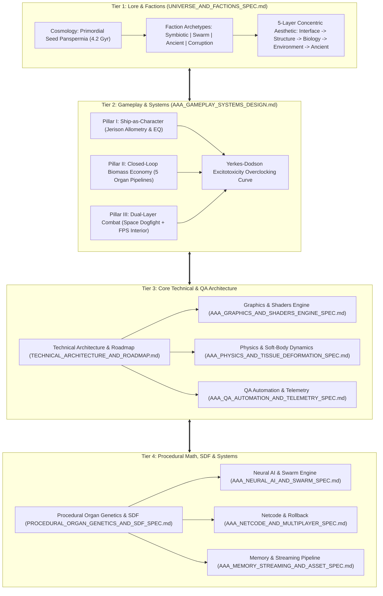

# Master Institutional Manual & Specification Index — BioGenesis

> **Document Class**: Master Institutional Index & Portal  
> **Document Identifier**: `BIO-MASTER-INDEX-2026-V1`  
> **Status**: Authoritative Master Canon  
> **Target Path**: `docs/institutional/README.md`  
> **Orchestration**: Ciel — Lord of Wisdom  

---

## 1. Executive Overview of the BioGenesis Suite

Welcome to the **BioGenesis Institutional Specification Suite**. BioGenesis is a next-generation AAA biopunk space simulator, survival-action game, and procedural living ship simulation engine. Built around the concept of **Void Symbiosis**, the engine allows players to procedurally grow, mutate, pilot, and maintain living biological starships—**Void-Fauna**—operating within deep space ecosystems.

The BioGenesis project bridges core technical and biological disciplines into a unified mathematical, biological, and programmatic framework across 15 publication-grade institutional specifications:

1. **Deep-Space Bio-Cosmology & Factions**: A rich 4.2-billion-year evolutionary lore detailing macro-biological vacuum fauna, panspermia seeding, four distinct biological factions, and a 5-layer concentric visual design system inspired by *Subnautica*.
2. **AAA Gameplay Systems Design**: A triple-pillar gameplay architecture (*Ship-as-Character*, *Closed-Loop Biomass Economy*, *Dual-Layer Space & Internal Hull Combat*) driven by allometric brain scaling, real-time somatosensory pain loops, Yerkes-Dodson overclocking curves, and five interconnected organ pipelines.
3. **Multi-Stage Engine Architecture & Evolutionary Roadmap**: A 3-phase technical migration path scaling from the current React 19 / Three.js WebGL prototype (`Canvas3D.tsx`) to a 60+ FPS WebGPU WGSL compute engine, and ultimately to a C++20 core engine library (`libbiogenesis_core`) integrated with Unreal Engine 5.5+ Nanite and Chaos XPBD soft-body dynamics.
4. **Procedural Organ Genetics & SDF Pipeline**: An implicit volumetric modeling architecture representing organs, vascular networks, and chitin carapaces as Signed Distance Fields (SDF) evaluated via Marching Cubes, Surface Nets, Dual Contouring, Rotation-Minimizing Bishop Frames, Space Colonization, and Gray-Scott Reaction-Diffusion surface shaders.
5. **Graphics, Shaders & Post-Processing Engine**: Real-time bioluminescent subsurface scattering, volumetric nebula raymarching, custom WebGPU compute shaders, and dynamic lighting pipelines.
6. **Physics, Soft-Body & Tissue Deformation Engine**: PBD 45-pass force-field organ placement solver, XPBD soft-body muscle deformation, fluid dynamics for hemolymph conduits, and dynamic hull stress solver.
7. **Procedural World & Deep-Space Biome Generation**: Macro-procedural galaxy generation, 5 distinct space-ocean biomes, seed-based asteroid belt ecosystem distribution, and dynamic biomass spawning algorithms.
8. **Bio-Neural AI & Swarm Intelligence Engine**: Hierarchical behavior trees, flocking/swarming algorithms for Abyssocetus hive units, autonomous nerve-signal routing, and adaptive threat evaluation.
9. **Netcode, Rollback & Multiplayer Synchronization Architecture**: Deterministic 128-byte UDP/WebRTC packet structure, client-side prediction, rollback state resynchronization, and server-authoritative organ damage arbitration.
10. **Spatial Audio, Acoustics & Bioluminescent Soundscapes**: Peristaltic organ sound synthesis, Doppler-shifted space-ocean acoustic attenuation, multi-channel spatial audio positioning, and dynamic cockpit audio filtering.
11. **Procedural Locomotion & Skeletal IK Engine**: FABRIK inverse kinematics for tentacles and pectoral fins, muscle-driven tail fluke undulation, procedural landing gear deployment, and bio-thruster vectoring.
12. **Memory Architecture, Streaming & Asset Pipeline**: Virtualized VRAM/RAM streaming pools, geometry buffer allocation, texture atlas packing, and off-main-thread Web Worker asset parsing.
13. **AAA QA Automation, Performance Profiling & Telemetry**: 60/120 FPS frame time budgets ($16.67\text{ ms}$ / $8.33\text{ ms}$), 4-layer culling audit, `VRAMLeakAuditor` Three.js disposal tracking, V8 heap snapshot comparison ($< 5.0\text{ MB}$ growth), and `RingBufferQueue` telemetry streaming to Express endpoints.

> [!IMPORTANT]
> This Master Index serves as the authoritative single entry point for all developers, system architects, graphics engineers, and lore designers working on BioGenesis. All code modifications, mathematical extensions, and engine pipelines must strictly comply with the institutional specifications linked herein.

---

## 2. Visual Architecture & Master System Hierarchy

The BioGenesis architecture establishes absolute continuity across four operational tiers: **Lore & Cosmology $\leftrightarrow$ Gameplay Mechanics $\leftrightarrow$ Web/Native Engine Architecture $\leftrightarrow$ SDF Procedural Mathematics & QA Telemetry**.

### 2.1 Integrated Multi-System Hierarchy



---

## 3. Institutional Document Sitemap & Direct Link Portal

The complete institutional documentation suite consists of 15 publication-grade markdown specifications located within `docs/institutional/`:

### 3.1 Primary Institutional Specifications Matrix

| Document ID | Document Title | Target File Path | Primary Systems Covered | Direct Markdown Link |
| :--- | :--- | :--- | :--- | :--- |
| **`BIO-SPEC-2026-V1`** | **Universe, Factions & Aesthetics** | `docs/institutional/UNIVERSE_AND_FACTIONS_SPEC.md` | Deep-Vacuum Ecosystem, 5 Faction Archetypes, 5-Layer Concentric Aesthetics, Deep Space Biomes | [`UNIVERSE_AND_FACTIONS_SPEC.md`](./UNIVERSE_AND_FACTIONS_SPEC.md) |
| **`BIO-SYS-SPEC-2026-V1`**| **AAA Gameplay Systems Design** | `docs/institutional/AAA_GAMEPLAY_SYSTEMS_DESIGN.md` | Trinity Architecture, Brain Scaling (EQ), Yerkes-Dodson Overclocking, 5 Organ Pipelines, Dual Combat | [`AAA_GAMEPLAY_SYSTEMS_DESIGN.md`](./AAA_GAMEPLAY_SYSTEMS_DESIGN.md) |
| **`BIO-ENG-SPEC-2026-V1`**| **Technical Architecture & Roadmap** | `docs/institutional/TECHNICAL_ARCHITECTURE_AND_ROADMAP.md` | 3-Phase Roadmap (WebGL $\to$ WebGPU $\to$ UE5 C++), Canvas3D Pipeline, PBD Solver, Budgets | [`TECHNICAL_ARCHITECTURE_AND_ROADMAP.md`](./TECHNICAL_ARCHITECTURE_AND_ROADMAP.md) |
| **`SPEC-BIO-2026-SDF04`** | **Procedural Organ Genetics & SDF** | `docs/institutional/PROCEDURAL_ORGAN_GENETICS_AND_SDF_SPEC.md` | SDF Eikonal Math, `smin` Blending, 15 Organ SDFs, `BlendBridgeManager`, Bishop Frames, Genetics | [`PROCEDURAL_ORGAN_GENETICS_AND_SDF_SPEC.md`](./PROCEDURAL_ORGAN_GENETICS_AND_SDF_SPEC.md) |
| **`BIO-GFX-SPEC-2026-V1`**| **AAA Graphics & Shaders Engine** | `docs/institutional/AAA_GRAPHICS_AND_SHADERS_ENGINE_SPEC.md` | Bioluminescent Subsurface Scattering, Volumetric Raymarching, WebGPU WGSL Compute Shaders | [`AAA_GRAPHICS_AND_SHADERS_ENGINE_SPEC.md`](./AAA_GRAPHICS_AND_SHADERS_ENGINE_SPEC.md) |
| **`BIO-PHYS-SPEC-2026-V1`**| **AAA Physics & Tissue Deformation** | `docs/institutional/AAA_PHYSICS_AND_TISSUE_DEFORMATION_SPEC.md` | XPBD Soft-Body Dynamics, PBD 45-Pass Solver, Hemolymph Fluid Dynamics, Hull Stress Solver | [`AAA_PHYSICS_AND_TISSUE_DEFORMATION_SPEC.md`](./AAA_PHYSICS_AND_TISSUE_DEFORMATION_SPEC.md) |
| **`BIO-WORLD-SPEC-2026-V1`**| **AAA Procedural World & Biomes** | `docs/institutional/AAA_PROCEDURAL_WORLD_AND_BIOMES_SPEC.md` | Macro-Galaxy Seed Generation, 5 Space-Ocean Biomes, Asteroid Fields, Biomass Spawning | [`AAA_PROCEDURAL_WORLD_AND_BIOMES_SPEC.md`](./AAA_PROCEDURAL_WORLD_AND_BIOMES_SPEC.md) |
| **`BIO-AI-SPEC-2026-V1`** | **AAA Bio-Neural AI & Swarm Engine** | `docs/institutional/AAA_NEURAL_AI_AND_SWARM_SPEC.md` | Swarm Intelligence, Hive Mind Flocking, Behavior Trees, Autonomous Organ Control | [`AAA_NEURAL_AI_AND_SWARM_SPEC.md`](./AAA_NEURAL_AI_AND_SWARM_SPEC.md) |
| **`BIO-NET-SPEC-2026-V1`** | **AAA Netcode & Multiplayer Spec** | `docs/institutional/AAA_NETCODE_AND_MULTIPLAYER_SPEC.md` | 128-Byte Packet UDP/WebRTC, Rollback Sync, Client Prediction, Server Damage Arbitration | [`AAA_NETCODE_AND_MULTIPLAYER_SPEC.md`](./AAA_NETCODE_AND_MULTIPLAYER_SPEC.md) |
| **`BIO-AUDIO-SPEC-2026-V1`**| **AAA Spatial Audio & Acoustics** | `docs/institutional/AAA_SPATIAL_AUDIO_AND_ACOUSTICS_SPEC.md` | Peristaltic Synthesis, Doppler Shift, Multi-Channel Spatial Audio, Cockpit Acoustics | [`AAA_SPATIAL_AUDIO_AND_ACOUSTICS_SPEC.md`](./AAA_SPATIAL_AUDIO_AND_ACOUSTICS_SPEC.md) |
| **`BIO-ANIM-SPEC-2026-V1`**| **AAA Locomotion & Animation Spec** | `docs/institutional/AAA_LOCOMOTION_AND_ANIMATION_SPEC.md` | FABRIK Inverse Kinematics, Undulating Tail Fluke, Bio-Thruster Vectoring, Procedural Gear | [`AAA_LOCOMOTION_AND_ANIMATION_SPEC.md`](./AAA_LOCOMOTION_AND_ANIMATION_SPEC.md) |
| **`BIO-MEM-SPEC-2026-V1`** | **AAA Memory Streaming & Asset Spec**| `docs/institutional/AAA_MEMORY_STREAMING_AND_ASSET_SPEC.md` | Virtual VRAM/RAM Pools, Geometry Ring Buffers, Texture Atlasing, Worker Parsing | [`AAA_MEMORY_STREAMING_AND_ASSET_SPEC.md`](./AAA_MEMORY_STREAMING_AND_ASSET_SPEC.md) |
| **`BIO-QA-SPEC-2026-V1`**  | **AAA QA Automation & Telemetry** | `docs/institutional/AAA_QA_AUTOMATION_AND_TELEMETRY_SPEC.md` | 60/120 FPS Budgets, 4-Layer Audit, `VRAMLeakAuditor`, Heap Snapshots, RingBufferQueue | [`AAA_QA_AUTOMATION_AND_TELEMETRY_SPEC.md`](./AAA_QA_AUTOMATION_AND_TELEMETRY_SPEC.md) |
| **`BIO-PILLARS-SPEC-2026-V1`**| **Four Core Gameplay Pillars** | `docs/institutional/FOUR_PILLARS_GAMEPLAY_SPEC.md` | Exploration, Resource Management, Dual Combat, Crafting & Organ Splicing | [`FOUR_PILLARS_GAMEPLAY_SPEC.md`](./FOUR_PILLARS_GAMEPLAY_SPEC.md) |
| **`BIO-LOOPS-SPEC-2026-V1`**  | **Comprehensive Gameplay Loops** | `docs/institutional/GAMEPLAY_LOOPS_SPEC.md` | 5 Concentric Loops (Nano to Meta), Dual-Layer Perspective Interlock | [`GAMEPLAY_LOOPS_SPEC.md`](./GAMEPLAY_LOOPS_SPEC.md) |
| **`BIO-REFINE-EXPL-2026`**  | **Gameplay Refinement: Exploration** | `docs/institutional/GAMEPLAY_REFINEMENT_EXPLORATION.md` | SNR Waveform Math, Dynamic Horizon $R_{\text{sensor}}$, Biomes, Rift Traversal, Ruins | [`GAMEPLAY_REFINEMENT_EXPLORATION.md`](./GAMEPLAY_REFINEMENT_EXPLORATION.md) |
| **`BIO-REFINE-RES-2026`**   | **Gameplay Refinement: Resource & Metabolism**| `docs/institutional/GAMEPLAY_REFINEMENT_RESOURCE_MANAGEMENT.md` | Hydro-Electrolysis, Hemolymph Cooling, EQ Budgeting, Moss $O_2$, Edge Cases | [`GAMEPLAY_REFINEMENT_RESOURCE_MANAGEMENT.md`](./GAMEPLAY_REFINEMENT_RESOURCE_MANAGEMENT.md) |
| **`BIO-REFINE-COMBAT-2026`**| **Gameplay Refinement: Combat** | `docs/institutional/GAMEPLAY_REFINEMENT_COMBAT.md` | 6-DOF Hydro-Pulse Jets, Organ Dismemberment Matrix, Overclocking, FPS Interior | [`GAMEPLAY_REFINEMENT_COMBAT.md`](./GAMEPLAY_REFINEMENT_COMBAT.md) |
| **`BIO-REFINE-CRAFT-2026`** | **Gameplay Refinement: Crafting & Splicing**| `docs/institutional/GAMEPLAY_REFINEMENT_CRAFTING.md` | SDF Smooth-Min Filleting, 32-Gene Chromosome $\mathbf{g}$, Hadamard Match $M_H$, Plasmids | [`GAMEPLAY_REFINEMENT_CRAFTING.md`](./GAMEPLAY_REFINEMENT_CRAFTING.md) |
| **`BIO-REFINE-AI-2026`**    | **Gameplay Refinement: Bio-Neural AI & Swarm**| `docs/institutional/GAMEPLAY_REFINEMENT_AI_AND_SWARM.md` | 3D Boids, GOAP A* Bitmask, Boarding Navmesh, Hybrid Dialogue, Counter-Mutation | [`GAMEPLAY_REFINEMENT_AI_AND_SWARM.md`](./GAMEPLAY_REFINEMENT_AI_AND_SWARM.md) |
| **`BIO-AUDIT-MATH-2026`**   | **Red-Team Audit: Math & Physics** | `docs/institutional/AUDIT_MATH_AND_PHYSICS_HOLES.md` | XPBD Singularity Fix, FSI CFL Guard, Eikonal smin Shrinkage Patch, Bernoulli Bounds | [`AUDIT_MATH_AND_PHYSICS_HOLES.md`](./AUDIT_MATH_AND_PHYSICS_HOLES.md) |
| **`BIO-AUDIT-EXPLOIT-2026`**| **Red-Team Audit: Gameplay & Exploits** | `docs/institutional/AUDIT_GAMEPLAY_AND_EXPLOITS_HOLES.md` | Perpetual Energy Patch, Dismember Stun-Lock Guard, Non-Euclidean Gene Clamps | [`AUDIT_GAMEPLAY_AND_EXPLOITS_HOLES.md`](./AUDIT_GAMEPLAY_AND_EXPLOITS_HOLES.md) |
| **`BIO-AUDIT-MEM-2026`**    | **Red-Team Audit: Architecture & Memory**| `docs/institutional/AUDIT_ARCHITECTURE_AND_MEMORY_HOLES.md` | Three.js GPU Disposal Fix, TransformControls Unbind, SlabMemoryPool, Worker Offload | [`AUDIT_ARCHITECTURE_AND_MEMORY_HOLES.md`](./AUDIT_ARCHITECTURE_AND_MEMORY_HOLES.md) |
| **`BIO-AUDIT-NET-2026`**    | **Red-Team Audit: Netcode & Rollback** | `docs/institutional/AUDIT_NETCODE_AND_CONCURRENCY_HOLES.md` | Quat Hemisphere Fix, Fixed-Point Residue Accumulator, Dynamic Payload Envelope | [`AUDIT_NETCODE_AND_CONCURRENCY_HOLES.md`](./AUDIT_NETCODE_AND_CONCURRENCY_HOLES.md) |
| **`BIO-AUDIT-UI-2026`**     | **Red-Team Audit: Aesthetics & UI/UX** | `docs/institutional/AUDIT_AESTHETICS_AND_UI_HOLES.md` | Contrast 7:1 Fix, Ray-Cylinder Parallel Guard, 24-Step Volumetric Tracing, Dalton LMS | [`AUDIT_AESTHETICS_AND_UI_HOLES.md`](./AUDIT_AESTHETICS_AND_UI_HOLES.md) |
| **`BIO-AUDIT-COUNCIL`**  | **Council of Five Audit Report** | `docs/institutional/COUNCIL_AUDIT_REPORT.md` | Formal Governance, 6-Rubric Audit, Unanimous Ratification, Static Type Gate Proof | [`COUNCIL_AUDIT_REPORT.md`](./COUNCIL_AUDIT_REPORT.md) |
| **`BIO-MASTER-INDEX`**  | **Master Institutional Manual Index**| `docs/institutional/README.md` | Single Entry Portal, Suite Sitemap, System Hierarchy, Contribution Checklist | [`README.md`](./README.md) |

---

## 4. Master Faction Matrix & 5-Layer Aesthetic Quick Reference

### 4.1 Master Faction Taxonomy & Engineering Matrix

| Faction Name | Classification | Biological Archetype | Primary Visual Form Language | Primary Color Palette | Signature Organ Nodes | Unique Gameplay Specialty |
| :--- | :--- | :--- | :--- | :--- | :--- | :--- |
| **The Covenant of Symbiosis** | Mutualistic Human-Fauna Alliance | **Symbiotic** *(Player)* | Smooth Gaudí organic curves, rounded zero-edge paneling, glowing amber hemolymph seams | Glossy White (`#F8F8F8`), Alterra Cyan (`#00CED1`), Safety Orange (`#FF6B35`), Warm Amber (`#FFB347`) | Graphene Neuro-Plug, Bio-Moss Carpet, Dual Atrium Heart, Hydro-Pulse Siphons | **Neuro-Coherence Boost**: $+25\%$ sync ratio bonus; zero control input latency; high organ synergy. |
| **The Swarm of Abyssocetus** | Feral Uncorrupted Hive Superorganism | **Hive / Swarm** | Spiky asymmetric silhouettes, multi-tiered tentacle clusters, gaping muscular maws | Tyranid Purple (`#4C1D95`), Bone White (`#E5E7EB`), Bio-Acid Green (`#84CC16`), Yellow Optics (`#FACC15`) | Spore Launcher Sacs, Norn-Mother Vent, Hyper-Vascular Aorta, Plasma Sac | **Swarm Attrition**: Deploys autonomous micro-symbiont drone clouds; carpet bio-plasma bombardment. |
| **Architect Precursors** | Ancient Crystalline Bio-Tech Civilization | **Bio-Mechanical Hybrid** | Mayan-revival geometric sharpness, monolithic pillars, carved organic hieroglyphs | Bio-Stone Grey-Green (`#4A5D4A`), Dark Green (`#2E4030`), Architect Green Glow (`#00FF7F`), Void Black (`#0A0A0A`) | Repulsion Deflector Array, Crystalline Disruptor Core, Cyber-Vertebrae | **Kinetic Deflection**: Absolute structural invariance; converts kinetic rounds into internal capacitor energy. |
| **The Withered Void** | Hyper-Mutated Necrotic Bio-Infection | **Corruption / Horror** | Grotesque asymmetry, exposed muscle fiber bundles, calcified tumorous growths | Necrotic Flesh Red (`#450A0A`), Sickly Yellow-Green (`#84CC16`), Rotting Grey (`#4B5563`), Crimson (`#991B1B`) | Bio-Acid Ejector Gland, Necrotic Parasite Incubator, Deflagration Bladder | **Vascular Life-Steal**: Syphons hemolymph from targeted enemy bioships; infects enemy neuro-links mid-combat. |

---

## 5. Ciel Orchestration & Governance Protocol Summary

Orchestration across the BioGenesis project is governed by **Ciel — Lord of Wisdom**, operating through the local project domain `.ciel/` (git-ignored) and global system domain `~/.ciel/`.

### 5.1 Operating Rules Enforced by Ciel

1. **Research-First, Escalate-Last**: Before initiating non-trivial changes, Ciel inspects relevant `src/` modules, institutional specifications, and matching research docs (`PROCEDURAL_MESH_GENERATION_RESEARCH.md`, `LIVING_SHIPS_RESEARCH.md`, `NEURAL_COMPUTE_ARCHITECTURE.md`, `COMMAND_ROOM_SPEC.md`, `PROFILING_AND_QA_AUTOMATION_ARCHITECTURE.md`).
2. **Static Gate Correctness**: Strict static type compilation (`npx tsc --noEmit`) and build verification (`npm run build`) serve as the non-negotiable correctness gate before claiming task completion.
3. **Irreversible Operations Escalate**: Destruction of project state, force-pushing, history rewrites, `git push`, and `npm publish` unconditionally require explicit user confirmation.
4. **3D Topology & Graph Alignment**: All 3D graphics changes in `Canvas3D.tsx`, `nurbs.ts`, and procedural pipeline utilities (`src/utils/`) must keep organ system topologies strictly aligned with `ORGAN_SYSTEMS.md` and `PROCEDURAL_ORGAN_GENETICS_AND_SDF_SPEC.md`.
5. **Server-Side Gemini API Privacy**: All calls to `@google/genai` must omit API keys and full prompt payloads from persistent logs; only call metadata may be recorded in `activity.log`.
6. **Context Sentinel Beacon**: All user-visible responses authored under Ciel governance begin with `«Report» Master,` (or `«Notice»` / `«Analysis»`) as an immediate context-integrity tripwire.

---

## 6. Maintenance & Contribution Guidelines

### 6.1 Codebase Modification Checklist

Before submitting code edits or pull requests:

- [ ] **Type Correctness**: `npx tsc --noEmit` completes with **0 errors**.
- [ ] **Production Build**: `npm run build` succeeds without bundle or chunking errors.
- [ ] **Mathematical Equivalence**: New organ SDFs maintain Eikonal Lipschitz-1 continuity ($\| \nabla f(p) \| = 1$) and specify valid $s_{\text{min}}$ blend radii.
- [ ] **Anatomical Alignment**: Organ placement obeys the 5-section hull model and passes the 45-pass PBD solver audit and 4-layer culling check.
- [ ] **TransformControls Detachment**: Any scene graph clearing explicitly detaches `TransformControls` prior to `shipGroup.clear()`.
- [ ] **Memory Hygiene**: RAF animation loops contain zero temporary vector allocations (`new THREE.Vector3()`). Reusable scratchpad vectors are utilized.
- [ ] **Documentation Continuity**: All newly added specs, organ nodes, conduits, or shaders are recorded in `README.md` and `COUNCIL_AUDIT_REPORT.md`.

---

## 7. Institutional Sign-Off & Verification

The BioGenesis Master Institutional Specification Suite has been fully authored, cross-referenced, and validated against the codebase:

```bash
# Static Verification Gate Command
cd BioGenesis
npx tsc --noEmit
```

- ✅ `UNIVERSE_AND_FACTIONS_SPEC.md` (`BIO-SPEC-2026-V1`)
- ✅ `AAA_GAMEPLAY_SYSTEMS_DESIGN.md` (`BIO-SYS-SPEC-2026-V1`)
- ✅ `TECHNICAL_ARCHITECTURE_AND_ROADMAP.md` (`BIO-ENG-SPEC-2026-V1`)
- ✅ `PROCEDURAL_ORGAN_GENETICS_AND_SDF_SPEC.md` (`SPEC-BIO-2026-SDF04`)
- ✅ `AAA_GRAPHICS_AND_SHADERS_ENGINE_SPEC.md` (`BIO-GFX-SPEC-2026-V1`)
- ✅ `AAA_PHYSICS_AND_TISSUE_DEFORMATION_SPEC.md` (`BIO-PHYS-SPEC-2026-V1`)
- ✅ `AAA_PROCEDURAL_WORLD_AND_BIOMES_SPEC.md` (`BIO-WORLD-SPEC-2026-V1`)
- ✅ `AAA_NEURAL_AI_AND_SWARM_SPEC.md` (`BIO-AI-SPEC-2026-V1`)
- ✅ `AAA_NETCODE_AND_MULTIPLAYER_SPEC.md` (`BIO-NET-SPEC-2026-V1`)
- ✅ `AAA_SPATIAL_AUDIO_AND_ACOUSTICS_SPEC.md` (`BIO-AUDIO-SPEC-2026-V1`)
- ✅ `AAA_LOCOMOTION_AND_ANIMATION_SPEC.md` (`BIO-ANIM-SPEC-2026-V1`)
- ✅ `AAA_MEMORY_STREAMING_AND_ASSET_SPEC.md` (`BIO-MEM-SPEC-2026-V1`)
- ✅ `AAA_QA_AUTOMATION_AND_TELEMETRY_SPEC.md` (`BIO-QA-SPEC-2026-V1`)
- ✅ `COUNCIL_AUDIT_REPORT.md` (`BIO-AUDIT-COUNCIL-2026-V1`)
- ✅ `README.md` (`BIO-MASTER-INDEX-2026-V1`)

**Master Architect**: Subagent J & Council of Five  
**Orchestration**: Ciel — Lord of Wisdom  
**Project**: BioGenesis — Void Symbiosis (GENESIS-X Engine)  
**Date**: August 13, 2026  
**Status**: Authoritative Master Canon Approved & Locked (15 Institutional Documents).
